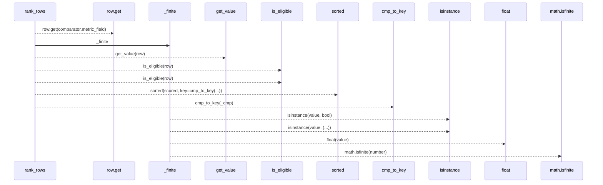
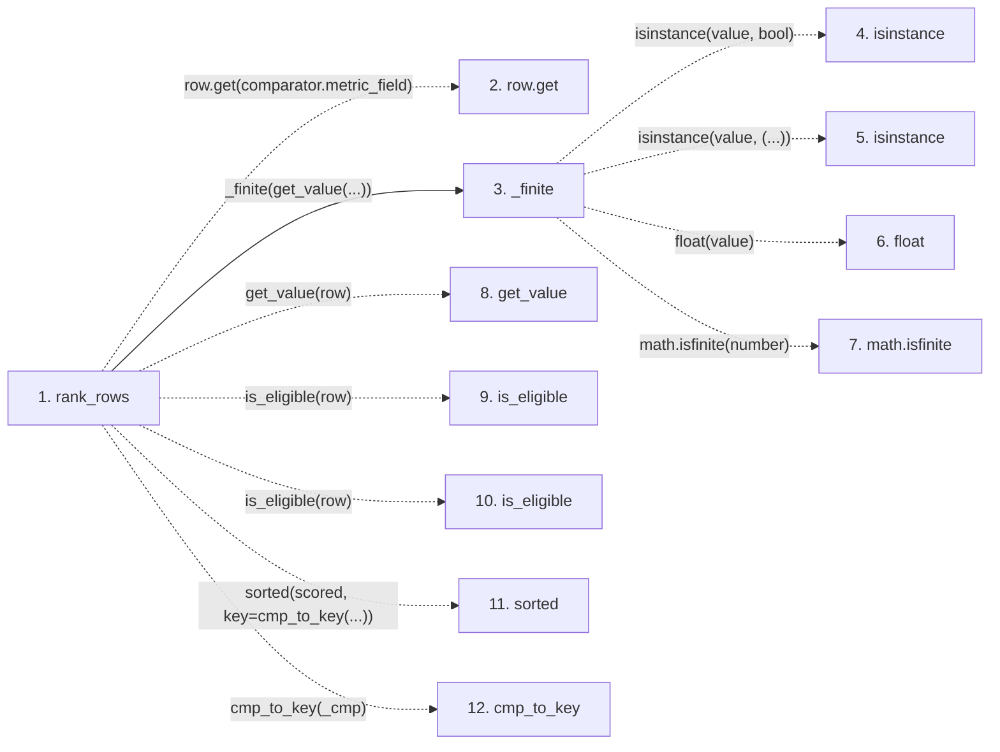

# rank_rows

**Entry point:** `rank_rows` (`api`)
**Source:** [objective_comparator](../modules/objective_comparator.md)
**Modules touched:** [objective_comparator](../modules/objective_comparator.md)

## Call sequence

> Static overview in presentation order, not runtime execution order. Arrows retain captured callers; representative internal continuations and boundary examples precede repeated helper detail.

<!-- Auto-generated from static call edges. Dashed arrows are external or unresolved calls. Reviewed runtime conditions and side effects belong in Behavior. -->

> Call sequence diagram shows 11 of 11 interactions; 0 omitted to keep the visualization within the 30-interaction and generated-diagram limits, with uncertain identities omitted rather than inferred.

> Captured boundary calls: external 6 of 6 (0 omitted); unresolved 4 of 4 (0 omitted). These counts cover the captured static trace.
> Detailed flow queries retain their own coverage and limits; omitted paths may execute at runtime.

## Data flow

<!-- Auto-generated static analysis. Treat values and boundaries as best-effort hints, not runtime proof. -->

### Step data

| Step | Inputs | Reads | Writes | Returns |
|---|---|---|---|---|
| `rank_rows` | `rows: Iterable[Mapping[str, Any]]`, `comparator: ObjectiveComparator`, `value: Optional[Callable[[Mapping[str, Any]], Any]]`, `eligible: Optional[Callable[[Mapping[str, Any]], bool]]` | - | - | `...` |
| `row.get` | - | - | - | - |
| `_finite` | `value: Any` | - | - | `None`, `...` |
| `isinstance` | - | - | - | - |
| `isinstance` | - | - | - | - |
| `float` | - | - | - | - |
| `math.isfinite` | - | - | - | - |
| `get_value` | - | - | - | - |
| `is_eligible` | - | - | - | - |
| `is_eligible` | - | - | - | - |
| `sorted` | - | - | - | - |
| `cmp_to_key` | - | - | - | - |

### Call data

| From | To | Line | Call |
|---|---|---:|---|
| rank_rows | row.get | 192 | `row.get(comparator.metric_field)` |
| rank_rows | _finite | 193 | `_finite(get_value(...))` |
| _finite | isinstance | 58 | `isinstance(value, bool)` |
| _finite | isinstance | 58 | `isinstance(value, (...))` |
| _finite | float | 60 | `float(value)` |
| _finite | math.isfinite | 61 | `math.isfinite(number)` |
| rank_rows | get_value | 193 | `get_value(row)` |
| rank_rows | is_eligible | 194 | `is_eligible(row)` |
| rank_rows | is_eligible | 195 | `is_eligible(row)` |
| rank_rows | sorted | 207 | `sorted(scored, key=cmp_to_key(...))` |
| rank_rows | cmp_to_key | 207 | `cmp_to_key(_cmp)` |

### Boundary effects

*No boundary effects detected.*

### Static analysis gaps

| Kind | Step | Target | Line |
|---|---|---|---:|
| unresolved_call | `rank_rows` | `row.get` | 192 |
| external_call | `_finite` | `isinstance` | 58 |
| external_call | `_finite` | `math.isfinite` | 61 |
| unresolved_call | `rank_rows` | `get_value` | 193 |
| unresolved_call | `rank_rows` | `is_eligible` | 194 |
| unresolved_call | `rank_rows` | `is_eligible` | 195 |
| external_call | `rank_rows` | `sorted` | 207 |
| external_call | `rank_rows` | `cmp_to_key` | 207 |

## Behavior

This flow starts at `rank_rows` and is classified as `api`. The generated call and data-flow sections are bounded static projections; runtime conditions and side effects require source-level confirmation.
