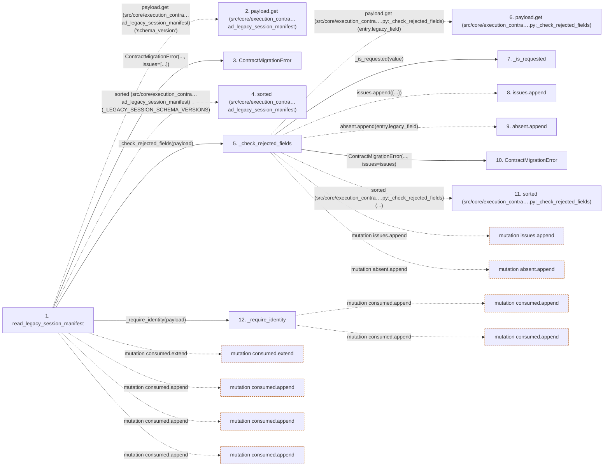

# read_legacy_session_manifest

**Entry point:** `read_legacy_session_manifest` (`api`)
**Source:** [execution_contracts](../modules/execution_contracts.md)
**Modules touched:** [compat_legacy_alias](../modules/compat_legacy_alias.md), [execution_contracts](../modules/execution_contracts.md)

## Call sequence

> Static overview in presentation order, not runtime execution order. Arrows retain captured callers; representative internal continuations and boundary examples precede repeated helper detail.

```mermaid
sequenceDiagram
    participant p0 as read_legacy_session_manifest
    participant p1 as _check_rejected_fields
    participant p2 as _require_identity
    participant p3 as reject_raw_secret_parameters
    participant p4 as ContractMigrationError
    participant p5 as BudgetDimensions
    participant p6 as LegacyRunInputs
    participant p7 as _is_requested
    participant p8 as is_secret_reference
    participant p9 as ContractError
    participant p10 as model_type_to_skill_id
    participant p11 as sorted (src/core/execution_contra…ad_legacy_session_manifest)
    participant p12 as payload.get (src/core/execution_contra…ad_legacy_session_manifest)
    participant p13 as isinstance (src/core/execution_contra…ad_legacy_session_manifest)
    participant p14 as int
    participant p15 as float
    participant p16 as consumed.extend
    participant p17 as dict
    participant p18 as consumed.append (src/core/execution_contra…ad_legacy_session_manifest)
    participant p19 as str (src/core/execution_contra…ad_legacy_session_manifest)
    participant p20 as payload.get (src/core/execution_contra….py:_check_rejected_fields)
    participant p21 as payload.get (src/core/execution_contracts.py:_require_identity)
    p0->>p1: _check_rejected_fields
    p0->>p2: _require_identity
    p0->>p3: reject_raw_secret_parameters
    p0->>p4: ContractMigrationError
    p0->>p5: BudgetDimensions
    p0->>p6: LegacyRunInputs
    p1->>p7: _is_requested
    p3->>p8: is_secret_reference
    p3->>p9: ContractError
    p2->>p10: model_type_to_skill_id
    p0-->>p11: sorted (src/core/execution_contra…ad_legacy_session_manifest)(_LEGACY_SESSION_SCHEMA_VERSIONS)
    p0-->>p12: payload.get (src/core/execution_contra…ad_legacy_session_manifest)('schema_version')
    p0-->>p12: payload.get (src/core/execution_contra…ad_legacy_session_manifest)('budget')
    p0-->>p13: isinstance (src/core/execution_contra…ad_legacy_session_manifest)(budget_block, Mapping)
    p0-->>p14: int(payload[...])
    p0-->>p15: float(budget_block[...])
    p0-->>p14: int(payload[...])
    p0-->>p16: consumed.extend([...])
    p0-->>p17: dict(...)
    p0-->>p12: payload.get (src/core/execution_contra…ad_legacy_session_manifest)('skill_params')
    p0-->>p18: consumed.append (src/core/execution_contra…ad_legacy_session_manifest)('skill_params')
    p0-->>p12: payload.get (src/core/execution_contra…ad_legacy_session_manifest)('objective')
    p0-->>p18: consumed.append (src/core/execution_contra…ad_legacy_session_manifest)('objective')
    p0-->>p12: payload.get (src/core/execution_contra…ad_legacy_session_manifest)('focus_hint')
    p0-->>p18: consumed.append (src/core/execution_contra…ad_legacy_session_manifest)('focus_hint')
    p0-->>p19: str (src/core/execution_contra…ad_legacy_session_manifest)(schema_version)
    p0-->>p19: str (src/core/execution_contra…ad_legacy_session_manifest)(objective_text)
    p0-->>p19: str (src/core/execution_contra…ad_legacy_session_manifest)(focus_hint)
    p1-->>p20: payload.get (src/core/execution_contra….py:_check_rejected_fields)(entry.legacy_field)
    p2-->>p21: payload.get (src/core/execution_contracts.py:_require_identity)('skill_id')
```

<!-- Auto-generated from static call edges. Dashed arrows are external or unresolved calls. Reviewed runtime conditions and side effects belong in Behavior. -->

> Call sequence diagram shows 30 of 60 interactions; 30 omitted to keep the visualization within the 30-interaction and generated-diagram limits, with uncertain identities omitted rather than inferred.

> Captured boundary calls: external 9 of 17 (8 omitted); unresolved 11 of 27 (16 omitted). These counts cover the captured static trace.

Omitted captured detail, grouped by actual caller occurrence and target module:

| Caller | Parent step | Target module | Kind | Omitted interactions |
| --- | --- | --- | --- | --- |
| `src/core/execution_contracts.py:_check_rejected_fields` | 5 | - | unresolved | 2 |
| `src/core/execution_contracts.py:_check_rejected_fields` | 5 | [src/core/execution_contracts.py](../modules/execution_contracts.md) | internal | 1 |
| `src/core/execution_contracts.py:_check_rejected_fields` | 5 | - | external | 1 |
| `src/core/execution_contracts.py:_require_identity` | 12 | - | external | 6 |
| `src/core/execution_contracts.py:_require_identity` | 12 | - | unresolved | 10 |
| `src/compat/legacy_alias.py:model_type_to_skill_id` | 17 | - | unresolved | 1 |
| `src/core/execution_contracts.py:_require_identity` | 12 | [src/core/execution_contracts.py](../modules/execution_contracts.md) | internal | 3 |
| `src/core/execution_contracts.py:read_legacy_session_manifest` | 1 | [src/core/execution_contracts.py](../modules/execution_contracts.md) | internal | 2 |
> Omission summary shows 8 of 11 groups; 3 further groups are not expanded here. Counts above include all omitted interactions.
> Detailed flow queries retain their own coverage and limits; omitted paths may execute at runtime.

## Data flow

<!-- Auto-generated static analysis. Treat values and boundaries as best-effort hints, not runtime proof. -->

### Step data

| Step | Inputs | Reads | Writes | Returns |
|---|---|---|---|---|
| `read_legacy_session_manifest` | `payload: Mapping[str, Any]` | `_LEGACY_SESSION_SCHEMA_VERSIONS`, `_LEGACY_SESSION_SCHEMA_VERSIONS`, `Mapping` | - | `LegacyRunInputs(...)` |
| `payload.get (src/core/execution_contra…ad_legacy_session_manifest)` | - | - | - | - |
| `ContractMigrationError` | - | - | - | - |
| `sorted (src/core/execution_contra…ad_legacy_session_manifest)` | - | - | - | - |
| `_check_rejected_fields` | `payload: Mapping[str, Any]` | `_REJECTED_FIELDS` | - | `absent` |
| `payload.get (src/core/execution_contra….py:_check_rejected_fields)` | - | - | - | - |
| `_is_requested` | `value: Any` | - | - | `...` |
| `issues.append` | - | - | - | - |
| `absent.append` | - | - | - | - |
| `ContractMigrationError` | - | - | - | - |
| `sorted (src/core/execution_contra….py:_check_rejected_fields)` | - | - | - | - |
| `_require_identity` | `payload: Mapping[str, Any]` | - | - | `(...)` |

### Call data

| From | To | Line | Call |
|---|---|---:|---|
| read_legacy_session_manifest | payload.get (src/core/execution_contra…ad_legacy_session_manifest) | 1394 | `payload.get('schema_version')` |
| read_legacy_session_manifest | ContractMigrationError | 1396 | `ContractMigrationError(..., issues=[...])` |
| read_legacy_session_manifest | sorted (src/core/execution_contra…ad_legacy_session_manifest) | 1398 | `sorted(_LEGACY_SESSION_SCHEMA_VERSIONS)` |
| read_legacy_session_manifest | _check_rejected_fields | 1401 | `_check_rejected_fields(payload)` |
| _check_rejected_fields | payload.get (src/core/execution_contra….py:_check_rejected_fields) | 1326 | `payload.get(entry.legacy_field)` |
| _check_rejected_fields | _is_requested | 1327 | `_is_requested(value)` |
| _check_rejected_fields | issues.append | 1328 | `issues.append({...})` |
| _check_rejected_fields | absent.append | 1339 | `absent.append(entry.legacy_field)` |
| _check_rejected_fields | ContractMigrationError | 1341 | `ContractMigrationError(..., issues=issues)` |
| _check_rejected_fields | sorted (src/core/execution_contra….py:_check_rejected_fields) | 1343 | `sorted(...)` |
| read_legacy_session_manifest | _require_identity | 1402 | `_require_identity(payload)` |

### Boundary effects

| Kind | Target | Step | Line |
|---|---|---|---:|
| mutation | `consumed.extend` | `read_legacy_session_manifest` | 1421 |
| mutation | `consumed.append` | `read_legacy_session_manifest` | 1426 |
| mutation | `consumed.append` | `read_legacy_session_manifest` | 1430 |
| mutation | `consumed.append` | `read_legacy_session_manifest` | 1433 |
| mutation | `issues.append` | `_check_rejected_fields` | 1328 |
| mutation | `absent.append` | `_check_rejected_fields` | 1339 |
| mutation | `consumed.append` | `_require_identity` | 1354 |
| mutation | `consumed.append` | `_require_identity` | 1357 |

### Static analysis gaps

| Kind | Step | Target | Line |
|---|---|---|---:|
| unresolved_call | `read_legacy_session_manifest` | `payload.get` | 1394 |
| external_call | `read_legacy_session_manifest` | `sorted` | 1398 |
| unresolved_call | `_check_rejected_fields` | `payload.get` | 1326 |
| external_call | `_check_rejected_fields` | `sorted` | 1343 |
| step_limit | `read_legacy_session_manifest` | `first 12 steps` | 0 |

## Behavior

This flow starts at `read_legacy_session_manifest` and is classified as `api`. The generated call and data-flow sections are bounded static projections; runtime conditions and side effects require source-level confirmation.
