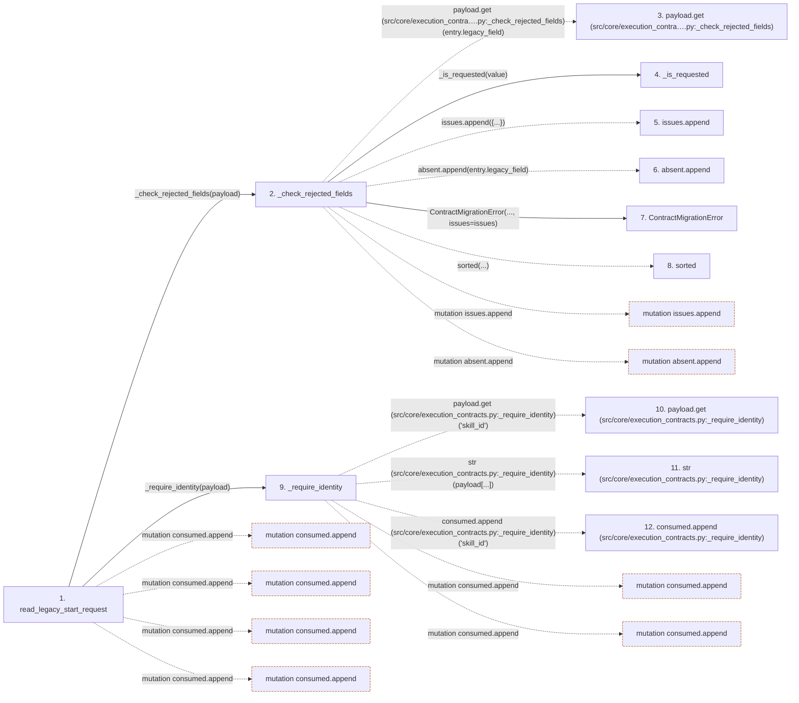

# read_legacy_start_request

**Entry point:** `read_legacy_start_request` (`api`)
**Source:** [execution_contracts](../modules/execution_contracts.md)
**Modules touched:** [compat_legacy_alias](../modules/compat_legacy_alias.md), [execution_contracts](../modules/execution_contracts.md)

## Call sequence

> Static overview in presentation order, not runtime execution order. Arrows retain captured callers; representative internal continuations and boundary examples precede repeated helper detail.

```mermaid
sequenceDiagram
    participant p0 as read_legacy_start_request
    participant p1 as _check_rejected_fields
    participant p2 as _require_identity
    participant p3 as reject_raw_secret_parameters
    participant p4 as BudgetDimensions
    participant p5 as LegacyRunInputs
    participant p6 as _is_requested
    participant p7 as is_secret_reference
    participant p8 as ContractError
    participant p9 as ContractMigrationError
    participant p10 as model_type_to_skill_id
    participant p11 as int
    participant p12 as payload.get (src/core/execution_contra…:read_legacy_start_request)
    participant p13 as float
    participant p14 as consumed.append (src/core/execution_contra…:read_legacy_start_request)
    participant p15 as dict
    participant p16 as str (src/core/execution_contra…:read_legacy_start_request)
    participant p17 as payload.get (src/core/execution_contra….py:_check_rejected_fields)
    participant p18 as payload.get (src/core/execution_contracts.py:_require_identity)
    participant p19 as parameters.items
    p0->>p1: _check_rejected_fields
    p0->>p2: _require_identity
    p0->>p3: reject_raw_secret_parameters
    p0->>p4: BudgetDimensions
    p0->>p5: LegacyRunInputs
    p1->>p6: _is_requested
    p3->>p7: is_secret_reference
    p3->>p8: ContractError
    p1->>p9: ContractMigrationError
    p2->>p10: model_type_to_skill_id
    p0-->>p11: int(...)
    p0-->>p12: payload.get (src/core/execution_contra…:read_legacy_start_request)('timeout_minutes')
    p0-->>p12: payload.get (src/core/execution_contra…:read_legacy_start_request)('max_iterations')
    p0-->>p13: float(...)
    p0-->>p12: payload.get (src/core/execution_contra…:read_legacy_start_request)('max_budget_usd')
    p0-->>p11: int(...)
    p0-->>p12: payload.get (src/core/execution_contra…:read_legacy_start_request)(field)
    p0-->>p14: consumed.append (src/core/execution_contra…:read_legacy_start_request)(field)
    p0-->>p15: dict(...)
    p0-->>p12: payload.get (src/core/execution_contra…:read_legacy_start_request)('skill_params')
    p0-->>p14: consumed.append (src/core/execution_contra…:read_legacy_start_request)('skill_params')
    p0-->>p12: payload.get (src/core/execution_contra…:read_legacy_start_request)('objective')
    p0-->>p14: consumed.append (src/core/execution_contra…:read_legacy_start_request)('objective')
    p0-->>p12: payload.get (src/core/execution_contra…:read_legacy_start_request)('focus_hint')
    p0-->>p14: consumed.append (src/core/execution_contra…:read_legacy_start_request)('focus_hint')
    p0-->>p16: str (src/core/execution_contra…:read_legacy_start_request)(objective_text)
    p0-->>p16: str (src/core/execution_contra…:read_legacy_start_request)(focus_hint)
    p1-->>p17: payload.get (src/core/execution_contra….py:_check_rejected_fields)(entry.legacy_field)
    p2-->>p18: payload.get (src/core/execution_contracts.py:_require_identity)('skill_id')
    p3-->>p19: parameters.items
```

<!-- Auto-generated from static call edges. Dashed arrows are external or unresolved calls. Reviewed runtime conditions and side effects belong in Behavior. -->

> Call sequence diagram shows 30 of 56 interactions; 26 omitted to keep the visualization within the 30-interaction and generated-diagram limits, with uncertain identities omitted rather than inferred.

> Captured boundary calls: external 6 of 14 (8 omitted); unresolved 14 of 29 (15 omitted). These counts cover the captured static trace.

Omitted captured detail, grouped by actual caller occurrence and target module:

| Caller | Parent step | Target module | Kind | Omitted interactions |
| --- | --- | --- | --- | --- |
| `src/core/execution_contracts.py:_check_rejected_fields` | 2 | - | unresolved | 2 |
| `src/core/execution_contracts.py:_check_rejected_fields` | 2 | - | external | 1 |
| `src/core/execution_contracts.py:_require_identity` | 9 | - | external | 6 |
| `src/core/execution_contracts.py:_require_identity` | 9 | - | unresolved | 10 |
| `src/compat/legacy_alias.py:model_type_to_skill_id` | 14 | - | unresolved | 1 |
| `src/core/execution_contracts.py:_require_identity` | 9 | [src/core/execution_contracts.py](../modules/execution_contracts.md) | internal | 3 |
| `src/core/execution_contracts.py:reject_raw_secret_parameters` | 43 | - | unresolved | 1 |
| `src/core/execution_contracts.py:is_secret_reference` | 46 | - | external | 1 |
> Omission summary shows 8 of 9 groups; 1 further groups are not expanded here. Counts above include all omitted interactions.
> Detailed flow queries retain their own coverage and limits; omitted paths may execute at runtime.

## Data flow

<!-- Auto-generated static analysis. Treat values and boundaries as best-effort hints, not runtime proof. -->

### Step data

| Step | Inputs | Reads | Writes | Returns |
|---|---|---|---|---|
| `read_legacy_start_request` | `payload: Mapping[str, Any]` | `SYSTEM_DEFAULTS`, `SYSTEM_DEFAULTS`, `SYSTEM_DEFAULTS` | - | `LegacyRunInputs(...)` |
| `_check_rejected_fields` | `payload: Mapping[str, Any]` | `_REJECTED_FIELDS` | - | `absent` |
| `payload.get (src/core/execution_contra….py:_check_rejected_fields)` | - | - | - | - |
| `_is_requested` | `value: Any` | - | - | `...` |
| `issues.append` | - | - | - | - |
| `absent.append` | - | - | - | - |
| `ContractMigrationError` | - | - | - | - |
| `sorted` | - | - | - | - |
| `_require_identity` | `payload: Mapping[str, Any]` | - | - | `(...)` |
| `payload.get (src/core/execution_contracts.py:_require_identity)` | - | - | - | - |
| `str (src/core/execution_contracts.py:_require_identity)` | - | - | - | - |
| `consumed.append (src/core/execution_contracts.py:_require_identity)` | - | - | - | - |

### Call data

| From | To | Line | Call |
|---|---|---:|---|
| read_legacy_start_request | _check_rejected_fields | 1459 | `_check_rejected_fields(payload)` |
| _check_rejected_fields | payload.get (src/core/execution_contra….py:_check_rejected_fields) | 1328 | `payload.get(entry.legacy_field)` |
| _check_rejected_fields | _is_requested | 1329 | `_is_requested(value)` |
| _check_rejected_fields | issues.append | 1330 | `issues.append({...})` |
| _check_rejected_fields | absent.append | 1341 | `absent.append(entry.legacy_field)` |
| _check_rejected_fields | ContractMigrationError | 1343 | `ContractMigrationError(..., issues=issues)` |
| _check_rejected_fields | sorted | 1345 | `sorted(...)` |
| read_legacy_start_request | _require_identity | 1460 | `_require_identity(payload)` |
| _require_identity | payload.get (src/core/execution_contracts.py:_require_identity) | 1354 | `payload.get('skill_id')` |
| _require_identity | str (src/core/execution_contracts.py:_require_identity) | 1355 | `str(payload[...])` |
| _require_identity | consumed.append (src/core/execution_contracts.py:_require_identity) | 1356 | `consumed.append('skill_id')` |

### Boundary effects

| Kind | Target | Step | Line |
|---|---|---|---:|
| mutation | `consumed.append` | `read_legacy_start_request` | 1472 |
| mutation | `consumed.append` | `read_legacy_start_request` | 1477 |
| mutation | `consumed.append` | `read_legacy_start_request` | 1481 |
| mutation | `consumed.append` | `read_legacy_start_request` | 1484 |
| mutation | `issues.append` | `_check_rejected_fields` | 1330 |
| mutation | `absent.append` | `_check_rejected_fields` | 1341 |
| mutation | `consumed.append` | `_require_identity` | 1356 |
| mutation | `consumed.append` | `_require_identity` | 1359 |

### Static analysis gaps

| Kind | Step | Target | Line |
|---|---|---|---:|
| unresolved_call | `_check_rejected_fields` | `payload.get` | 1328 |
| external_call | `_check_rejected_fields` | `sorted` | 1345 |
| unresolved_call | `_require_identity` | `payload.get` | 1354 |
| step_limit | `read_legacy_start_request` | `first 12 steps` | 0 |

## Behavior

This flow starts at `read_legacy_start_request` and is classified as `api`. The generated call and data-flow sections are bounded static projections; runtime conditions and side effects require source-level confirmation.
