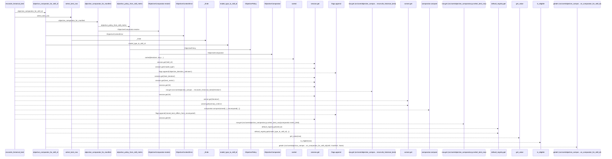
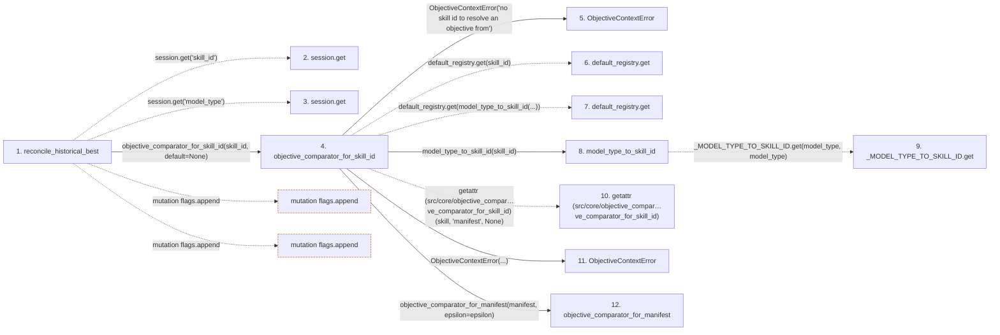

# reconcile_historical_best

**Entry point:** `reconcile_historical_best` (`api`)
**Source:** [objective_comparator](../modules/objective_comparator.md)
**Modules touched:** [compat_legacy_alias](../modules/compat_legacy_alias.md), [execution_contracts](../modules/execution_contracts.md), [objective_comparator](../modules/objective_comparator.md)

## Call sequence

> Static overview in presentation order, not runtime execution order. Arrows retain captured callers; representative internal continuations and boundary examples precede repeated helper detail.

<!-- Auto-generated from static call edges. Dashed arrows are external or unresolved calls. Reviewed runtime conditions and side effects belong in Behavior. -->

> Call sequence diagram shows 30 of 50 interactions; 20 omitted to keep the visualization within the 30-interaction and generated-diagram limits, with uncertain identities omitted rather than inferred.

> Captured boundary calls: external 2 of 14 (12 omitted); unresolved 18 of 22 (4 omitted). These counts cover the captured static trace.

Omitted captured detail, grouped by actual caller occurrence and target module:

| Caller | Parent step | Target module | Kind | Omitted interactions |
| --- | --- | --- | --- | --- |
| `src/compat/legacy_alias.py:model_type_to_skill_id` | 8 | - | unresolved | 1 |
| `src/core/objective_comparator.py:objective_comparator_for_skill_id` | 4 | [src/core/objective_comparator.py](../modules/objective_comparator.md) | internal | 1 |
| `src/core/objective_comparator.py:objective_comparator_for_manifest` | 12 | - | external | 4 |
| `src/core/objective_comparator.py:objective_comparator_for_manifest` | 12 | [src/core/objective_comparator.py](../modules/objective_comparator.md) | internal | 1 |
| `src/core/objective_comparator.py:ObjectiveComparator.resolve` | 20 | - | external | 4 |
| `src/core/objective_comparator.py:ObjectiveComparator.resolve` | 20 | [src/core/objective_comparator.py](../modules/objective_comparator.md) | internal | 2 |
| `src/core/objective_comparator.py:_finite` | 23 | - | external | 4 |
| `src/core/objective_comparator.py:select_best_row` | 38 | - | unresolved | 3 |
> Detailed flow queries retain their own coverage and limits; omitted paths may execute at runtime.

## Data flow

<!-- Auto-generated static analysis. Treat values and boundaries as best-effort hints, not runtime proof. -->

### Step data

| Step | Inputs | Reads | Writes | Returns |
|---|---|---|---|---|
| `reconcile_historical_best` | `session: Mapping[str, Any]`, `iterations: Sequence[Mapping[str, Any]]`, `comparator: Optional[ObjectiveComparator]` | `ObjectiveContextError` | - | `{...}`, `{...}`, `{...}` |
| `session.get` | - | - | - | - |
| `session.get` | - | - | - | - |
| `objective_comparator_for_skill_id` | `skill_id: Optional[str]`, `epsilon: Optional[float]`, `default: Optional[ObjectiveComparator]` | - | - | `default`, `default`, `objective_comparator_for_manifest(...)` |
| `ObjectiveContextError` | - | - | - | - |
| `default_registry.get` | - | - | - | - |
| `default_registry.get` | - | - | - | - |
| `model_type_to_skill_id` | `model_type: str` | - | - | `''`, `_MODEL_TYPE_TO_SKILL_ID.get(...)` |
| `_MODEL_TYPE_TO_SKILL_ID.get` | - | - | - | - |
| `getattr (src/core/objective_compar…ve_comparator_for_skill_id)` | - | - | - | - |
| `ObjectiveContextError` | - | - | - | - |
| `objective_comparator_for_manifest` | `manifest: Any`, `epsilon: Optional[float]`, `metric_field: str` | - | - | `ObjectiveComparator.resolve(...)` |

### Call data

| From | To | Line | Call |
|---|---|---:|---|
| reconcile_historical_best | session.get | 295 | `session.get('skill_id')` |
| reconcile_historical_best | session.get | 295 | `session.get('model_type')` |
| reconcile_historical_best | objective_comparator_for_skill_id | 297 | `objective_comparator_for_skill_id(skill_id, default=None)` |
| objective_comparator_for_skill_id | ObjectiveContextError | 251 | `ObjectiveContextError('no skill id to resolve an objective from')` |
| objective_comparator_for_skill_id | default_registry.get | 255 | `default_registry.get(skill_id)` |
| objective_comparator_for_skill_id | default_registry.get | 264 | `default_registry.get(model_type_to_skill_id(...))` |
| objective_comparator_for_skill_id | model_type_to_skill_id | 264 | `model_type_to_skill_id(skill_id)` |
| model_type_to_skill_id | _MODEL_TYPE_TO_SKILL_ID.get | 45 | `_MODEL_TYPE_TO_SKILL_ID.get(model_type, model_type)` |
| objective_comparator_for_skill_id | getattr (src/core/objective_compar…ve_comparator_for_skill_id) | 267 | `getattr(skill, 'manifest', None)` |
| objective_comparator_for_skill_id | ObjectiveContextError | 271 | `ObjectiveContextError(...)` |
| objective_comparator_for_skill_id | objective_comparator_for_manifest | 274 | `objective_comparator_for_manifest(manifest, epsilon=epsilon)` |

### Boundary effects

| Kind | Target | Step | Line |
|---|---|---|---:|
| mutation | `flags.append` | `reconcile_historical_best` | 301 |
| mutation | `flags.append` | `reconcile_historical_best` | 347 |

### Static analysis gaps

| Kind | Step | Target | Line |
|---|---|---|---:|
| unresolved_call | `reconcile_historical_best` | `session.get` | 295 |
| unresolved_call | `objective_comparator_for_skill_id` | `default_registry.get` | 255 |
| unresolved_call | `objective_comparator_for_skill_id` | `default_registry.get` | 264 |
| unresolved_call | `model_type_to_skill_id` | `_MODEL_TYPE_TO_SKILL_ID.get` | 45 |
| external_call | `objective_comparator_for_skill_id` | `getattr` | 267 |
| step_limit | `reconcile_historical_best` | `first 12 steps` | 0 |

## Behavior

This flow starts at `reconcile_historical_best` and is classified as `api`. The generated call and data-flow sections are bounded static projections; runtime conditions and side effects require source-level confirmation.
