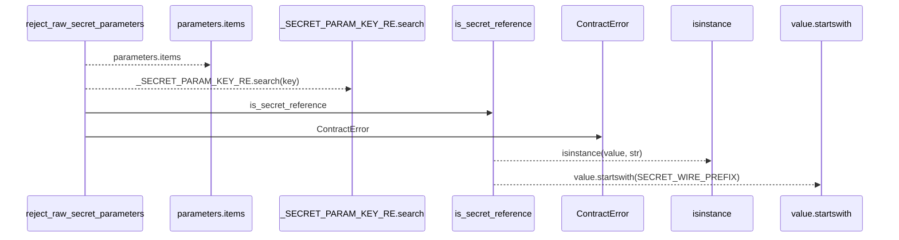
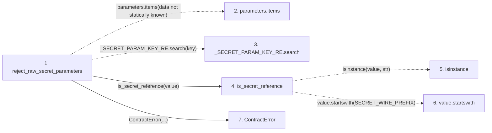

# reject_raw_secret_parameters

**Entry point:** `reject_raw_secret_parameters` (`api`)
**Source:** [execution_contracts](../modules/execution_contracts.md)
**Modules touched:** [execution_contracts](../modules/execution_contracts.md)

## Call sequence

> Static overview in presentation order, not runtime execution order. Arrows retain captured callers; representative internal continuations and boundary examples precede repeated helper detail.

<!-- Auto-generated from static call edges. Dashed arrows are external or unresolved calls. Reviewed runtime conditions and side effects belong in Behavior. -->

> Call sequence diagram shows 6 of 6 interactions; 0 omitted to keep the visualization within the 30-interaction and generated-diagram limits, with uncertain identities omitted rather than inferred.

> Captured boundary calls: external 1 of 1 (0 omitted); unresolved 3 of 3 (0 omitted). These counts cover the captured static trace.
> Detailed flow queries retain their own coverage and limits; omitted paths may execute at runtime.

## Data flow

<!-- Auto-generated static analysis. Treat values and boundaries as best-effort hints, not runtime proof. -->

### Step data

| Step | Inputs | Reads | Writes | Returns |
|---|---|---|---|---|
| `reject_raw_secret_parameters` | `parameters: Mapping[str, Any]`, `where: str` | `SECRET_WIRE_PREFIX` | - | - |
| `parameters.items` | - | - | - | - |
| `_SECRET_PARAM_KEY_RE.search` | - | - | - | - |
| `is_secret_reference` | `value: Any` | `SECRET_WIRE_PREFIX` | - | `...` |
| `isinstance` | - | - | - | - |
| `value.startswith` | - | - | - | - |
| `ContractError` | - | - | - | - |

### Call data

| From | To | Line | Call |
|---|---|---:|---|
| reject_raw_secret_parameters | parameters.items | 189 | `parameters.items(data not statically known)` |
| reject_raw_secret_parameters | _SECRET_PARAM_KEY_RE.search | 190 | `_SECRET_PARAM_KEY_RE.search(key)` |
| reject_raw_secret_parameters | is_secret_reference | 190 | `is_secret_reference(value)` |
| is_secret_reference | isinstance | 184 | `isinstance(value, str)` |
| is_secret_reference | value.startswith | 184 | `value.startswith(SECRET_WIRE_PREFIX)` |
| reject_raw_secret_parameters | ContractError | 191 | `ContractError(...)` |

### Boundary effects

*No boundary effects detected.*

### Static analysis gaps

| Kind | Step | Target | Line |
|---|---|---|---:|
| unresolved_call | `reject_raw_secret_parameters` | `parameters.items` | 189 |
| unresolved_call | `reject_raw_secret_parameters` | `_SECRET_PARAM_KEY_RE.search` | 190 |
| external_call | `is_secret_reference` | `isinstance` | 184 |
| unresolved_call | `is_secret_reference` | `value.startswith` | 184 |

## Behavior

This flow starts at `reject_raw_secret_parameters` and is classified as `api`. The generated call and data-flow sections are bounded static projections; runtime conditions and side effects require source-level confirmation.
