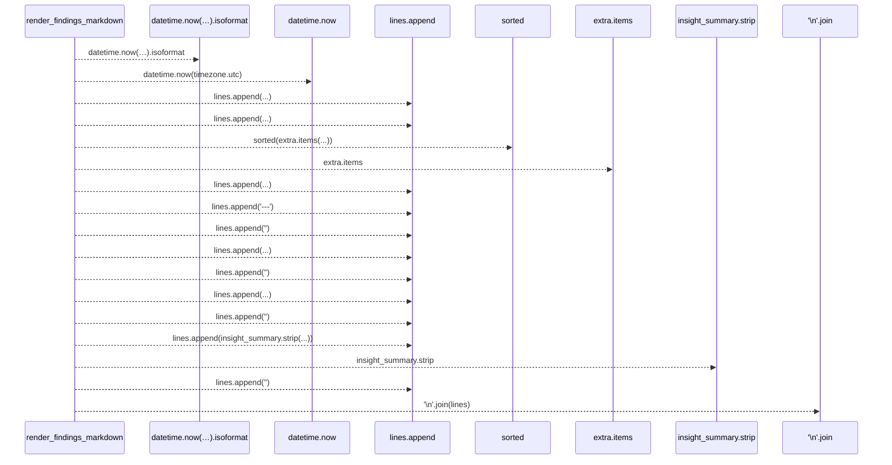
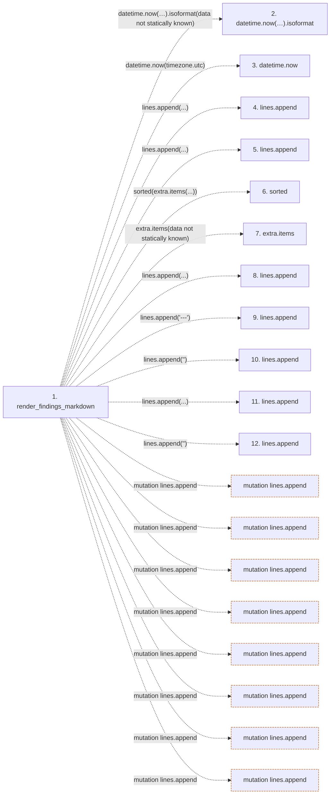

# render_findings_markdown

**Entry point:** `render_findings_markdown` (`api`)
**Source:** [insights_feedback](../modules/insights_feedback.md)
**Modules touched:** [insights_feedback](../modules/insights_feedback.md)

## Call sequence

> Static overview in presentation order, not runtime execution order. Arrows retain captured callers; representative internal continuations and boundary examples precede repeated helper detail.

<!-- Auto-generated from static call edges. Dashed arrows are external or unresolved calls. Reviewed runtime conditions and side effects belong in Behavior. -->

> Call sequence diagram shows 17 of 17 interactions; 0 omitted to keep the visualization within the 30-interaction and generated-diagram limits, with uncertain identities omitted rather than inferred.

> Captured boundary calls: external 2 of 2 (0 omitted); unresolved 15 of 15 (0 omitted). These counts cover the captured static trace.
> Detailed flow queries retain their own coverage and limits; omitted paths may execute at runtime.

## Data flow

<!-- Auto-generated static analysis. Treat values and boundaries as best-effort hints, not runtime proof. -->

### Step data

| Step | Inputs | Reads | Writes | Returns |
|---|---|---|---|---|
| `render_findings_markdown` | `skill_id: str`, `subject_id: str`, `variant: str`, `research_id: str`, `insight_summary: str`, `primary_metric: Optional[float]`, `metric_name: Optional[str]`, `iterations: int` | - | - | `...` |
| `datetime.now(…).isoformat` | - | - | - | - |
| `datetime.now` | - | - | - | - |
| `lines.append` | - | - | - | - |
| `lines.append` | - | - | - | - |
| `sorted` | - | - | - | - |
| `extra.items` | - | - | - | - |
| `lines.append` | - | - | - | - |
| `lines.append` | - | - | - | - |
| `lines.append` | - | - | - | - |
| `lines.append` | - | - | - | - |
| `lines.append` | - | - | - | - |

### Call data

| From | To | Line | Call |
|---|---|---:|---|
| render_findings_markdown | datetime.now(…).isoformat | 78 | `datetime.now(timezone.utc).isoformat(data not statically known)` |
| render_findings_markdown | datetime.now | 78 | `datetime.now(timezone.utc)` |
| render_findings_markdown | lines.append | 89 | `lines.append(...)` |
| render_findings_markdown | lines.append | 91 | `lines.append(...)` |
| render_findings_markdown | sorted | 93 | `sorted(extra.items(...))` |
| render_findings_markdown | extra.items | 93 | `extra.items(data not statically known)` |
| render_findings_markdown | lines.append | 94 | `lines.append(...)` |
| render_findings_markdown | lines.append | 95 | `lines.append('---')` |
| render_findings_markdown | lines.append | 96 | `lines.append('')` |
| render_findings_markdown | lines.append | 97 | `lines.append(...)` |
| render_findings_markdown | lines.append | 98 | `lines.append('')` |

### Boundary effects

| Kind | Target | Step | Line |
|---|---|---|---:|
| mutation | `lines.append` | `render_findings_markdown` | 89 |
| mutation | `lines.append` | `render_findings_markdown` | 91 |
| mutation | `lines.append` | `render_findings_markdown` | 94 |
| mutation | `lines.append` | `render_findings_markdown` | 95 |
| mutation | `lines.append` | `render_findings_markdown` | 96 |
| mutation | `lines.append` | `render_findings_markdown` | 97 |
| mutation | `lines.append` | `render_findings_markdown` | 98 |
| mutation | `lines.append` | `render_findings_markdown` | 99 |

### Static analysis gaps

| Kind | Step | Target | Line |
|---|---|---|---:|
| unresolved_call | `render_findings_markdown` | `datetime.now(timezone.utc).isoformat` | 78 |
| external_call | `render_findings_markdown` | `datetime.now` | 78 |
| external_call | `render_findings_markdown` | `sorted` | 93 |
| unresolved_call | `render_findings_markdown` | `extra.items` | 93 |
| step_limit | `render_findings_markdown` | `first 12 steps` | 0 |

## Behavior

This flow starts at `render_findings_markdown` and is classified as `api`. The generated call and data-flow sections are bounded static projections; runtime conditions and side effects require source-level confirmation.
