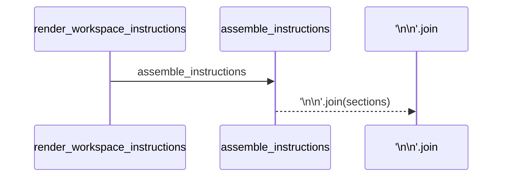
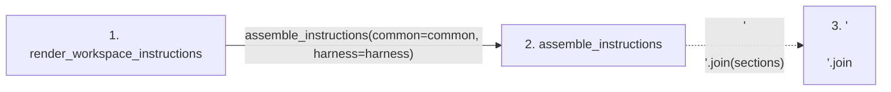

# render_workspace_instructions

**Entry point:** `render_workspace_instructions` (`api`)
**Source:** [instruction_assembly](../modules/instruction_assembly.md)
**Modules touched:** [instruction_assembly](../modules/instruction_assembly.md)

## Call sequence

> Static overview in presentation order, not runtime execution order. Arrows retain captured callers; representative internal continuations and boundary examples precede repeated helper detail.

<!-- Auto-generated from static call edges. Dashed arrows are external or unresolved calls. Reviewed runtime conditions and side effects belong in Behavior. -->

> Call sequence diagram shows 2 of 2 interactions; 0 omitted to keep the visualization within the 30-interaction and generated-diagram limits, with uncertain identities omitted rather than inferred.

> Captured boundary calls: external 0 of 0 (0 omitted); unresolved 1 of 1 (0 omitted). These counts cover the captured static trace.
> Detailed flow queries retain their own coverage and limits; omitted paths may execute at runtime.

## Data flow

<!-- Auto-generated static analysis. Treat values and boundaries as best-effort hints, not runtime proof. -->

### Step data

| Step | Inputs | Reads | Writes | Returns |
|---|---|---|---|---|
| `render_workspace_instructions` | `filename: str`, `common: str`, `harness: str` | - | - | `(...)` |
| `assemble_instructions` | `common: str`, `harness: str`, `skill_primer: str` | - | - | `...` |
| `'\n\n'.join` | - | - | - | - |

### Call data

| From | To | Line | Call |
|---|---|---:|---|
| render_workspace_instructions | assemble_instructions | 77 | `assemble_instructions(common=common, harness=harness)` |
| assemble_instructions | '\n\n'.join | 63 | `'\n\n'.join(sections)` |

### Boundary effects

*No boundary effects detected.*

### Static analysis gaps

| Kind | Step | Target | Line |
|---|---|---|---:|
| unresolved_call | `assemble_instructions` | `'\n\n'.join` | 63 |

## Behavior

This flow starts at `render_workspace_instructions` and is classified as `api`. The generated call and data-flow sections are bounded static projections; runtime conditions and side effects require source-level confirmation.
