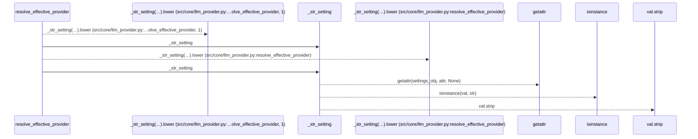
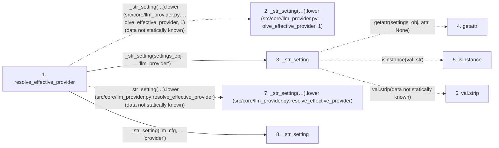

# resolve_effective_provider

**Entry point:** `resolve_effective_provider` (`api`)
**Source:** [llm_provider](../modules/llm_provider.md)
**Modules touched:** [llm_provider](../modules/llm_provider.md)

## Call sequence

> Static overview in presentation order, not runtime execution order. Arrows retain captured callers; representative internal continuations and boundary examples precede repeated helper detail.

<!-- Auto-generated from static call edges. Dashed arrows are external or unresolved calls. Reviewed runtime conditions and side effects belong in Behavior. -->

> Call sequence diagram shows 7 of 7 interactions; 0 omitted to keep the visualization within the 30-interaction and generated-diagram limits, with uncertain identities omitted rather than inferred.

> Captured boundary calls: external 2 of 2 (0 omitted); unresolved 3 of 3 (0 omitted). These counts cover the captured static trace.
> Detailed flow queries retain their own coverage and limits; omitted paths may execute at runtime.

## Data flow

<!-- Auto-generated static analysis. Treat values and boundaries as best-effort hints, not runtime proof. -->

### Step data

| Step | Inputs | Reads | Writes | Returns |
|---|---|---|---|---|
| `resolve_effective_provider` | `llm_cfg: Any`, `settings_obj: Any` | - | - | `...`, `...`, `'anthropic'` |
| `_str_setting(…).lower (src/core/llm_provider.py:…olve_effective_provider, 1)` | - | - | - | - |
| `_str_setting` | `settings_obj: Any`, `attr: str` | - | - | `...` |
| `getattr` | - | - | - | - |
| `isinstance` | - | - | - | - |
| `val.strip` | - | - | - | - |
| `_str_setting(…).lower (src/core/llm_provider.py:resolve_effective_provider)` | - | - | - | - |
| `_str_setting` | `settings_obj: Any`, `attr: str` | - | - | `...` |

### Call data

| From | To | Line | Call |
|---|---|---:|---|
| resolve_effective_provider | _str_setting(…).lower (src/core/llm_provider.py:…olve_effective_provider, 1) | 1340 | `_str_setting(settings_obj, 'llm_provider').lower(data not statically known)` |
| resolve_effective_provider | _str_setting | 1340 | `_str_setting(settings_obj, 'llm_provider')` |
| _str_setting | getattr | 1332 | `getattr(settings_obj, attr, None)` |
| _str_setting | isinstance | 1333 | `isinstance(val, str)` |
| _str_setting | val.strip | 1333 | `val.strip(data not statically known)` |
| resolve_effective_provider | _str_setting(…).lower (src/core/llm_provider.py:resolve_effective_provider) | 1343 | `_str_setting(llm_cfg, 'provider').lower(data not statically known)` |
| resolve_effective_provider | _str_setting | 1343 | `_str_setting(llm_cfg, 'provider')` |

### Boundary effects

*No boundary effects detected.*

### Static analysis gaps

| Kind | Step | Target | Line |
|---|---|---|---:|
| unresolved_call | `resolve_effective_provider` | `_str_setting(settings_obj, 'llm_provider').lower` | 1340 |
| external_call | `_str_setting` | `getattr` | 1332 |
| external_call | `_str_setting` | `isinstance` | 1333 |
| unresolved_call | `_str_setting` | `val.strip` | 1333 |
| unresolved_call | `resolve_effective_provider` | `_str_setting(llm_cfg, 'provider').lower` | 1343 |

## Behavior

This flow starts at `resolve_effective_provider` and is classified as `api`. The generated call and data-flow sections are bounded static projections; runtime conditions and side effects require source-level confirmation.
