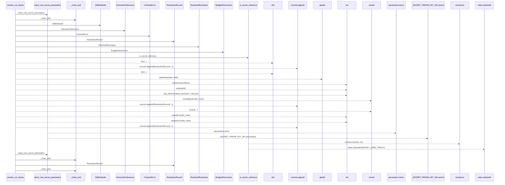
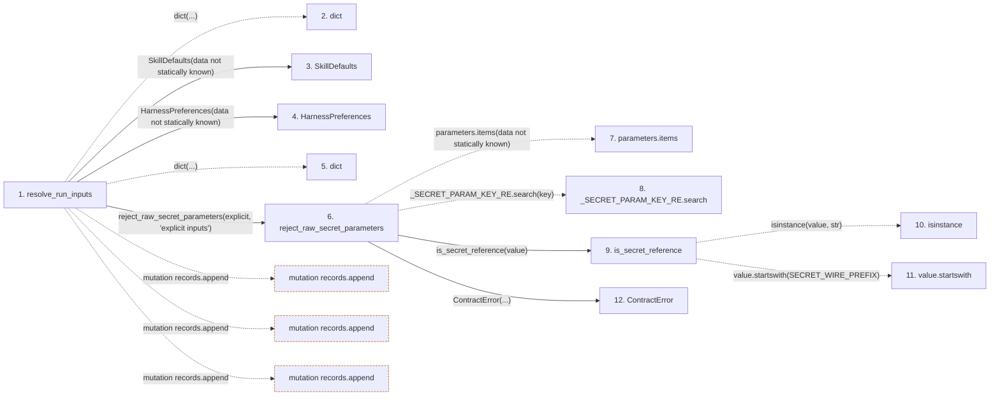

# resolve_run_inputs

**Entry point:** `resolve_run_inputs` (`api`)
**Source:** [execution_contracts](../modules/execution_contracts.md)
**Modules touched:** [execution_contracts](../modules/execution_contracts.md)

## Call sequence

> Static overview in presentation order, not runtime execution order. Arrows retain captured callers; representative internal continuations and boundary examples precede repeated helper detail.

<!-- Auto-generated from static call edges. Dashed arrows are external or unresolved calls. Reviewed runtime conditions and side effects belong in Behavior. -->

> Call sequence diagram shows 30 of 33 interactions; 3 omitted to keep the visualization within the 30-interaction and generated-diagram limits, with uncertain identities omitted rather than inferred.

> Captured boundary calls: external 11 of 11 (0 omitted); unresolved 6 of 6 (0 omitted). These counts cover the captured static trace.

Omitted captured detail, grouped by actual caller occurrence and target module:

| Caller | Parent step | Target module | Kind | Omitted interactions |
| --- | --- | --- | --- | --- |
| `src/core/execution_contracts.py:reject_raw_secret_parameters` | 6 | [src/core/execution_contracts.py](../modules/execution_contracts.md) | internal | 1 |
| `src/core/execution_contracts.py:_chain_pick` | 14 | [src/core/execution_contracts.py](../modules/execution_contracts.md) | internal | 1 |
| `src/core/execution_contracts.py:resolve_run_inputs` | 1 | [src/core/execution_contracts.py](../modules/execution_contracts.md) | internal | 1 |
> Detailed flow queries retain their own coverage and limits; omitted paths may execute at runtime.

## Data flow

<!-- Auto-generated static analysis. Treat values and boundaries as best-effort hints, not runtime proof. -->

### Step data

| Step | Inputs | Reads | Writes | Returns |
|---|---|---|---|---|
| `resolve_run_inputs` | `operator: OperatorConstraints`, `explicit: Optional[Mapping[str, Any]]`, `skill_defaults: Optional[SkillDefaults]`, `harness_preferences: Optional[HarnessPreferences]`, `system_defaults: Optional[Mapping[str, Any]]` | `SYSTEM_DEFAULTS`, `_RESOLVABLE_BUDGET_FIELDS`, `_RESOLVABLE_BUDGET_FIELDS` | `budget_values[...]`, `parameters[...]`, `model_roles[...]` | `ResolvedRunInputs(...)` |
| `dict` | - | - | - | - |
| `SkillDefaults` | - | - | - | - |
| `HarnessPreferences` | - | - | - | - |
| `dict` | - | - | - | - |
| `reject_raw_secret_parameters` | `parameters: Mapping[str, Any]`, `where: str` | `SECRET_WIRE_PREFIX` | - | - |
| `parameters.items` | - | - | - | - |
| `_SECRET_PARAM_KEY_RE.search` | - | - | - | - |
| `is_secret_reference` | `value: Any` | `SECRET_WIRE_PREFIX` | - | `...` |
| `isinstance` | - | - | - | - |
| `value.startswith` | - | - | - | - |
| `ContractError` | - | - | - | - |

### Call data

| From | To | Line | Call |
|---|---|---:|---|
| resolve_run_inputs | dict | 1073 | `dict(...)` |
| resolve_run_inputs | SkillDefaults | 1074 | `SkillDefaults(data not statically known)` |
| resolve_run_inputs | HarnessPreferences | 1075 | `HarnessPreferences(data not statically known)` |
| resolve_run_inputs | dict | 1076 | `dict(...)` |
| resolve_run_inputs | reject_raw_secret_parameters | 1078 | `reject_raw_secret_parameters(explicit, 'explicit inputs')` |
| reject_raw_secret_parameters | parameters.items | 187 | `parameters.items(data not statically known)` |
| reject_raw_secret_parameters | _SECRET_PARAM_KEY_RE.search | 188 | `_SECRET_PARAM_KEY_RE.search(key)` |
| reject_raw_secret_parameters | is_secret_reference | 188 | `is_secret_reference(value)` |
| is_secret_reference | isinstance | 182 | `isinstance(value, str)` |
| is_secret_reference | value.startswith | 182 | `value.startswith(SECRET_WIRE_PREFIX)` |
| reject_raw_secret_parameters | ContractError | 189 | `ContractError(...)` |

### Boundary effects

| Kind | Target | Step | Line |
|---|---|---|---:|
| mutation | `records.append` | `resolve_run_inputs` | 1103 |
| mutation | `records.append` | `resolve_run_inputs` | 1126 |
| mutation | `records.append` | `resolve_run_inputs` | 1142 |

### Static analysis gaps

| Kind | Step | Target | Line |
|---|---|---|---:|
| unresolved_call | `reject_raw_secret_parameters` | `parameters.items` | 187 |
| unresolved_call | `reject_raw_secret_parameters` | `_SECRET_PARAM_KEY_RE.search` | 188 |
| external_call | `is_secret_reference` | `isinstance` | 182 |
| unresolved_call | `is_secret_reference` | `value.startswith` | 182 |
| step_limit | `resolve_run_inputs` | `first 12 steps` | 0 |

## Behavior

This flow starts at `resolve_run_inputs` and is classified as `api`. The generated call and data-flow sections are bounded static projections; runtime conditions and side effects require source-level confirmation.
