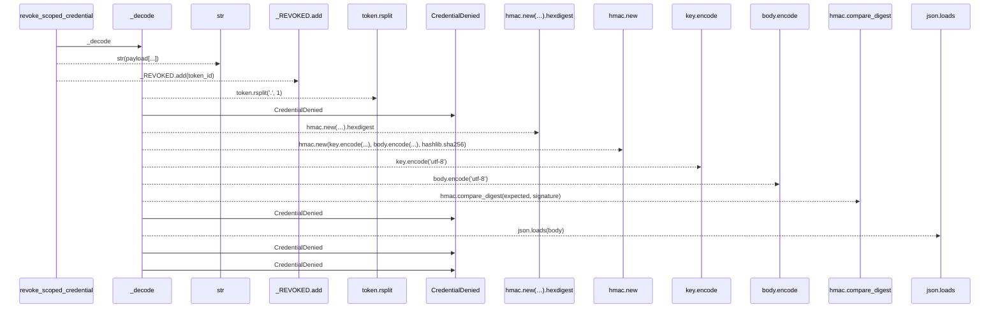
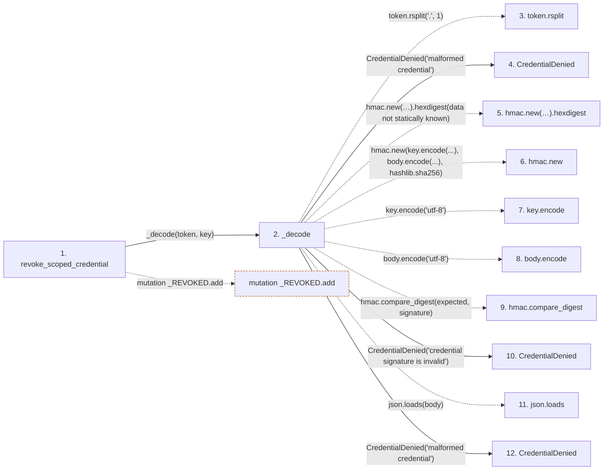

# revoke_scoped_credential

**Entry point:** `revoke_scoped_credential` (`api`)
**Source:** [scoped_credentials](../modules/scoped_credentials.md)
**Modules touched:** [scoped_credentials](../modules/scoped_credentials.md)

## Call sequence

> Static overview in presentation order, not runtime execution order. Arrows retain captured callers; representative internal continuations and boundary examples precede repeated helper detail.

<!-- Auto-generated from static call edges. Dashed arrows are external or unresolved calls. Reviewed runtime conditions and side effects belong in Behavior. -->

> Call sequence diagram shows 14 of 14 interactions; 0 omitted to keep the visualization within the 30-interaction and generated-diagram limits, with uncertain identities omitted rather than inferred.

> Captured boundary calls: external 4 of 4 (0 omitted); unresolved 5 of 5 (0 omitted). These counts cover the captured static trace.
> Detailed flow queries retain their own coverage and limits; omitted paths may execute at runtime.

## Data flow

<!-- Auto-generated static analysis. Treat values and boundaries as best-effort hints, not runtime proof. -->

### Step data

| Step | Inputs | Reads | Writes | Returns |
|---|---|---|---|---|
| `revoke_scoped_credential` | `token: str`, `key: str` | - | - | `token_id` |
| `_decode` | `token: str`, `key: str` | `json` | - | `payload` |
| `token.rsplit` | - | - | - | - |
| `CredentialDenied` | - | - | - | - |
| `hmac.new(…).hexdigest` | - | - | - | - |
| `hmac.new` | - | - | - | - |
| `key.encode` | - | - | - | - |
| `body.encode` | - | - | - | - |
| `hmac.compare_digest` | - | - | - | - |
| `CredentialDenied` | - | - | - | - |
| `json.loads` | - | - | - | - |
| `CredentialDenied` | - | - | - | - |

### Call data

| From | To | Line | Call |
|---|---|---:|---|
| revoke_scoped_credential | _decode | 103 | `_decode(token, key)` |
| _decode | token.rsplit | 154 | `token.rsplit('.', 1)` |
| _decode | CredentialDenied | 156 | `CredentialDenied('malformed credential')` |
| _decode | hmac.new(…).hexdigest | 157 | `hmac.new(key.encode('utf-8'), body.encode('utf-8'), hashlib.sha256).hexdigest(data not statically known)` |
| _decode | hmac.new | 157 | `hmac.new(key.encode(...), body.encode(...), hashlib.sha256)` |
| _decode | key.encode | 158 | `key.encode('utf-8')` |
| _decode | body.encode | 158 | `body.encode('utf-8')` |
| _decode | hmac.compare_digest | 160 | `hmac.compare_digest(expected, signature)` |
| _decode | CredentialDenied | 161 | `CredentialDenied('credential signature is invalid')` |
| _decode | json.loads | 163 | `json.loads(body)` |
| _decode | CredentialDenied | 165 | `CredentialDenied('malformed credential')` |

### Boundary effects

| Kind | Target | Step | Line |
|---|---|---|---:|
| mutation | `_REVOKED.add` | `revoke_scoped_credential` | 105 |

### Static analysis gaps

| Kind | Step | Target | Line |
|---|---|---|---:|
| unresolved_call | `_decode` | `token.rsplit` | 154 |
| unresolved_call | `_decode` | `hmac.new(key.encode('utf-8'), body.encode('utf-8'), hashlib.sha256).hexdigest` | 157 |
| external_call | `_decode` | `hmac.new` | 157 |
| unresolved_call | `_decode` | `key.encode` | 158 |
| unresolved_call | `_decode` | `body.encode` | 158 |
| external_call | `_decode` | `hmac.compare_digest` | 160 |
| external_call | `_decode` | `json.loads` | 163 |
| step_limit | `revoke_scoped_credential` | `first 12 steps` | 0 |

## Behavior

This flow starts at `revoke_scoped_credential` and is classified as `api`. The generated call and data-flow sections are bounded static projections; runtime conditions and side effects require source-level confirmation.
