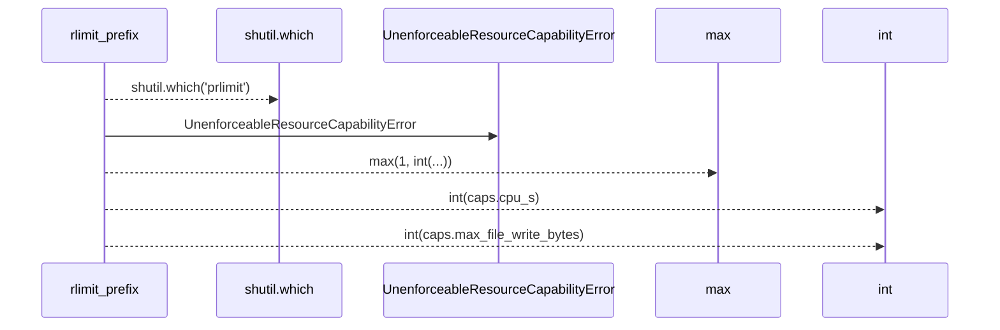
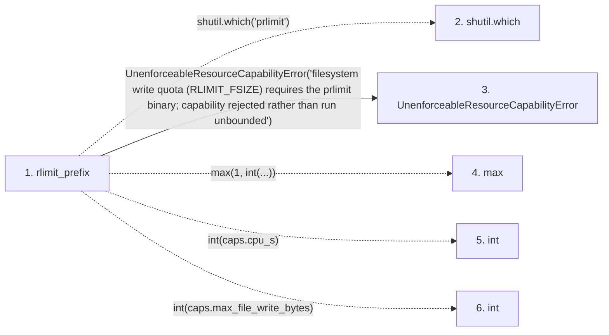

# rlimit_prefix

**Entry point:** `rlimit_prefix` (`api`)
**Source:** [process_limits](../modules/process_limits.md)
**Modules touched:** [process_limits](../modules/process_limits.md)

## Call sequence

> Static overview in presentation order, not runtime execution order. Arrows retain captured callers; representative internal continuations and boundary examples precede repeated helper detail.

<!-- Auto-generated from static call edges. Dashed arrows are external or unresolved calls. Reviewed runtime conditions and side effects belong in Behavior. -->

> Call sequence diagram shows 5 of 5 interactions; 0 omitted to keep the visualization within the 30-interaction and generated-diagram limits, with uncertain identities omitted rather than inferred.

> Captured boundary calls: external 4 of 4 (0 omitted); unresolved 0 of 0 (0 omitted). These counts cover the captured static trace.
> Detailed flow queries retain their own coverage and limits; omitted paths may execute at runtime.

## Data flow

<!-- Auto-generated static analysis. Treat values and boundaries as best-effort hints, not runtime proof. -->

### Step data

| Step | Inputs | Reads | Writes | Returns |
|---|---|---|---|---|
| `rlimit_prefix` | `caps: ProcessResourceCaps` | - | - | `[...]`, `[...]`, `prefix` |
| `shutil.which` | - | - | - | - |
| `UnenforceableResourceCapabilityError` | - | - | - | - |
| `max` | - | - | - | - |
| `int` | - | - | - | - |
| `int` | - | - | - | - |

### Call data

| From | To | Line | Call |
|---|---|---:|---|
| rlimit_prefix | shutil.which | 154 | `shutil.which('prlimit')` |
| rlimit_prefix | UnenforceableResourceCapabilityError | 157 | `UnenforceableResourceCapabilityError('filesystem write quota (RLIMIT_FSIZE) requires the prlimit binary; capability rejected rather than run unbounded')` |
| rlimit_prefix | max | 164 | `max(1, int(...))` |
| rlimit_prefix | int | 164 | `int(caps.cpu_s)` |
| rlimit_prefix | int | 167 | `int(caps.max_file_write_bytes)` |

### Boundary effects

*No boundary effects detected.*

### Static analysis gaps

| Kind | Step | Target | Line |
|---|---|---|---:|
| external_call | `rlimit_prefix` | `shutil.which` | 154 |
| external_call | `rlimit_prefix` | `max` | 164 |

## Behavior

This flow starts at `rlimit_prefix` and is classified as `api`. The generated call and data-flow sections are bounded static projections; runtime conditions and side effects require source-level confirmation.
