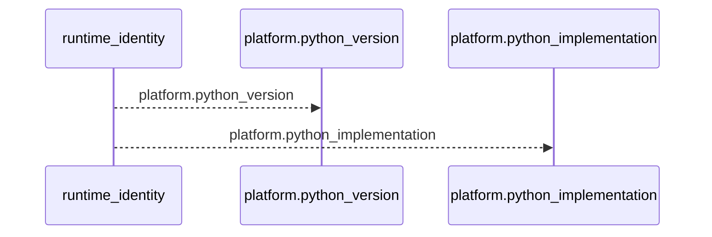
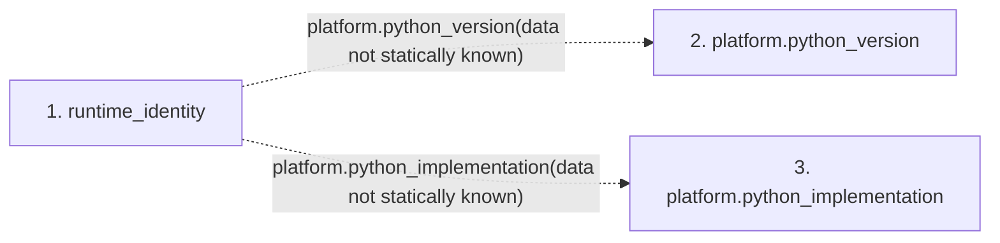

# runtime_identity

**Entry point:** `runtime_identity` (`api`)
**Source:** [run_spec](../modules/run_spec.md)
**Modules touched:** [run_spec](../modules/run_spec.md)

## Call sequence

> Static overview in presentation order, not runtime execution order. Arrows retain captured callers; representative internal continuations and boundary examples precede repeated helper detail.

<!-- Auto-generated from static call edges. Dashed arrows are external or unresolved calls. Reviewed runtime conditions and side effects belong in Behavior. -->

> Call sequence diagram shows 2 of 2 interactions; 0 omitted to keep the visualization within the 30-interaction and generated-diagram limits, with uncertain identities omitted rather than inferred.

> Captured boundary calls: external 2 of 2 (0 omitted); unresolved 0 of 0 (0 omitted). These counts cover the captured static trace.
> Detailed flow queries retain their own coverage and limits; omitted paths may execute at runtime.

## Data flow

<!-- Auto-generated static analysis. Treat values and boundaries as best-effort hints, not runtime proof. -->

### Step data

| Step | Inputs | Reads | Writes | Returns |
|---|---|---|---|---|
| `runtime_identity` | - | `sys` | - | `{...}` |
| `platform.python_version` | - | - | - | - |
| `platform.python_implementation` | - | - | - | - |

### Call data

| From | To | Line | Call |
|---|---|---:|---|
| runtime_identity | platform.python_version | 131 | `platform.python_version(data not statically known)` |
| runtime_identity | platform.python_implementation | 132 | `platform.python_implementation(data not statically known)` |

### Boundary effects

*No boundary effects detected.*

### Static analysis gaps

| Kind | Step | Target | Line |
|---|---|---|---:|
| external_call | `runtime_identity` | `platform.python_version` | 131 |
| external_call | `runtime_identity` | `platform.python_implementation` | 132 |

## Behavior

This flow starts at `runtime_identity` and is classified as `api`. The generated call and data-flow sections are bounded static projections; runtime conditions and side effects require source-level confirmation.
