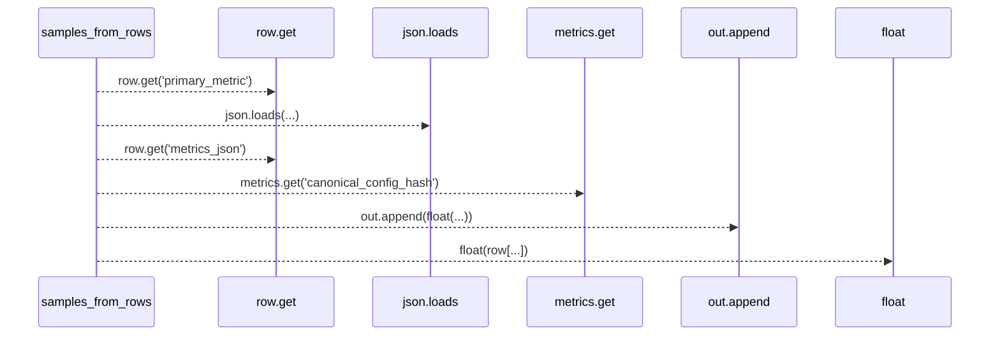
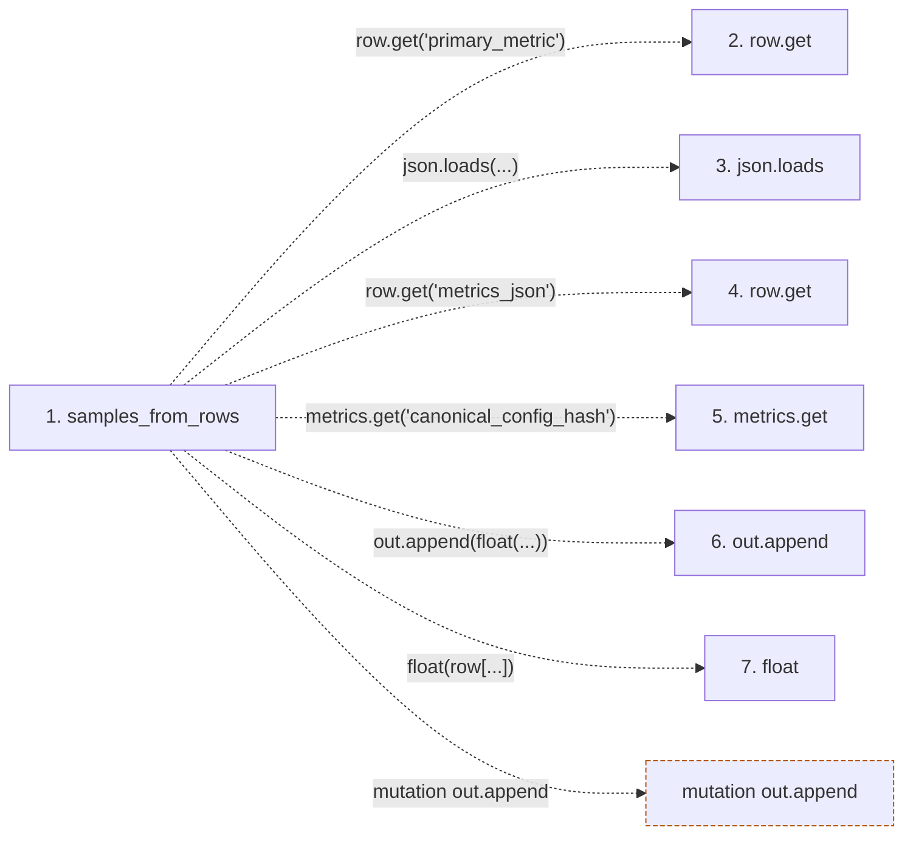

# samples_from_rows

**Entry point:** `samples_from_rows` (`api`)
**Source:** [significance](../modules/significance.md)
**Modules touched:** [significance](../modules/significance.md)

## Call sequence

> Static overview in presentation order, not runtime execution order. Arrows retain captured callers; representative internal continuations and boundary examples precede repeated helper detail.

<!-- Auto-generated from static call edges. Dashed arrows are external or unresolved calls. Reviewed runtime conditions and side effects belong in Behavior. -->

> Call sequence diagram shows 6 of 6 interactions; 0 omitted to keep the visualization within the 30-interaction and generated-diagram limits, with uncertain identities omitted rather than inferred.

> Captured boundary calls: external 2 of 2 (0 omitted); unresolved 4 of 4 (0 omitted). These counts cover the captured static trace.
> Detailed flow queries retain their own coverage and limits; omitted paths may execute at runtime.

## Data flow

<!-- Auto-generated static analysis. Treat values and boundaries as best-effort hints, not runtime proof. -->

### Step data

| Step | Inputs | Reads | Writes | Returns |
|---|---|---|---|---|
| `samples_from_rows` | `rows: Sequence[dict]`, `canonical_config_hash: str` | - | - | `out` |
| `row.get` | - | - | - | - |
| `json.loads` | - | - | - | - |
| `row.get` | - | - | - | - |
| `metrics.get` | - | - | - | - |
| `out.append` | - | - | - | - |
| `float` | - | - | - | - |

### Call data

| From | To | Line | Call |
|---|---|---:|---|
| samples_from_rows | row.get | 110 | `row.get('primary_metric')` |
| samples_from_rows | json.loads | 113 | `json.loads(...)` |
| samples_from_rows | row.get | 113 | `row.get('metrics_json')` |
| samples_from_rows | metrics.get | 116 | `metrics.get('canonical_config_hash')` |
| samples_from_rows | out.append | 117 | `out.append(float(...))` |
| samples_from_rows | float | 117 | `float(row[...])` |

### Boundary effects

| Kind | Target | Step | Line |
|---|---|---|---:|
| mutation | `out.append` | `samples_from_rows` | 117 |

### Static analysis gaps

| Kind | Step | Target | Line |
|---|---|---|---:|
| unresolved_call | `samples_from_rows` | `row.get` | 110 |
| external_call | `samples_from_rows` | `json.loads` | 113 |
| unresolved_call | `samples_from_rows` | `row.get` | 113 |
| unresolved_call | `samples_from_rows` | `metrics.get` | 116 |

## Behavior

This flow starts at `samples_from_rows` and is classified as `api`. The generated call and data-flow sections are bounded static projections; runtime conditions and side effects require source-level confirmation.
