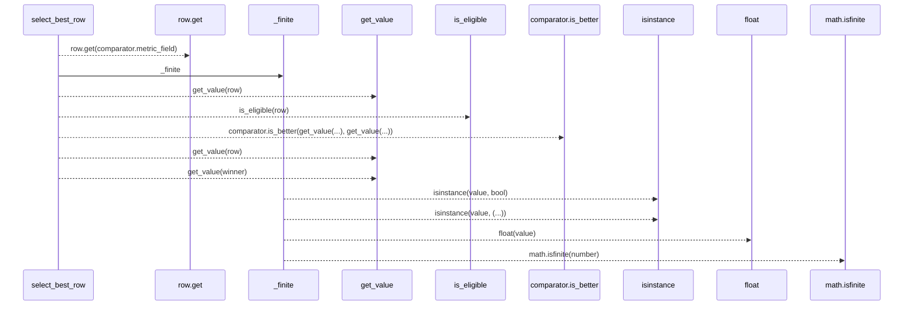
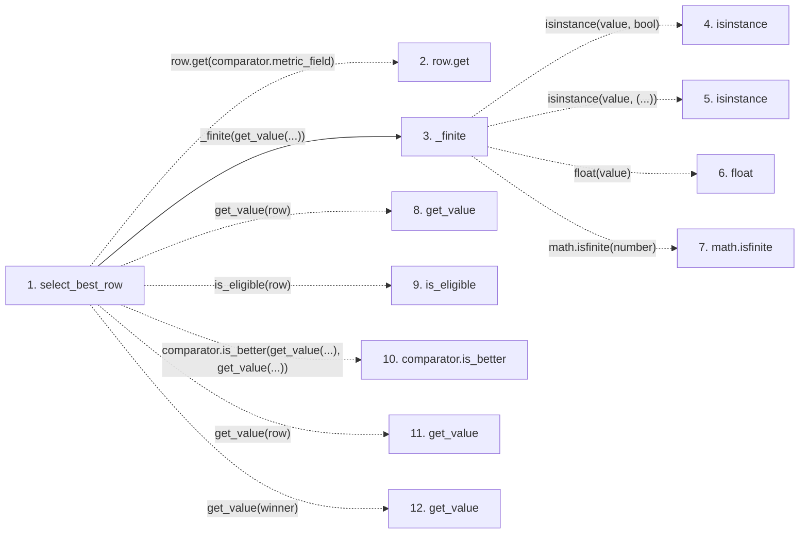

# select_best_row

**Entry point:** `select_best_row` (`api`)
**Source:** [objective_comparator](../modules/objective_comparator.md)
**Modules touched:** [objective_comparator](../modules/objective_comparator.md)

## Call sequence

> Static overview in presentation order, not runtime execution order. Arrows retain captured callers; representative internal continuations and boundary examples precede repeated helper detail.

<!-- Auto-generated from static call edges. Dashed arrows are external or unresolved calls. Reviewed runtime conditions and side effects belong in Behavior. -->

> Call sequence diagram shows 11 of 11 interactions; 0 omitted to keep the visualization within the 30-interaction and generated-diagram limits, with uncertain identities omitted rather than inferred.

> Captured boundary calls: external 4 of 4 (0 omitted); unresolved 6 of 6 (0 omitted). These counts cover the captured static trace.
> Detailed flow queries retain their own coverage and limits; omitted paths may execute at runtime.

## Data flow

<!-- Auto-generated static analysis. Treat values and boundaries as best-effort hints, not runtime proof. -->

### Step data

| Step | Inputs | Reads | Writes | Returns |
|---|---|---|---|---|
| `select_best_row` | `rows: Iterable[Mapping[str, Any]]`, `comparator: ObjectiveComparator`, `value: Optional[Callable[[Mapping[str, Any]], Any]]`, `eligible: Optional[Callable[[Mapping[str, Any]], bool]]` | - | - | `winner` |
| `row.get` | - | - | - | - |
| `_finite` | `value: Any` | - | - | `None`, `...` |
| `isinstance` | - | - | - | - |
| `isinstance` | - | - | - | - |
| `float` | - | - | - | - |
| `math.isfinite` | - | - | - | - |
| `get_value` | - | - | - | - |
| `is_eligible` | - | - | - | - |
| `comparator.is_better` | - | - | - | - |
| `get_value` | - | - | - | - |
| `get_value` | - | - | - | - |

### Call data

| From | To | Line | Call |
|---|---|---:|---|
| select_best_row | row.get | 170 | `row.get(comparator.metric_field)` |
| select_best_row | _finite | 171 | `_finite(get_value(...))` |
| _finite | isinstance | 58 | `isinstance(value, bool)` |
| _finite | isinstance | 58 | `isinstance(value, (...))` |
| _finite | float | 60 | `float(value)` |
| _finite | math.isfinite | 61 | `math.isfinite(number)` |
| select_best_row | get_value | 171 | `get_value(row)` |
| select_best_row | is_eligible | 174 | `is_eligible(row)` |
| select_best_row | comparator.is_better | 179 | `comparator.is_better(get_value(...), get_value(...))` |
| select_best_row | get_value | 179 | `get_value(row)` |
| select_best_row | get_value | 179 | `get_value(winner)` |

### Boundary effects

*No boundary effects detected.*

### Static analysis gaps

| Kind | Step | Target | Line |
|---|---|---|---:|
| unresolved_call | `select_best_row` | `row.get` | 170 |
| external_call | `_finite` | `isinstance` | 58 |
| external_call | `_finite` | `math.isfinite` | 61 |
| unresolved_call | `select_best_row` | `get_value` | 171 |
| unresolved_call | `select_best_row` | `is_eligible` | 174 |
| unresolved_call | `select_best_row` | `comparator.is_better` | 179 |
| unresolved_call | `select_best_row` | `get_value` | 179 |

## Behavior

This flow starts at `select_best_row` and is classified as `api`. The generated call and data-flow sections are bounded static projections; runtime conditions and side effects require source-level confirmation.
