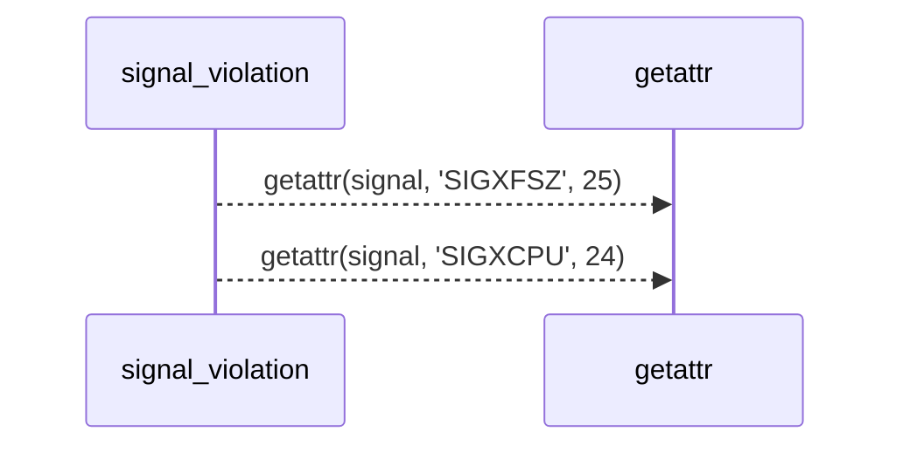
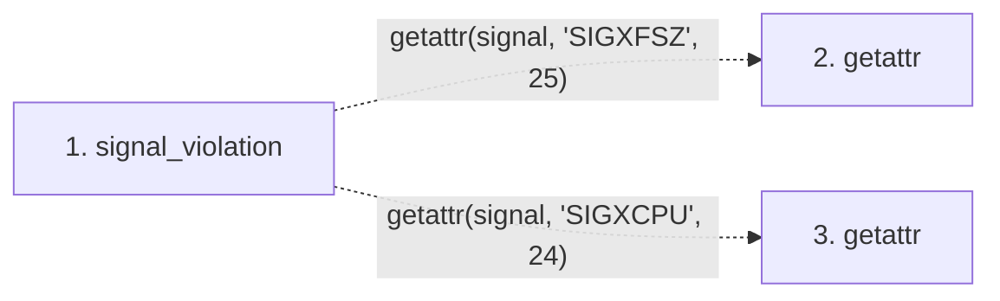

# signal_violation

**Entry point:** `signal_violation` (`api`)
**Source:** [process_limits](../modules/process_limits.md)
**Modules touched:** [process_limits](../modules/process_limits.md)

## Call sequence

> Static overview in presentation order, not runtime execution order. Arrows retain captured callers; representative internal continuations and boundary examples precede repeated helper detail.

<!-- Auto-generated from static call edges. Dashed arrows are external or unresolved calls. Reviewed runtime conditions and side effects belong in Behavior. -->

> Call sequence diagram shows 2 of 2 interactions; 0 omitted to keep the visualization within the 30-interaction and generated-diagram limits, with uncertain identities omitted rather than inferred.

> Captured boundary calls: external 2 of 2 (0 omitted); unresolved 0 of 0 (0 omitted). These counts cover the captured static trace.
> Detailed flow queries retain their own coverage and limits; omitted paths may execute at runtime.

## Data flow

<!-- Auto-generated static analysis. Treat values and boundaries as best-effort hints, not runtime proof. -->

### Step data

| Step | Inputs | Reads | Writes | Returns |
|---|---|---|---|---|
| `signal_violation` | `returncode: Optional[int]` | `signal`, `signal` | - | `'file_size'`, `'cpu'`, `None` |
| `getattr` | - | - | - | - |
| `getattr` | - | - | - | - |

### Call data

| From | To | Line | Call |
|---|---|---:|---|
| signal_violation | getattr | 380 | `getattr(signal, 'SIGXFSZ', 25)` |
| signal_violation | getattr | 382 | `getattr(signal, 'SIGXCPU', 24)` |

### Boundary effects

*No boundary effects detected.*

### Static analysis gaps

| Kind | Step | Target | Line |
|---|---|---|---:|
| external_call | `signal_violation` | `getattr` | 380 |
| external_call | `signal_violation` | `getattr` | 382 |

## Behavior

This flow starts at `signal_violation` and is classified as `api`. The generated call and data-flow sections are bounded static projections; runtime conditions and side effects require source-level confirmation.
