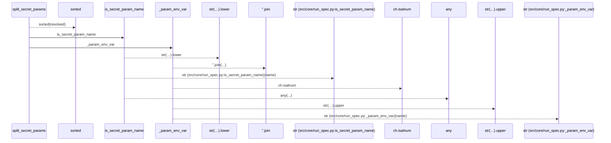
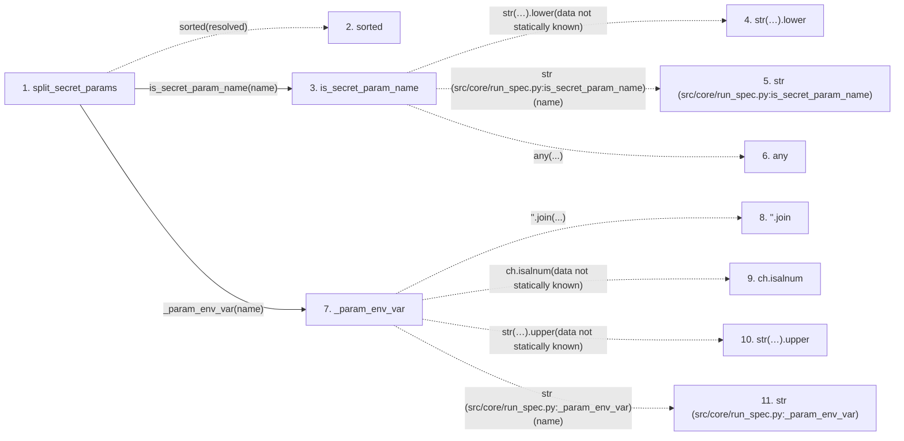

# split_secret_params

**Entry point:** `split_secret_params` (`api`)
**Source:** [run_spec](../modules/run_spec.md)
**Modules touched:** [run_spec](../modules/run_spec.md)

## Call sequence

> Static overview in presentation order, not runtime execution order. Arrows retain captured callers; representative internal continuations and boundary examples precede repeated helper detail.

<!-- Auto-generated from static call edges. Dashed arrows are external or unresolved calls. Reviewed runtime conditions and side effects belong in Behavior. -->

> Call sequence diagram shows 10 of 10 interactions; 0 omitted to keep the visualization within the 30-interaction and generated-diagram limits, with uncertain identities omitted rather than inferred.

> Captured boundary calls: external 4 of 4 (0 omitted); unresolved 4 of 4 (0 omitted). These counts cover the captured static trace.
> Detailed flow queries retain their own coverage and limits; omitted paths may execute at runtime.

## Data flow

<!-- Auto-generated static analysis. Treat values and boundaries as best-effort hints, not runtime proof. -->

### Step data

| Step | Inputs | Reads | Writes | Returns |
|---|---|---|---|---|
| `split_secret_params` | `resolved: Mapping[str, Any]` | `SECRET_REBIND_POLICY` | `refs[...]`, `values[...]` | `(...)` |
| `sorted` | - | - | - | - |
| `is_secret_param_name` | `name: str` | `SECRET_NAME_MARKERS` | - | `any(...)` |
| `str(…).lower` | - | - | - | - |
| `str (src/core/run_spec.py:is_secret_param_name)` | - | - | - | - |
| `any` | - | - | - | - |
| `_param_env_var` | `name: str` | - | - | `...` |
| `''.join` | - | - | - | - |
| `ch.isalnum` | - | - | - | - |
| `str(…).upper` | - | - | - | - |
| `str (src/core/run_spec.py:_param_env_var)` | - | - | - | - |

### Call data

| From | To | Line | Call |
|---|---|---:|---|
| split_secret_params | sorted | 69 | `sorted(resolved)` |
| split_secret_params | is_secret_param_name | 70 | `is_secret_param_name(name)` |
| is_secret_param_name | str(…).lower | 49 | `str(name).lower(data not statically known)` |
| is_secret_param_name | str (src/core/run_spec.py:is_secret_param_name) | 49 | `str(name)` |
| is_secret_param_name | any | 50 | `any(...)` |
| split_secret_params | _param_env_var | 72 | `_param_env_var(name)` |
| _param_env_var | ''.join | 54 | `''.join(...)` |
| _param_env_var | ch.isalnum | 55 | `ch.isalnum(data not statically known)` |
| _param_env_var | str(…).upper | 55 | `str(name).upper(data not statically known)` |
| _param_env_var | str (src/core/run_spec.py:_param_env_var) | 55 | `str(name)` |

### Boundary effects

*No boundary effects detected.*

### Static analysis gaps

| Kind | Step | Target | Line |
|---|---|---|---:|
| external_call | `split_secret_params` | `sorted` | 69 |
| unresolved_call | `is_secret_param_name` | `str(name).lower` | 49 |
| external_call | `is_secret_param_name` | `any` | 50 |
| unresolved_call | `_param_env_var` | `''.join` | 54 |
| unresolved_call | `_param_env_var` | `ch.isalnum` | 55 |
| unresolved_call | `_param_env_var` | `str(name).upper` | 55 |

## Behavior

This flow starts at `split_secret_params` and is classified as `api`. The generated call and data-flow sections are bounded static projections; runtime conditions and side effects require source-level confirmation.
