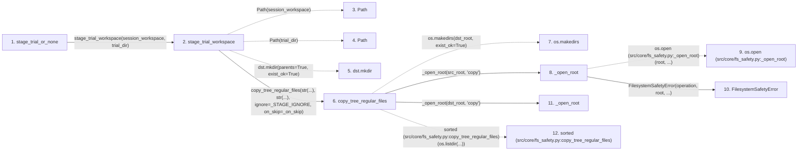

# stage_trial_or_none

**Entry point:** `stage_trial_or_none` (`api`)
**Source:** [trial_workspace](../modules/trial_workspace.md)
**Modules touched:** [fs_safety](../modules/fs_safety.md), [trial_workspace](../modules/trial_workspace.md)

## Call sequence

> Static overview in presentation order, not runtime execution order. Arrows retain captured callers; representative internal continuations and boundary examples precede repeated helper detail.

```mermaid
sequenceDiagram
    participant p0 as stage_trial_or_none
    participant p1 as stage_trial_workspace
    participant p2 as copy_tree_regular_files
    participant p3 as _open_root
    participant p4 as _copy_entry_at
    participant p5 as _copy_dir_at
    participant p6 as _write_at
    participant p7 as FilesystemSafetyError
    participant p8 as _leaf_denial_reason
    participant p9 as _unlink_quiet
    participant p10 as Path
    participant p11 as logger.warning
    participant p12 as dst.mkdir
    participant p13 as str (src/core/trial_workspace.py:stage_trial_workspace)
    participant p14 as os.makedirs
    participant p15 as sorted (src/core/fs_safety.py:copy_tree_regular_files)
    participant p16 as os.listdir (src/core/fs_safety.py:copy_tree_regular_files)
    participant p17 as on_skip (src/core/fs_safety.py:copy_tree_regular_files)
    participant p18 as str (src/core/fs_safety.py:copy_tree_regular_files)
    participant p19 as os.close (src/core/fs_safety.py:copy_tree_regular_files)
    participant p20 as os.open (src/core/fs_safety.py:_open_root)
    participant p21 as os.stat (src/core/fs_safety.py:_copy_entry_at)
    participant p22 as stat_mod.S_ISLNK (src/core/fs_safety.py:_copy_entry_at)
    participant p23 as stat_mod.S_ISDIR
    participant p24 as os.mkdir
    participant p25 as os.open (src/core/fs_safety.py:_copy_entry_at)
    p0->>p1: stage_trial_workspace
    p1->>p2: copy_tree_regular_files
    p2->>p3: _open_root
    p2->>p4: _copy_entry_at
    p4->>p5: _copy_dir_at
    p4->>p6: _write_at
    p3->>p7: FilesystemSafetyError
    p6->>p8: _leaf_denial_reason
    p6->>p9: _unlink_quiet
    p1-->>p10: Path(session_workspace)
    p0-->>p11: logger.warning('Trial staging failed for s ( s) falling back to the session workspace for this command', trial_dir, exc)
    p1-->>p10: Path(trial_dir)
    p1-->>p12: dst.mkdir(parents=True, exist_ok=True)
    p1-->>p13: str (src/core/trial_workspace.py:stage_trial_workspace)(src)
    p1-->>p13: str (src/core/trial_workspace.py:stage_trial_workspace)(dst)
    p2-->>p14: os.makedirs(dst_root, exist_ok=True)
    p2-->>p15: sorted (src/core/fs_safety.py:copy_tree_regular_files)(os.listdir(...))
    p2-->>p16: os.listdir (src/core/fs_safety.py:copy_tree_regular_files)(src_fd)
    p2-->>p17: on_skip (src/core/fs_safety.py:copy_tree_regular_files)(name, exc.reason)
    p2-->>p17: on_skip (src/core/fs_safety.py:copy_tree_regular_files)(name, ...)
    p2-->>p18: str (src/core/fs_safety.py:copy_tree_regular_files)(exc)
    p2-->>p19: os.close (src/core/fs_safety.py:copy_tree_regular_files)(dst_fd)
    p2-->>p19: os.close (src/core/fs_safety.py:copy_tree_regular_files)(src_fd)
    p3-->>p20: os.open (src/core/fs_safety.py:_open_root)(root, ...)
    p4-->>p21: os.stat (src/core/fs_safety.py:_copy_entry_at)(name, dir_fd=src_fd, follow_symlinks=False)
    p4-->>p22: stat_mod.S_ISLNK (src/core/fs_safety.py:_copy_entry_at)(st.st_mode)
    p4-->>p23: stat_mod.S_ISDIR(st.st_mode)
    p4-->>p24: os.mkdir(name, 493, dir_fd=dst_fd)
    p4-->>p25: os.open (src/core/fs_safety.py:_copy_entry_at)(name, _DIR_OPEN_FLAGS, dir_fd=src_fd)
    p4-->>p25: os.open (src/core/fs_safety.py:_copy_entry_at)(name, _DIR_OPEN_FLAGS, dir_fd=dst_fd)
```

<!-- Auto-generated from static call edges. Dashed arrows are external or unresolved calls. Reviewed runtime conditions and side effects belong in Behavior. -->

> Call sequence diagram shows 30 of 60 interactions; 30 omitted to keep the visualization within the 30-interaction and generated-diagram limits, with uncertain identities omitted rather than inferred.

> Captured boundary calls: external 17 of 34 (17 omitted); unresolved 4 of 8 (4 omitted). These counts cover the captured static trace.

Omitted captured detail, grouped by actual caller occurrence and target module:

| Caller | Parent step | Target module | Kind | Omitted interactions |
| --- | --- | --- | --- | --- |
| `src/core/fs_safety.py:copy_tree_regular_files` | 6 | [src/core/fs_safety.py](../modules/fs_safety.md) | internal | 1 |
| `src/core/fs_safety.py:_copy_entry_at` | 14 | [src/core/fs_safety.py](../modules/fs_safety.md) | internal | 3 |
| `src/core/fs_safety.py:_copy_entry_at` | 14 | - | external | 6 |
| `src/core/fs_safety.py:_copy_dir_at` | 23 | - | external | 3 |
| `src/core/fs_safety.py:_copy_dir_at` | 23 | [src/core/fs_safety.py](../modules/fs_safety.md) | internal | 1 |
| `src/core/fs_safety.py:_copy_dir_at` | 23 | - | unresolved | 2 |
| `src/core/fs_safety.py:_copy_entry_at` | 14 | - | unresolved | 1 |
| `src/core/fs_safety.py:_write_at` | 37 | - | external | 5 |
> Omission summary shows 8 of 12 groups; 4 further groups are not expanded here. Counts above include all omitted interactions.
> Detailed flow queries retain their own coverage and limits; omitted paths may execute at runtime.

## Data flow

<!-- Auto-generated static analysis. Treat values and boundaries as best-effort hints, not runtime proof. -->

### Step data

| Step | Inputs | Reads | Writes | Returns |
|---|---|---|---|---|
| `stage_trial_or_none` | `session_workspace: str`, `trial_dir: str` | `fs_safety` | - | `trial_dir`, `None` |
| `stage_trial_workspace` | `session_workspace: str`, `trial_dir: str` | `_STAGE_IGNORE` | - | `fs_safety.copy_tree_regular_files(...)` |
| `Path` | - | - | - | - |
| `Path` | - | - | - | - |
| `dst.mkdir` | - | - | - | - |
| `copy_tree_regular_files` | `src_root: str`, `dst_root: str`, `ignore: Container[str]`, `on_skip: Optional[SkipCallback]` | `FilesystemSafetyError` | - | `copied` |
| `os.makedirs` | - | - | - | - |
| `_open_root` | `root: str`, `operation: str` | `os` | - | `os.open(...)` |
| `os.open (src/core/fs_safety.py:_open_root)` | - | - | - | - |
| `FilesystemSafetyError` | - | - | - | - |
| `_open_root` | `root: str`, `operation: str` | `os` | - | `os.open(...)` |
| `sorted (src/core/fs_safety.py:copy_tree_regular_files)` | - | - | - | - |

### Call data

| From | To | Line | Call |
|---|---|---:|---|
| stage_trial_or_none | stage_trial_workspace | 141 | `stage_trial_workspace(session_workspace, trial_dir)` |
| stage_trial_workspace | Path | 119 | `Path(session_workspace)` |
| stage_trial_workspace | Path | 120 | `Path(trial_dir)` |
| stage_trial_workspace | dst.mkdir | 121 | `dst.mkdir(parents=True, exist_ok=True)` |
| stage_trial_workspace | copy_tree_regular_files | 129 | `fs_safety.copy_tree_regular_files(str(...), str(...), ignore=_STAGE_IGNORE, on_skip=_on_skip)` |
| copy_tree_regular_files | os.makedirs | 394 | `os.makedirs(dst_root, exist_ok=True)` |
| copy_tree_regular_files | _open_root | 395 | `_open_root(src_root, 'copy')` |
| _open_root | os.open (src/core/fs_safety.py:_open_root) | 81 | `os.open(root, ...)` |
| _open_root | FilesystemSafetyError | 83 | `FilesystemSafetyError(operation, root, ...)` |
| copy_tree_regular_files | _open_root | 397 | `_open_root(dst_root, 'copy')` |
| copy_tree_regular_files | sorted (src/core/fs_safety.py:copy_tree_regular_files) | 400 | `sorted(os.listdir(...))` |

### Boundary effects

*No boundary effects detected.*

### Static analysis gaps

| Kind | Step | Target | Line |
|---|---|---|---:|
| unresolved_call | `stage_trial_workspace` | `dst.mkdir` | 121 |
| external_call | `copy_tree_regular_files` | `os.makedirs` | 394 |
| external_call | `_open_root` | `os.open` | 81 |
| external_call | `copy_tree_regular_files` | `sorted` | 400 |
| step_limit | `stage_trial_or_none` | `first 12 steps` | 0 |

## Behavior

This flow starts at `stage_trial_or_none` and is classified as `api`. The generated call and data-flow sections are bounded static projections; runtime conditions and side effects require source-level confirmation.
