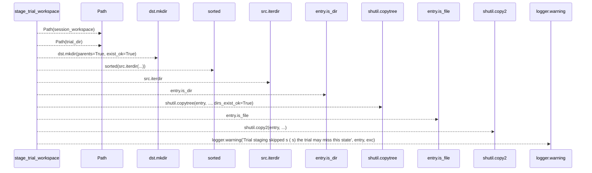
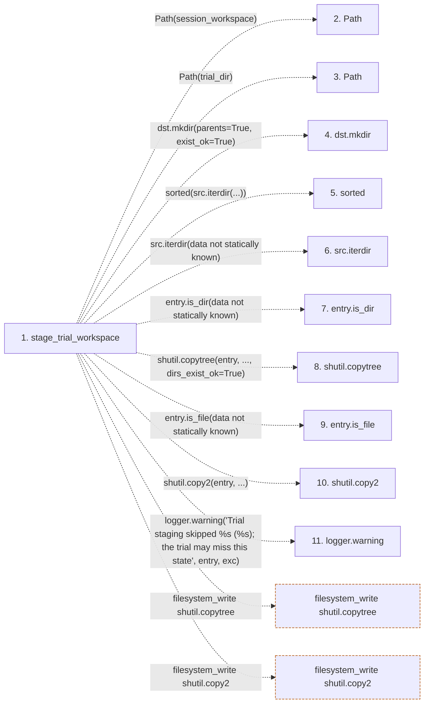

# stage_trial_workspace

**Entry point:** `stage_trial_workspace` (`api`)
**Source:** [trial_workspace](../modules/trial_workspace.md)
**Modules touched:** [trial_workspace](../modules/trial_workspace.md)

## Call sequence

> Static overview in presentation order, not runtime execution order. Arrows retain captured callers; representative internal continuations and boundary examples precede repeated helper detail.

<!-- Auto-generated from static call edges. Dashed arrows are external or unresolved calls. Reviewed runtime conditions and side effects belong in Behavior. -->

> Call sequence diagram shows 10 of 10 interactions; 0 omitted to keep the visualization within the 30-interaction and generated-diagram limits, with uncertain identities omitted rather than inferred.

> Captured boundary calls: external 5 of 5 (0 omitted); unresolved 5 of 5 (0 omitted). These counts cover the captured static trace.
> Detailed flow queries retain their own coverage and limits; omitted paths may execute at runtime.

## Data flow

<!-- Auto-generated static analysis. Treat values and boundaries as best-effort hints, not runtime proof. -->

### Step data

| Step | Inputs | Reads | Writes | Returns |
|---|---|---|---|---|
| `stage_trial_workspace` | `session_workspace: str`, `trial_dir: str` | `_STAGE_IGNORE` | - | `staged` |
| `Path` | - | - | - | - |
| `Path` | - | - | - | - |
| `dst.mkdir` | - | - | - | - |
| `sorted` | - | - | - | - |
| `src.iterdir` | - | - | - | - |
| `entry.is_dir` | - | - | - | - |
| `shutil.copytree` | - | - | - | - |
| `entry.is_file` | - | - | - | - |
| `shutil.copy2` | - | - | - | - |
| `logger.warning` | - | - | - | - |

### Call data

| From | To | Line | Call |
|---|---|---:|---|
| stage_trial_workspace | Path | 114 | `Path(session_workspace)` |
| stage_trial_workspace | Path | 115 | `Path(trial_dir)` |
| stage_trial_workspace | dst.mkdir | 116 | `dst.mkdir(parents=True, exist_ok=True)` |
| stage_trial_workspace | sorted | 118 | `sorted(src.iterdir(...))` |
| stage_trial_workspace | src.iterdir | 118 | `src.iterdir(data not statically known)` |
| stage_trial_workspace | entry.is_dir | 122 | `entry.is_dir(data not statically known)` |
| stage_trial_workspace | shutil.copytree | 123 | `shutil.copytree(entry, ..., dirs_exist_ok=True)` |
| stage_trial_workspace | entry.is_file | 124 | `entry.is_file(data not statically known)` |
| stage_trial_workspace | shutil.copy2 | 125 | `shutil.copy2(entry, ...)` |
| stage_trial_workspace | logger.warning | 130 | `logger.warning('Trial staging skipped %s (%s); the trial may miss this state', entry, exc)` |

### Boundary effects

| Kind | Target | Step | Line |
|---|---|---|---:|
| filesystem_write | `shutil.copytree` | `stage_trial_workspace` | 123 |
| filesystem_write | `shutil.copy2` | `stage_trial_workspace` | 125 |

### Static analysis gaps

| Kind | Step | Target | Line |
|---|---|---|---:|
| unresolved_call | `stage_trial_workspace` | `dst.mkdir` | 116 |
| external_call | `stage_trial_workspace` | `sorted` | 118 |
| unresolved_call | `stage_trial_workspace` | `src.iterdir` | 118 |
| unresolved_call | `stage_trial_workspace` | `entry.is_dir` | 122 |
| unresolved_call | `stage_trial_workspace` | `entry.is_file` | 124 |
| unresolved_call | `stage_trial_workspace` | `logger.warning` | 130 |

## Behavior

This flow starts at `stage_trial_workspace` and is classified as `api`. The generated call and data-flow sections are bounded static projections; runtime conditions and side effects require source-level confirmation.
