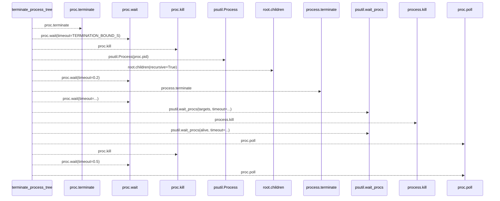
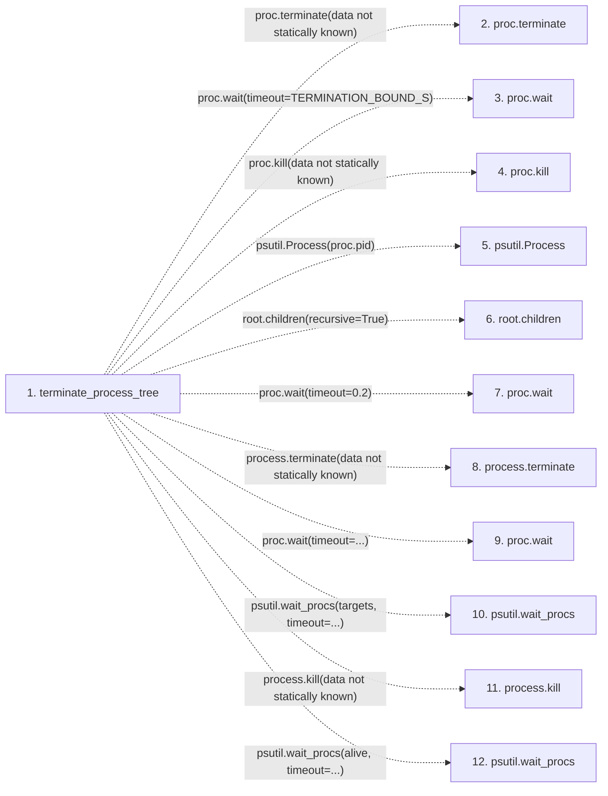

# terminate_process_tree

**Entry point:** `terminate_process_tree` (`api`)
**Source:** [process_limits](../modules/process_limits.md)
**Modules touched:** [process_limits](../modules/process_limits.md)

## Call sequence

> Static overview in presentation order, not runtime execution order. Arrows retain captured callers; representative internal continuations and boundary examples precede repeated helper detail.

<!-- Auto-generated from static call edges. Dashed arrows are external or unresolved calls. Reviewed runtime conditions and side effects belong in Behavior. -->

> Call sequence diagram shows 15 of 15 interactions; 0 omitted to keep the visualization within the 30-interaction and generated-diagram limits, with uncertain identities omitted rather than inferred.

> Captured boundary calls: external 0 of 0 (0 omitted); unresolved 15 of 15 (0 omitted). These counts cover the captured static trace.
> Detailed flow queries retain their own coverage and limits; omitted paths may execute at runtime.

## Data flow

<!-- Auto-generated static analysis. Treat values and boundaries as best-effort hints, not runtime proof. -->

### Step data

| Step | Inputs | Reads | Writes | Returns |
|---|---|---|---|---|
| `terminate_process_tree` | `proc: 'subprocess.Popen'` | `TERMINATION_BOUND_S`, `TERMINATION_BOUND_S`, `subprocess`, `TERMINATION_BOUND_S`, `TERMINATION_BOUND_S` | - | `True`, `False`, `True`, `...` |
| `proc.terminate` | - | - | - | - |
| `proc.wait` | - | - | - | - |
| `proc.kill` | - | - | - | - |
| `psutil.Process` | - | - | - | - |
| `root.children` | - | - | - | - |
| `proc.wait` | - | - | - | - |
| `process.terminate` | - | - | - | - |
| `proc.wait` | - | - | - | - |
| `psutil.wait_procs` | - | - | - | - |
| `process.kill` | - | - | - | - |
| `psutil.wait_procs` | - | - | - | - |

### Call data

| From | To | Line | Call |
|---|---|---:|---|
| terminate_process_tree | proc.terminate | 96 | `proc.terminate(data not statically known)` |
| terminate_process_tree | proc.wait | 97 | `proc.wait(timeout=TERMINATION_BOUND_S)` |
| terminate_process_tree | proc.kill | 101 | `proc.kill(data not statically known)` |
| terminate_process_tree | psutil.Process | 106 | `psutil.Process(proc.pid)` |
| terminate_process_tree | root.children | 107 | `root.children(recursive=True)` |
| terminate_process_tree | proc.wait | 110 | `proc.wait(timeout=0.2)` |
| terminate_process_tree | process.terminate | 116 | `process.terminate(data not statically known)` |
| terminate_process_tree | proc.wait | 123 | `proc.wait(timeout=...)` |
| terminate_process_tree | psutil.wait_procs | 126 | `psutil.wait_procs(targets, timeout=...)` |
| terminate_process_tree | process.kill | 129 | `process.kill(data not statically known)` |
| terminate_process_tree | psutil.wait_procs | 133 | `psutil.wait_procs(alive, timeout=...)` |

### Boundary effects

*No boundary effects detected.*

### Static analysis gaps

| Kind | Step | Target | Line |
|---|---|---|---:|
| unresolved_call | `terminate_process_tree` | `proc.terminate` | 96 |
| unresolved_call | `terminate_process_tree` | `proc.wait` | 97 |
| unresolved_call | `terminate_process_tree` | `proc.kill` | 101 |
| unresolved_call | `terminate_process_tree` | `psutil.Process` | 106 |
| unresolved_call | `terminate_process_tree` | `root.children` | 107 |
| unresolved_call | `terminate_process_tree` | `proc.wait` | 110 |
| unresolved_call | `terminate_process_tree` | `process.terminate` | 116 |
| unresolved_call | `terminate_process_tree` | `proc.wait` | 123 |
| unresolved_call | `terminate_process_tree` | `psutil.wait_procs` | 126 |
| unresolved_call | `terminate_process_tree` | `process.kill` | 129 |
| unresolved_call | `terminate_process_tree` | `psutil.wait_procs` | 133 |
| step_limit | `terminate_process_tree` | `first 12 steps` | 0 |

## Behavior

This flow starts at `terminate_process_tree` and is classified as `api`. The generated call and data-flow sections are bounded static projections; runtime conditions and side effects require source-level confirmation.
