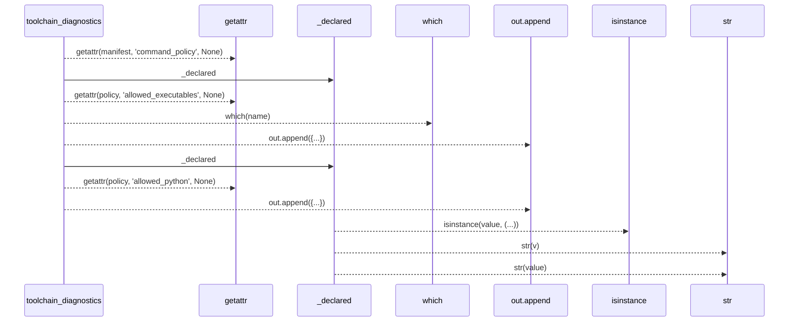
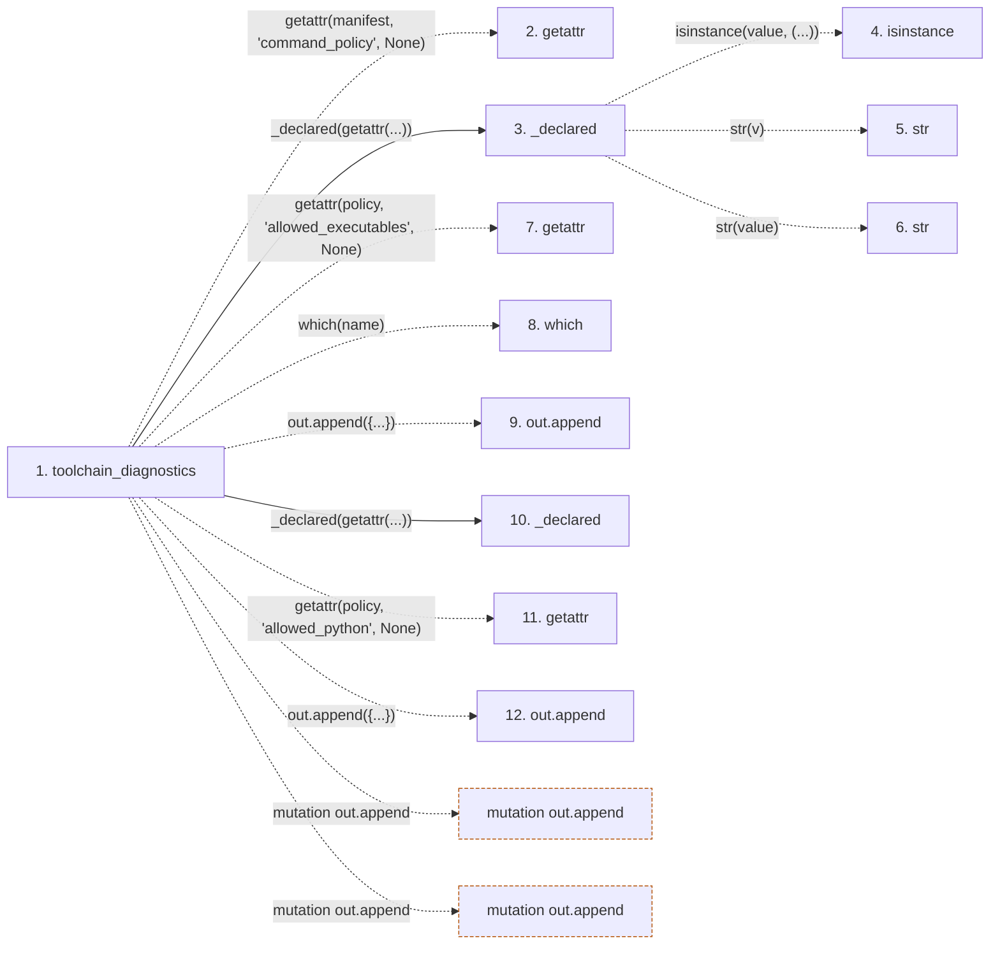

# toolchain_diagnostics

**Entry point:** `toolchain_diagnostics` (`api`)
**Source:** [support_matrix](../modules/support_matrix.md)
**Modules touched:** [support_matrix](../modules/support_matrix.md)

## Call sequence

> Static overview in presentation order, not runtime execution order. Arrows retain captured callers; representative internal continuations and boundary examples precede repeated helper detail.

<!-- Auto-generated from static call edges. Dashed arrows are external or unresolved calls. Reviewed runtime conditions and side effects belong in Behavior. -->

> Call sequence diagram shows 11 of 11 interactions; 0 omitted to keep the visualization within the 30-interaction and generated-diagram limits, with uncertain identities omitted rather than inferred.

> Captured boundary calls: external 6 of 6 (0 omitted); unresolved 3 of 3 (0 omitted). These counts cover the captured static trace.
> Detailed flow queries retain their own coverage and limits; omitted paths may execute at runtime.

## Data flow

<!-- Auto-generated static analysis. Treat values and boundaries as best-effort hints, not runtime proof. -->

### Step data

| Step | Inputs | Reads | Writes | Returns |
|---|---|---|---|---|
| `toolchain_diagnostics` | `manifest: Any`, `which: Any` | - | - | `out` |
| `getattr` | - | - | - | - |
| `_declared` | `value: Any` | - | - | `[...]`, `...`, `[...]` |
| `isinstance` | - | - | - | - |
| `str` | - | - | - | - |
| `str` | - | - | - | - |
| `getattr` | - | - | - | - |
| `which` | - | - | - | - |
| `out.append` | - | - | - | - |
| `_declared` | `value: Any` | - | - | `[...]`, `...`, `[...]` |
| `getattr` | - | - | - | - |
| `out.append` | - | - | - | - |

### Call data

| From | To | Line | Call |
|---|---|---:|---|
| toolchain_diagnostics | getattr | 158 | `getattr(manifest, 'command_policy', None)` |
| toolchain_diagnostics | _declared | 159 | `_declared(getattr(...))` |
| _declared | isinstance | 77 | `isinstance(value, (...))` |
| _declared | str | 78 | `str(v)` |
| _declared | str | 79 | `str(value)` |
| toolchain_diagnostics | getattr | 159 | `getattr(policy, 'allowed_executables', None)` |
| toolchain_diagnostics | which | 160 | `which(name)` |
| toolchain_diagnostics | out.append | 161 | `out.append({...})` |
| toolchain_diagnostics | _declared | 167 | `_declared(getattr(...))` |
| toolchain_diagnostics | getattr | 167 | `getattr(policy, 'allowed_python', None)` |
| toolchain_diagnostics | out.append | 168 | `out.append({...})` |

### Boundary effects

| Kind | Target | Step | Line |
|---|---|---|---:|
| mutation | `out.append` | `toolchain_diagnostics` | 161 |
| mutation | `out.append` | `toolchain_diagnostics` | 168 |

### Static analysis gaps

| Kind | Step | Target | Line |
|---|---|---|---:|
| external_call | `toolchain_diagnostics` | `getattr` | 158 |
| external_call | `_declared` | `isinstance` | 77 |
| external_call | `toolchain_diagnostics` | `getattr` | 159 |
| unresolved_call | `toolchain_diagnostics` | `which` | 160 |
| external_call | `toolchain_diagnostics` | `getattr` | 167 |

## Behavior

This flow starts at `toolchain_diagnostics` and is classified as `api`. The generated call and data-flow sections are bounded static projections; runtime conditions and side effects require source-level confirmation.
