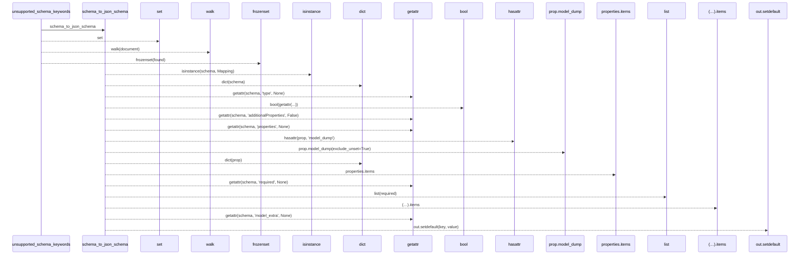
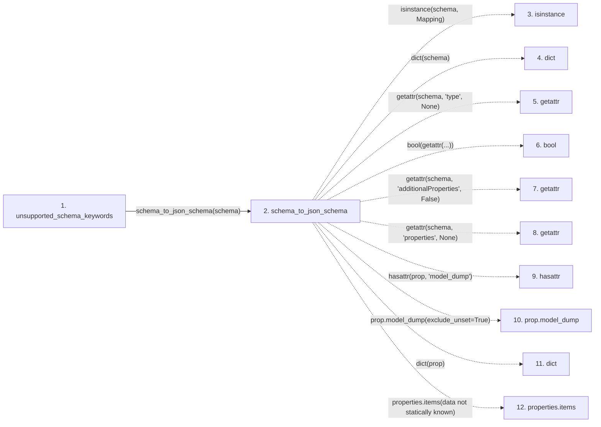

# unsupported_schema_keywords

**Entry point:** `unsupported_schema_keywords` (`api`)
**Source:** [skill_params](../modules/skill_params.md)
**Modules touched:** [skill_params](../modules/skill_params.md)

## Call sequence

> Static overview in presentation order, not runtime execution order. Arrows retain captured callers; representative internal continuations and boundary examples precede repeated helper detail.

<!-- Auto-generated from static call edges. Dashed arrows are external or unresolved calls. Reviewed runtime conditions and side effects belong in Behavior. -->

> Call sequence diagram shows 19 of 19 interactions; 0 omitted to keep the visualization within the 30-interaction and generated-diagram limits, with uncertain identities omitted rather than inferred.

> Captured boundary calls: external 13 of 13 (0 omitted); unresolved 5 of 5 (0 omitted). These counts cover the captured static trace.
> Detailed flow queries retain their own coverage and limits; omitted paths may execute at runtime.

## Data flow

<!-- Auto-generated static analysis. Treat values and boundaries as best-effort hints, not runtime proof. -->

### Step data

| Step | Inputs | Reads | Writes | Returns |
|---|---|---|---|---|
| `unsupported_schema_keywords` | `schema: Any` | - | - | `frozenset(...)` |
| `schema_to_json_schema` | `schema: Any` | `Mapping` | `out[...]`, `out[...]` | `dict(...)`, `out` |
| `isinstance` | - | - | - | - |
| `dict` | - | - | - | - |
| `getattr` | - | - | - | - |
| `bool` | - | - | - | - |
| `getattr` | - | - | - | - |
| `getattr` | - | - | - | - |
| `hasattr` | - | - | - | - |
| `prop.model_dump` | - | - | - | - |
| `dict` | - | - | - | - |
| `properties.items` | - | - | - | - |

### Call data

| From | To | Line | Call |
|---|---|---:|---|
| unsupported_schema_keywords | schema_to_json_schema | 77 | `schema_to_json_schema(schema)` |
| schema_to_json_schema | isinstance | 54 | `isinstance(schema, Mapping)` |
| schema_to_json_schema | dict | 55 | `dict(schema)` |
| schema_to_json_schema | getattr | 57 | `getattr(schema, 'type', None)` |
| schema_to_json_schema | bool | 58 | `bool(getattr(...))` |
| schema_to_json_schema | getattr | 58 | `getattr(schema, 'additionalProperties', False)` |
| schema_to_json_schema | getattr | 60 | `getattr(schema, 'properties', None)` |
| schema_to_json_schema | hasattr | 64 | `hasattr(prop, 'model_dump')` |
| schema_to_json_schema | prop.model_dump | 63 | `prop.model_dump(exclude_unset=True)` |
| schema_to_json_schema | dict | 64 | `dict(prop)` |
| schema_to_json_schema | properties.items | 65 | `properties.items(data not statically known)` |

### Boundary effects

*No boundary effects detected.*

### Static analysis gaps

| Kind | Step | Target | Line |
|---|---|---|---:|
| external_call | `schema_to_json_schema` | `isinstance` | 54 |
| external_call | `schema_to_json_schema` | `getattr` | 57 |
| external_call | `schema_to_json_schema` | `getattr` | 58 |
| external_call | `schema_to_json_schema` | `getattr` | 60 |
| external_call | `schema_to_json_schema` | `hasattr` | 64 |
| unresolved_call | `schema_to_json_schema` | `prop.model_dump` | 63 |
| unresolved_call | `schema_to_json_schema` | `properties.items` | 65 |
| step_limit | `unsupported_schema_keywords` | `first 12 steps` | 0 |

## Behavior

This flow starts at `unsupported_schema_keywords` and is classified as `api`. The generated call and data-flow sections are bounded static projections; runtime conditions and side effects require source-level confirmation.
