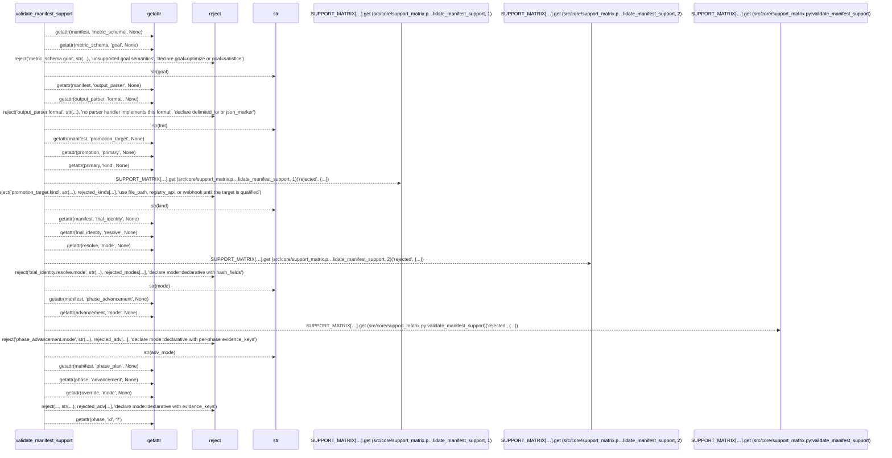
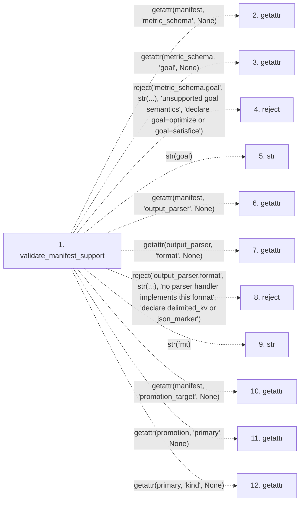

# validate_manifest_support

**Entry point:** `validate_manifest_support` (`api`)
**Source:** [support_matrix](../modules/support_matrix.md)
**Modules touched:** [support_matrix](../modules/support_matrix.md)

## Call sequence

> Static overview in presentation order, not runtime execution order. Arrows retain captured callers; representative internal continuations and boundary examples precede repeated helper detail.

<!-- Auto-generated from static call edges. Dashed arrows are external or unresolved calls. Reviewed runtime conditions and side effects belong in Behavior. -->

> Call sequence diagram shows 30 of 31 interactions; 1 omitted to keep the visualization within the 30-interaction and generated-diagram limits, with uncertain identities omitted rather than inferred.

> Captured boundary calls: external 21 of 22 (1 omitted); unresolved 9 of 9 (0 omitted). These counts cover the captured static trace.

Omitted captured detail, grouped by actual caller occurrence and target module:

| Caller | Parent step | Target module | Kind | Omitted interactions |
| --- | --- | --- | --- | --- |
| `src/core/support_matrix.py:validate_manifest_support` | 1 | - | external | 1 |
> Detailed flow queries retain their own coverage and limits; omitted paths may execute at runtime.

## Data flow

<!-- Auto-generated static analysis. Treat values and boundaries as best-effort hints, not runtime proof. -->

### Step data

| Step | Inputs | Reads | Writes | Returns |
|---|---|---|---|---|
| `validate_manifest_support` | `manifest: Any` | `SUPPORT_MATRIX`, `SUPPORT_MATRIX` | - | `diagnostics` |
| `getattr` | - | - | - | - |
| `getattr` | - | - | - | - |
| `reject` | - | - | - | - |
| `str` | - | - | - | - |
| `getattr` | - | - | - | - |
| `getattr` | - | - | - | - |
| `reject` | - | - | - | - |
| `str` | - | - | - | - |
| `getattr` | - | - | - | - |
| `getattr` | - | - | - | - |
| `getattr` | - | - | - | - |

### Call data

| From | To | Line | Call |
|---|---|---:|---|
| validate_manifest_support | getattr | 101 | `getattr(manifest, 'metric_schema', None)` |
| validate_manifest_support | getattr | 102 | `getattr(metric_schema, 'goal', None)` |
| validate_manifest_support | reject | 104 | `reject('metric_schema.goal', str(...), 'unsupported goal semantics', 'declare goal=optimize or goal=satisfice')` |
| validate_manifest_support | str | 104 | `str(goal)` |
| validate_manifest_support | getattr | 107 | `getattr(manifest, 'output_parser', None)` |
| validate_manifest_support | getattr | 108 | `getattr(output_parser, 'format', None)` |
| validate_manifest_support | reject | 110 | `reject('output_parser.format', str(...), 'no parser handler implements this format', 'declare delimited_kv or json_marker')` |
| validate_manifest_support | str | 110 | `str(fmt)` |
| validate_manifest_support | getattr | 113 | `getattr(manifest, 'promotion_target', None)` |
| validate_manifest_support | getattr | 114 | `getattr(promotion, 'primary', None)` |
| validate_manifest_support | getattr | 115 | `getattr(primary, 'kind', None)` |

### Boundary effects

*No boundary effects detected.*

### Static analysis gaps

| Kind | Step | Target | Line |
|---|---|---|---:|
| external_call | `validate_manifest_support` | `getattr` | 101 |
| external_call | `validate_manifest_support` | `getattr` | 102 |
| unresolved_call | `validate_manifest_support` | `reject` | 104 |
| external_call | `validate_manifest_support` | `getattr` | 107 |
| external_call | `validate_manifest_support` | `getattr` | 108 |
| unresolved_call | `validate_manifest_support` | `reject` | 110 |
| external_call | `validate_manifest_support` | `getattr` | 113 |
| external_call | `validate_manifest_support` | `getattr` | 114 |
| external_call | `validate_manifest_support` | `getattr` | 115 |
| step_limit | `validate_manifest_support` | `first 12 steps` | 0 |

## Behavior

This flow starts at `validate_manifest_support` and is classified as `api`. The generated call and data-flow sections are bounded static projections; runtime conditions and side effects require source-level confirmation.
