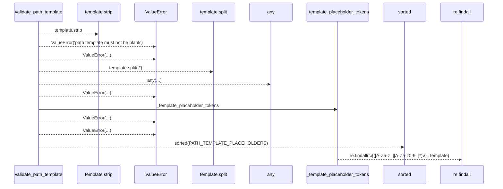
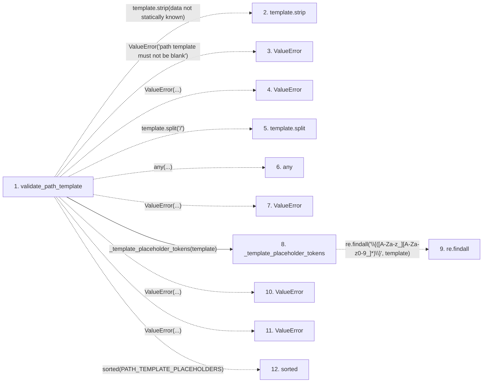

# validate_path_template

**Entry point:** `validate_path_template` (`api`)
**Source:** [skill_paths](../modules/skill_paths.md)
**Modules touched:** [skill_paths](../modules/skill_paths.md)

## Call sequence

> Static overview in presentation order, not runtime execution order. Arrows retain captured callers; representative internal continuations and boundary examples precede repeated helper detail.

<!-- Auto-generated from static call edges. Dashed arrows are external or unresolved calls. Reviewed runtime conditions and side effects belong in Behavior. -->

> Call sequence diagram shows 11 of 11 interactions; 0 omitted to keep the visualization within the 30-interaction and generated-diagram limits, with uncertain identities omitted rather than inferred.

> Captured boundary calls: external 8 of 8 (0 omitted); unresolved 2 of 2 (0 omitted). These counts cover the captured static trace.
> Detailed flow queries retain their own coverage and limits; omitted paths may execute at runtime.

## Data flow

<!-- Auto-generated static analysis. Treat values and boundaries as best-effort hints, not runtime proof. -->

### Step data

| Step | Inputs | Reads | Writes | Returns |
|---|---|---|---|---|
| `validate_path_template` | `template: str`, `allowed: frozenset[str]` | `PATH_TEMPLATE_PLACEHOLDERS`, `PATH_TEMPLATE_PLACEHOLDERS` | - | - |
| `template.strip` | - | - | - | - |
| `ValueError` | - | - | - | - |
| `ValueError` | - | - | - | - |
| `template.split` | - | - | - | - |
| `any` | - | - | - | - |
| `ValueError` | - | - | - | - |
| `_template_placeholder_tokens` | `template: str` | - | - | `re.findall(...)` |
| `re.findall` | - | - | - | - |
| `ValueError` | - | - | - | - |
| `ValueError` | - | - | - | - |
| `sorted` | - | - | - | - |

### Call data

| From | To | Line | Call |
|---|---|---:|---|
| validate_path_template | template.strip | 69 | `template.strip(data not statically known)` |
| validate_path_template | ValueError | 70 | `ValueError('path template must not be blank')` |
| validate_path_template | ValueError | 72 | `ValueError(...)` |
| validate_path_template | template.split | 75 | `template.split('/')` |
| validate_path_template | any | 76 | `any(...)` |
| validate_path_template | ValueError | 77 | `ValueError(...)` |
| validate_path_template | _template_placeholder_tokens | 78 | `_template_placeholder_tokens(template)` |
| _template_placeholder_tokens | re.findall | 119 | `re.findall('\\{([A-Za-z_][A-Za-z0-9_]*)\\}', template)` |
| validate_path_template | ValueError | 81 | `ValueError(...)` |
| validate_path_template | ValueError | 85 | `ValueError(...)` |
| validate_path_template | sorted | 88 | `sorted(PATH_TEMPLATE_PLACEHOLDERS)` |

### Boundary effects

*No boundary effects detected.*

### Static analysis gaps

| Kind | Step | Target | Line |
|---|---|---|---:|
| unresolved_call | `validate_path_template` | `template.strip` | 69 |
| external_call | `validate_path_template` | `ValueError` | 70 |
| external_call | `validate_path_template` | `ValueError` | 72 |
| unresolved_call | `validate_path_template` | `template.split` | 75 |
| external_call | `validate_path_template` | `any` | 76 |
| external_call | `validate_path_template` | `ValueError` | 77 |
| external_call | `_template_placeholder_tokens` | `re.findall` | 119 |
| external_call | `validate_path_template` | `ValueError` | 81 |
| external_call | `validate_path_template` | `ValueError` | 85 |
| external_call | `validate_path_template` | `sorted` | 88 |

## Behavior

This flow starts at `validate_path_template` and is classified as `api`. The generated call and data-flow sections are bounded static projections; runtime conditions and side effects require source-level confirmation.
