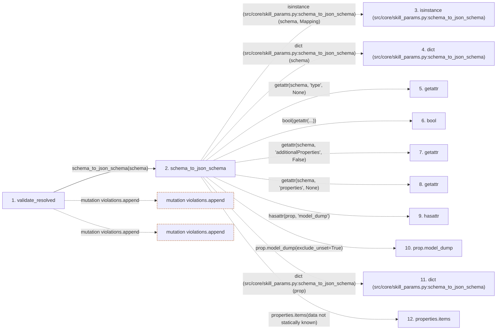

# validate_resolved

**Entry point:** `validate_resolved` (`api`)
**Source:** [skill_params](../modules/skill_params.md)
**Modules touched:** [skill_params](../modules/skill_params.md)

## Call sequence

> Static overview in presentation order, not runtime execution order. Arrows retain captured callers; representative internal continuations and boundary examples precede repeated helper detail.

```mermaid
sequenceDiagram
    participant p0 as validate_resolved
    participant p1 as schema_to_json_schema
    participant p2 as Draft202012Validator
    participant p3 as document.get
    participant p4 as violations.append
    participant p5 as sorted
    participant p6 as validator.iter_errors
    participant p7 as dict (src/core/skill_params.py:validate_resolved)
    participant p8 as list (src/core/skill_params.py:validate_resolved)
    participant p9 as _field_address
    participant p10 as isinstance (src/core/skill_params.py:schema_to_json_schema)
    participant p11 as isinstance (src/core/skill_params.py:_field_address)
    participant p12 as dict (src/core/skill_params.py:schema_to_json_schema)
    participant p13 as parts.append
    participant p14 as getattr
    participant p15 as bool
    participant p16 as ''.join
    participant p17 as hasattr
    participant p18 as prop.model_dump
    participant p19 as properties.items
    participant p20 as list (src/core/skill_params.py:schema_to_json_schema)
    participant p21 as (…).items
    participant p22 as out.setdefault
    p0->>p1: schema_to_json_schema
    p0-->>p2: Draft202012Validator(document)
    p0-->>p3: document.get('properties')
    p0-->>p3: document.get('additionalProperties')
    p0-->>p4: violations.append({...})
    p0-->>p5: sorted(validator.iter_errors(...), key=...)
    p0-->>p6: validator.iter_errors(dict(...))
    p0-->>p7: dict (src/core/skill_params.py:validate_resolved)(resolved)
    p0-->>p8: list (src/core/skill_params.py:validate_resolved)(e.absolute_path)
    p0-->>p4: violations.append({...})
    p0->>p9: _field_address
    p1-->>p10: isinstance (src/core/skill_params.py:schema_to_json_schema)(schema, Mapping)
    p9-->>p11: isinstance (src/core/skill_params.py:_field_address)(part, int)
    p1-->>p12: dict (src/core/skill_params.py:schema_to_json_schema)(schema)
    p9-->>p13: parts.append(...)
    p1-->>p14: getattr(schema, 'type', None)
    p9-->>p13: parts.append(...)
    p1-->>p15: bool(getattr(...))
    p9-->>p16: ''.join(parts)
    p1-->>p14: getattr(schema, 'additionalProperties', False)
    p1-->>p14: getattr(schema, 'properties', None)
    p1-->>p17: hasattr(prop, 'model_dump')
    p1-->>p18: prop.model_dump(exclude_unset=True)
    p1-->>p12: dict (src/core/skill_params.py:schema_to_json_schema)(prop)
    p1-->>p19: properties.items
    p1-->>p14: getattr(schema, 'required', None)
    p1-->>p20: list (src/core/skill_params.py:schema_to_json_schema)(required)
    p1-->>p21: (…).items
    p1-->>p14: getattr(schema, 'model_extra', None)
    p1-->>p22: out.setdefault(key, value)
```

<!-- Auto-generated from static call edges. Dashed arrows are external or unresolved calls. Reviewed runtime conditions and side effects belong in Behavior. -->

> Call sequence diagram shows 30 of 30 interactions; 0 omitted to keep the visualization within the 30-interaction and generated-diagram limits, with uncertain identities omitted rather than inferred.

> Captured boundary calls: external 16 of 16 (0 omitted); unresolved 12 of 12 (0 omitted). These counts cover the captured static trace.
> Detailed flow queries retain their own coverage and limits; omitted paths may execute at runtime.

## Data flow

<!-- Auto-generated static analysis. Treat values and boundaries as best-effort hints, not runtime proof. -->

### Step data

| Step | Inputs | Reads | Writes | Returns |
|---|---|---|---|---|
| `validate_resolved` | `skill_id: str`, `schema: Any`, `resolved: Mapping[str, Any]` | - | - | `violations` |
| `schema_to_json_schema` | `schema: Any` | `Mapping` | `out[...]`, `out[...]` | `dict(...)`, `out` |
| `isinstance (src/core/skill_params.py:schema_to_json_schema)` | - | - | - | - |
| `dict (src/core/skill_params.py:schema_to_json_schema)` | - | - | - | - |
| `getattr` | - | - | - | - |
| `bool` | - | - | - | - |
| `getattr` | - | - | - | - |
| `getattr` | - | - | - | - |
| `hasattr` | - | - | - | - |
| `prop.model_dump` | - | - | - | - |
| `dict (src/core/skill_params.py:schema_to_json_schema)` | - | - | - | - |
| `properties.items` | - | - | - | - |

### Call data

| From | To | Line | Call |
|---|---|---:|---|
| validate_resolved | schema_to_json_schema | 140 | `schema_to_json_schema(schema)` |
| schema_to_json_schema | isinstance (src/core/skill_params.py:schema_to_json_schema) | 54 | `isinstance(schema, Mapping)` |
| schema_to_json_schema | dict (src/core/skill_params.py:schema_to_json_schema) | 55 | `dict(schema)` |
| schema_to_json_schema | getattr | 57 | `getattr(schema, 'type', None)` |
| schema_to_json_schema | bool | 58 | `bool(getattr(...))` |
| schema_to_json_schema | getattr | 58 | `getattr(schema, 'additionalProperties', False)` |
| schema_to_json_schema | getattr | 60 | `getattr(schema, 'properties', None)` |
| schema_to_json_schema | hasattr | 64 | `hasattr(prop, 'model_dump')` |
| schema_to_json_schema | prop.model_dump | 63 | `prop.model_dump(exclude_unset=True)` |
| schema_to_json_schema | dict (src/core/skill_params.py:schema_to_json_schema) | 64 | `dict(prop)` |
| schema_to_json_schema | properties.items | 65 | `properties.items(data not statically known)` |

### Boundary effects

| Kind | Target | Step | Line |
|---|---|---|---:|
| mutation | `violations.append` | `validate_resolved` | 147 |
| mutation | `violations.append` | `validate_resolved` | 154 |

### Static analysis gaps

| Kind | Step | Target | Line |
|---|---|---|---:|
| external_call | `schema_to_json_schema` | `isinstance` | 54 |
| external_call | `schema_to_json_schema` | `getattr` | 57 |
| external_call | `schema_to_json_schema` | `getattr` | 58 |
| external_call | `schema_to_json_schema` | `getattr` | 60 |
| external_call | `schema_to_json_schema` | `hasattr` | 64 |
| unresolved_call | `schema_to_json_schema` | `prop.model_dump` | 63 |
| unresolved_call | `schema_to_json_schema` | `properties.items` | 65 |
| step_limit | `validate_resolved` | `first 12 steps` | 0 |

## Behavior

This flow starts at `validate_resolved` and is classified as `api`. The generated call and data-flow sections are bounded static projections; runtime conditions and side effects require source-level confirmation.
