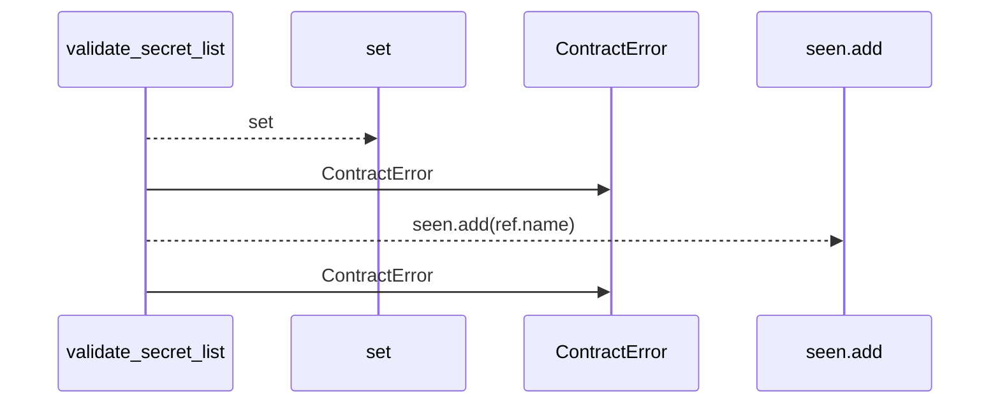
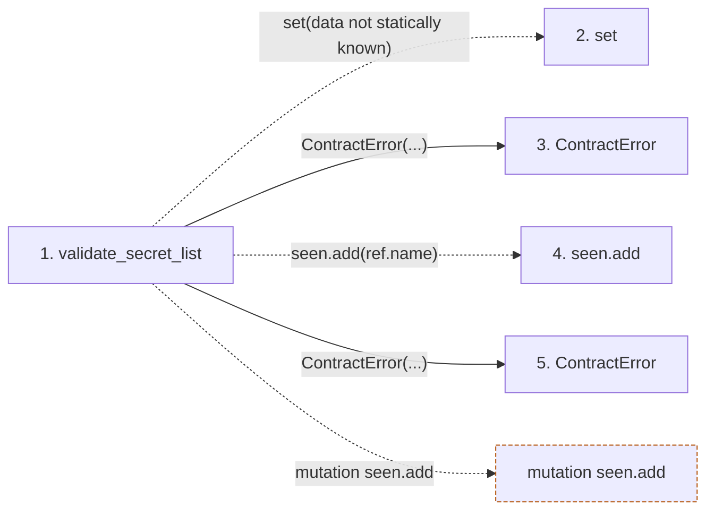

# validate_secret_list

**Entry point:** `validate_secret_list` (`api`)
**Source:** [execution_contracts](../modules/execution_contracts.md)
**Modules touched:** [execution_contracts](../modules/execution_contracts.md)

## Call sequence

> Static overview in presentation order, not runtime execution order. Arrows retain captured callers; representative internal continuations and boundary examples precede repeated helper detail.

<!-- Auto-generated from static call edges. Dashed arrows are external or unresolved calls. Reviewed runtime conditions and side effects belong in Behavior. -->

> Call sequence diagram shows 4 of 4 interactions; 0 omitted to keep the visualization within the 30-interaction and generated-diagram limits, with uncertain identities omitted rather than inferred.

> Captured boundary calls: external 1 of 1 (0 omitted); unresolved 1 of 1 (0 omitted). These counts cover the captured static trace.
> Detailed flow queries retain their own coverage and limits; omitted paths may execute at runtime.

## Data flow

<!-- Auto-generated static analysis. Treat values and boundaries as best-effort hints, not runtime proof. -->

### Step data

| Step | Inputs | Reads | Writes | Returns |
|---|---|---|---|---|
| `validate_secret_list` | `secrets: list[SecretReference]`, `integration: str` | - | - | - |
| `set` | - | - | - | - |
| `ContractError` | - | - | - | - |
| `seen.add` | - | - | - | - |
| `ContractError` | - | - | - | - |

### Call data

| From | To | Line | Call |
|---|---|---:|---|
| validate_secret_list | set | 199 | `set(data not statically known)` |
| validate_secret_list | ContractError | 202 | `ContractError(...)` |
| validate_secret_list | seen.add | 203 | `seen.add(ref.name)` |
| validate_secret_list | ContractError | 205 | `ContractError(...)` |

### Boundary effects

| Kind | Target | Step | Line |
|---|---|---|---:|
| mutation | `seen.add` | `validate_secret_list` | 203 |

### Static analysis gaps

*No static analysis gaps detected.*

## Behavior

This flow starts at `validate_secret_list` and is classified as `api`. The generated call and data-flow sections are bounded static projections; runtime conditions and side effects require source-level confirmation.
