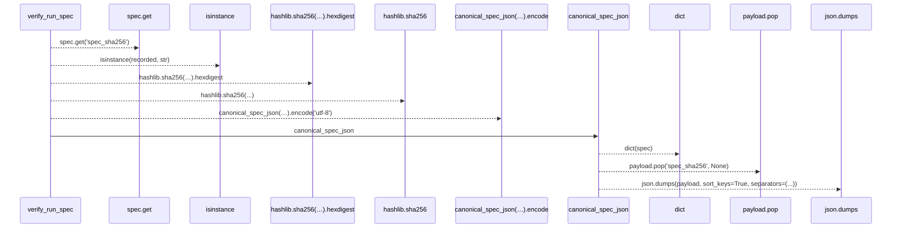
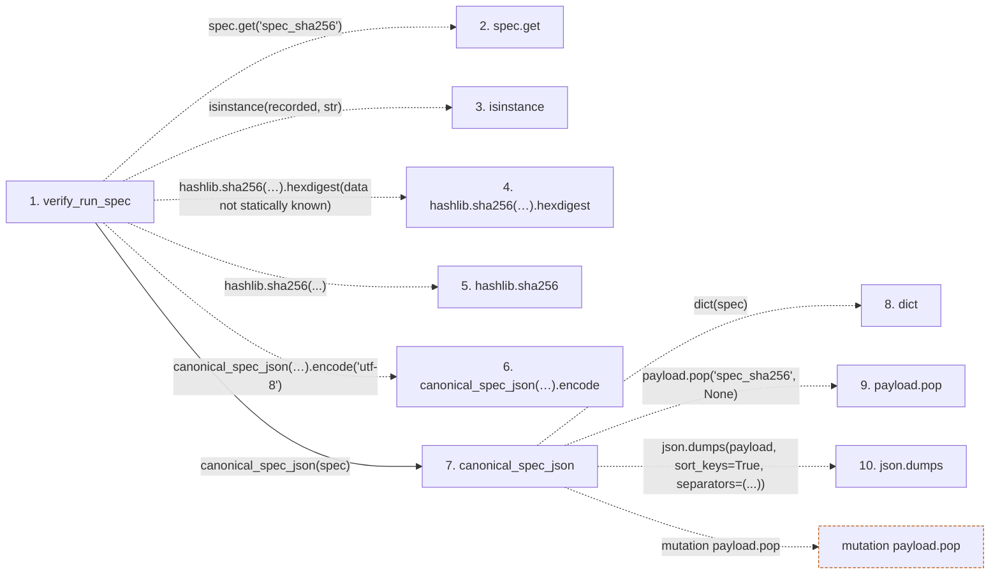

# verify_run_spec

**Entry point:** `verify_run_spec` (`api`)
**Source:** [run_spec](../modules/run_spec.md)
**Modules touched:** [run_spec](../modules/run_spec.md)

## Call sequence

> Static overview in presentation order, not runtime execution order. Arrows retain captured callers; representative internal continuations and boundary examples precede repeated helper detail.

<!-- Auto-generated from static call edges. Dashed arrows are external or unresolved calls. Reviewed runtime conditions and side effects belong in Behavior. -->

> Call sequence diagram shows 9 of 9 interactions; 0 omitted to keep the visualization within the 30-interaction and generated-diagram limits, with uncertain identities omitted rather than inferred.

> Captured boundary calls: external 4 of 4 (0 omitted); unresolved 4 of 4 (0 omitted). These counts cover the captured static trace.
> Detailed flow queries retain their own coverage and limits; omitted paths may execute at runtime.

## Data flow

<!-- Auto-generated static analysis. Treat values and boundaries as best-effort hints, not runtime proof. -->

### Step data

| Step | Inputs | Reads | Writes | Returns |
|---|---|---|---|---|
| `verify_run_spec` | `spec: Mapping[str, Any]` | - | - | `False`, `...` |
| `spec.get` | - | - | - | - |
| `isinstance` | - | - | - | - |
| `hashlib.sha256(…).hexdigest` | - | - | - | - |
| `hashlib.sha256` | - | - | - | - |
| `canonical_spec_json(…).encode` | - | - | - | - |
| `canonical_spec_json` | `spec: Mapping[str, Any]` | - | - | `json.dumps(...)` |
| `dict` | - | - | - | - |
| `payload.pop` | - | - | - | - |
| `json.dumps` | - | - | - | - |

### Call data

| From | To | Line | Call |
|---|---|---:|---|
| verify_run_spec | spec.get | 216 | `spec.get('spec_sha256')` |
| verify_run_spec | isinstance | 217 | `isinstance(recorded, str)` |
| verify_run_spec | hashlib.sha256(…).hexdigest | 219 | `hashlib.sha256(canonical_spec_json(spec).encode('utf-8')).hexdigest(data not statically known)` |
| verify_run_spec | hashlib.sha256 | 219 | `hashlib.sha256(...)` |
| verify_run_spec | canonical_spec_json(…).encode | 220 | `canonical_spec_json(spec).encode('utf-8')` |
| verify_run_spec | canonical_spec_json | 220 | `canonical_spec_json(spec)` |
| canonical_spec_json | dict | 138 | `dict(spec)` |
| canonical_spec_json | payload.pop | 139 | `payload.pop('spec_sha256', None)` |
| canonical_spec_json | json.dumps | 140 | `json.dumps(payload, sort_keys=True, separators=(...))` |

### Boundary effects

| Kind | Target | Step | Line |
|---|---|---|---:|
| mutation | `payload.pop` | `canonical_spec_json` | 139 |

### Static analysis gaps

| Kind | Step | Target | Line |
|---|---|---|---:|
| unresolved_call | `verify_run_spec` | `spec.get` | 216 |
| external_call | `verify_run_spec` | `isinstance` | 217 |
| unresolved_call | `verify_run_spec` | `hashlib.sha256(canonical_spec_json(spec).encode('utf-8')).hexdigest` | 219 |
| external_call | `verify_run_spec` | `hashlib.sha256` | 219 |
| unresolved_call | `verify_run_spec` | `canonical_spec_json(spec).encode` | 220 |
| external_call | `canonical_spec_json` | `json.dumps` | 140 |

## Behavior

This flow starts at `verify_run_spec` and is classified as `api`. The generated call and data-flow sections are bounded static projections; runtime conditions and side effects require source-level confirmation.
