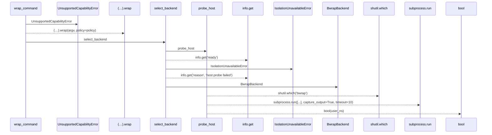
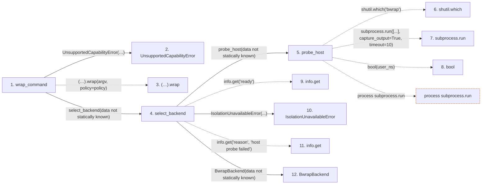

# wrap_command

**Entry point:** `wrap_command` (`api`)
**Source:** [isolation](../modules/isolation.md)
**Modules touched:** [isolation](../modules/isolation.md)

## Call sequence

> Static overview in presentation order, not runtime execution order. Arrows retain captured callers; representative internal continuations and boundary examples precede repeated helper detail.

<!-- Auto-generated from static call edges. Dashed arrows are external or unresolved calls. Reviewed runtime conditions and side effects belong in Behavior. -->

> Call sequence diagram shows 11 of 11 interactions; 0 omitted to keep the visualization within the 30-interaction and generated-diagram limits, with uncertain identities omitted rather than inferred.

> Captured boundary calls: external 3 of 3 (0 omitted); unresolved 3 of 3 (0 omitted). These counts cover the captured static trace.
> Detailed flow queries retain their own coverage and limits; omitted paths may execute at runtime.

## Data flow

<!-- Auto-generated static analysis. Treat values and boundaries as best-effort hints, not runtime proof. -->

### Step data

| Step | Inputs | Reads | Writes | Returns |
|---|---|---|---|---|
| `wrap_command` | `argv: Sequence[str]`, `policy: IsolationPolicy`, `backend: Optional[BwrapBackend]` | - | - | `...` |
| `UnsupportedCapabilityError` | - | - | - | - |
| `(…).wrap` | - | - | - | - |
| `select_backend` | - | - | - | `BwrapBackend(...)` |
| `probe_host` | `bwrap_bin: Optional[str]` | `subprocess` | `info[...]`, `info[...]`, `info[...]`, `info[...]`, `info[...]` | `info`, `info` |
| `shutil.which` | - | - | - | - |
| `subprocess.run` | - | - | - | - |
| `bool` | - | - | - | - |
| `info.get` | - | - | - | - |
| `IsolationUnavailableError` | - | - | - | - |
| `info.get` | - | - | - | - |
| `BwrapBackend` | - | - | - | - |

### Call data

| From | To | Line | Call |
|---|---|---:|---|
| wrap_command | UnsupportedCapabilityError | 209 | `UnsupportedCapabilityError('network allowlist enforcement is not available at the OS boundary on this backend; capability refused (no fallback to unrestricted egress)')` |
| wrap_command | (…).wrap | 214 | `(backend or select_backend()).wrap(argv, policy=policy)` |
| wrap_command | select_backend | 214 | `select_backend(data not statically known)` |
| select_backend | probe_host | 196 | `probe_host(data not statically known)` |
| probe_host | shutil.which | 167 | `shutil.which('bwrap')` |
| probe_host | subprocess.run | 174 | `subprocess.run([...], capture_output=True, timeout=10)` |
| probe_host | bool | 183 | `bool(user_ns)` |
| select_backend | info.get | 197 | `info.get('ready')` |
| select_backend | IsolationUnavailableError | 198 | `IsolationUnavailableError(...)` |
| select_backend | info.get | 199 | `info.get('reason', 'host probe failed')` |
| select_backend | BwrapBackend | 201 | `BwrapBackend(data not statically known)` |

### Boundary effects

| Kind | Target | Step | Line |
|---|---|---|---:|
| process | `subprocess.run` | `probe_host` | 174 |

### Static analysis gaps

| Kind | Step | Target | Line |
|---|---|---|---:|
| unresolved_call | `wrap_command` | `(backend or select_backend()).wrap` | 214 |
| external_call | `probe_host` | `shutil.which` | 167 |
| unresolved_call | `select_backend` | `info.get` | 197 |
| unresolved_call | `select_backend` | `info.get` | 199 |

## Behavior

This flow starts at `wrap_command` and is classified as `api`. The generated call and data-flow sections are bounded static projections; runtime conditions and side effects require source-level confirmation.
