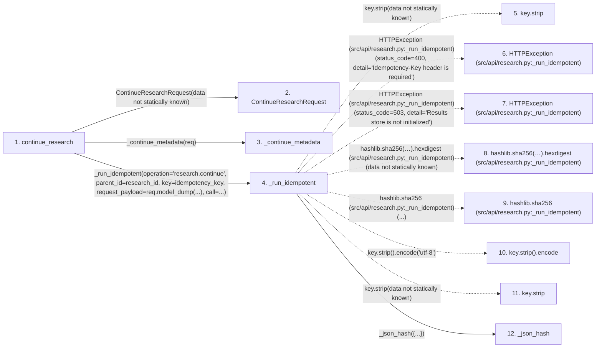

# continue_research

**Entry point:** `continue_research` (`http`)
**Source:** [research](../modules/research.md)
**Modules touched:** [audit](../modules/audit.md), [research](../modules/research.md)

## Call sequence

> Static overview in presentation order, not runtime execution order. Arrows retain captured callers; representative internal continuations and boundary examples precede repeated helper detail.

```mermaid
sequenceDiagram
    participant p0 as continue_research
    participant p1 as _run_idempotent
    participant p2 as _audit
    participant p3 as ContinueResearchRequest
    participant p4 as _continue_metadata
    participant p5 as record_api_audit_event
    participant p6 as request_metadata
    participant p7 as _json_hash
    participant p8 as _request_actor
    participant p9 as str
    participant p10 as req.model_dump
    participant p11 as _session_manager.continue_session
    participant p12 as session.get
    participant p13 as HTTPException (src/api/research.py:continue_research)
    participant p14 as key.strip
    participant p15 as HTTPException (src/api/research.py:_run_idempotent)
    participant p16 as hashlib.sha256(…).hexdigest (src/api/research.py:_run_idempotent)
    participant p17 as hashlib.sha256 (src/api/research.py:_run_idempotent)
    participant p18 as key.strip().encode
    participant p19 as _store.begin_idempotency_record
    participant p20 as existing.get
    participant p21 as json.loads
    p0->>p1: _run_idempotent
    p0->>p2: _audit
    p0->>p3: ContinueResearchRequest
    p0->>p4: _continue_metadata
    p2->>p5: record_api_audit_event
    p5->>p6: request_metadata
    p1->>p7: _json_hash
    p5->>p8: _request_actor
    p0-->>p9: str(e)
    p0-->>p10: req.model_dump(mode='json')
    p0-->>p11: _session_manager.continue_session(…)
    p0-->>p12: session.get('id')
    p0-->>p13: HTTPException (src/api/research.py:continue_research)(status_code=409, detail=str(...))
    p0-->>p9: str(e)
    p0-->>p9: str(e)
    p0-->>p13: HTTPException (src/api/research.py:continue_research)(status_code=409, detail=str(...))
    p0-->>p9: str(e)
    p1-->>p14: key.strip
    p1-->>p15: HTTPException (src/api/research.py:_run_idempotent)(status_code=400, detail='Idempotency-Key header is required')
    p1-->>p15: HTTPException (src/api/research.py:_run_idempotent)(status_code=503, detail='Results store is not initialized')
    p1-->>p16: hashlib.sha256(…).hexdigest (src/api/research.py:_run_idempotent)
    p1-->>p17: hashlib.sha256 (src/api/research.py:_run_idempotent)(...)
    p1-->>p18: key.strip().encode('utf-8')
    p1-->>p14: key.strip
    p1-->>p19: _store.begin_idempotency_record(operation=operation, parent_id=parent_id, key_hash=key_hash, request_hash=request_hash)
    p1-->>p20: existing.get('request_hash')
    p1-->>p15: HTTPException (src/api/research.py:_run_idempotent)(status_code=409, detail='Idempotency-Key was already used for a different request')
    p1-->>p20: existing.get('status')
    p1-->>p20: existing.get('response_json')
    p1-->>p21: json.loads(existing[...])
```

<!-- Auto-generated from static call edges. Dashed arrows are external or unresolved calls. Reviewed runtime conditions and side effects belong in Behavior. -->

> Call sequence diagram shows 30 of 49 interactions; 19 omitted to keep the visualization within the 30-interaction and generated-diagram limits, with uncertain identities omitted rather than inferred.

> Captured boundary calls: external 11 of 17 (6 omitted); unresolved 11 of 21 (10 omitted). These counts cover the captured static trace.

Omitted captured detail, grouped by actual caller occurrence and target module:

| Caller | Parent step | Target module | Kind | Omitted interactions |
| --- | --- | --- | --- | --- |
| `src/api/research.py:_json_hash` | 12 | - | external | 2 |
| `src/api/research.py:_json_hash` | 12 | - | unresolved | 2 |
| `src/api/research.py:_run_idempotent` | 4 | - | external | 2 |
| `src/api/research.py:_run_idempotent` | 4 | - | unresolved | 4 |
| `src/api/audit.py:_request_actor` | 33 | - | external | 2 |
| `src/api/audit.py:record_api_audit_event` | 32 | - | unresolved | 1 |
| `src/api/audit.py:request_metadata` | 37 | [src/api/audit.py](../modules/audit.md) | internal | 1 |
| `src/api/audit.py:request_metadata` | 37 | - | unresolved | 3 |
> Omission summary shows 8 of 9 groups; 1 further groups are not expanded here. Counts above include all omitted interactions.
> Detailed flow queries retain their own coverage and limits; omitted paths may execute at runtime.

## Data flow

<!-- Auto-generated static analysis. Treat values and boundaries as best-effort hints, not runtime proof. -->

### Step data

| Step | Inputs | Reads | Writes | Returns |
|---|---|---|---|---|
| `continue_research` | `request: Request`, `research_id: str`, `req: ContinueResearchRequest`, `idempotency_key: str \| None` | `SkillConfigError` | - | `session` |
| `ContinueResearchRequest` | - | - | - | - |
| `_continue_metadata` | `req: 'ContinueResearchRequest'` | - | - | `{...}` |
| `_run_idempotent` | `operation: str`, `parent_id: str`, `key: str \| None`, `request_payload: Dict[str, Any]`, `call: Callable[[], Awaitable[Dict[str, Any]]]` | `_store`, `json` | - | `json.loads(...)`, `response` |
| `key.strip` | - | - | - | - |
| `HTTPException (src/api/research.py:_run_idempotent)` | - | - | - | - |
| `HTTPException (src/api/research.py:_run_idempotent)` | - | - | - | - |
| `hashlib.sha256(…).hexdigest (src/api/research.py:_run_idempotent)` | - | - | - | - |
| `hashlib.sha256 (src/api/research.py:_run_idempotent)` | - | - | - | - |
| `key.strip().encode` | - | - | - | - |
| `key.strip` | - | - | - | - |
| `_json_hash` | `payload: Any` | - | - | `...` |

### Call data

| From | To | Line | Call |
|---|---|---:|---|
| continue_research | ContinueResearchRequest | 918 | `ContinueResearchRequest(data not statically known)` |
| continue_research | _continue_metadata | 919 | `_continue_metadata(req)` |
| continue_research | _run_idempotent | 921 | `_run_idempotent(operation='research.continue', parent_id=research_id, key=idempotency_key, request_payload=req.model_dump(...), call=...)` |
| _run_idempotent | key.strip | 407 | `key.strip(data not statically known)` |
| _run_idempotent | HTTPException (src/api/research.py:_run_idempotent) | 408 | `HTTPException(status_code=400, detail='Idempotency-Key header is required')` |
| _run_idempotent | HTTPException (src/api/research.py:_run_idempotent) | 410 | `HTTPException(status_code=503, detail='Results store is not initialized')` |
| _run_idempotent | hashlib.sha256(…).hexdigest (src/api/research.py:_run_idempotent) | 412 | `hashlib.sha256(key.strip().encode('utf-8')).hexdigest(data not statically known)` |
| _run_idempotent | hashlib.sha256 (src/api/research.py:_run_idempotent) | 412 | `hashlib.sha256(...)` |
| _run_idempotent | key.strip().encode | 412 | `key.strip().encode('utf-8')` |
| _run_idempotent | key.strip | 412 | `key.strip(data not statically known)` |
| _run_idempotent | _json_hash | 413 | `_json_hash({...})` |

### Boundary effects

*No boundary effects detected.*

### Static analysis gaps

| Kind | Step | Target | Line |
|---|---|---|---:|
| unresolved_call | `_run_idempotent` | `key.strip` | 407 |
| external_call | `_run_idempotent` | `HTTPException` | 408 |
| external_call | `_run_idempotent` | `HTTPException` | 410 |
| unresolved_call | `_run_idempotent` | `hashlib.sha256(key.strip().encode('utf-8')).hexdigest` | 412 |
| external_call | `_run_idempotent` | `hashlib.sha256` | 412 |
| unresolved_call | `_run_idempotent` | `key.strip().encode` | 412 |
| unresolved_call | `_run_idempotent` | `key.strip` | 412 |
| step_limit | `continue_research` | `first 12 steps` | 0 |

## Behavior

This flow starts at `continue_research` and is classified as `http`. The generated call and data-flow sections are bounded static projections; runtime conditions and side effects require source-level confirmation.
