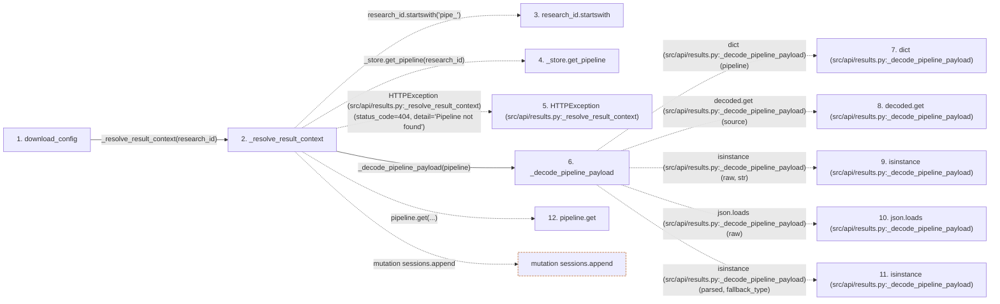

# download_config

**Entry point:** `download_config` (`http`)
**Source:** [results](../modules/results.md)
**Modules touched:** [results](../modules/results.md)

## Call sequence

> Static overview in presentation order, not runtime execution order. Arrows retain captured callers; representative internal continuations and boundary examples precede repeated helper detail.

```mermaid
sequenceDiagram
    participant p0 as download_config
    participant p1 as _resolve_result_context
    participant p2 as _resolve_workspace_file
    participant p3 as _decode_pipeline_payload
    participant p4 as _decode_session_payload
    participant p5 as HTTPException (src/api/results.py:download_config)
    participant p6 as session.get
    participant p7 as config_path.exists
    participant p8 as FileResponse
    participant p9 as str (src/api/results.py:download_config)
    participant p10 as research_id.startswith
    participant p11 as Path(…).resolve
    participant p12 as _store.get_pipeline
    participant p13 as Path
    participant p14 as HTTPException (src/api/results.py:_resolve_result_context)
    participant p15 as (…).resolve
    participant p16 as str(…).startswith
    participant p17 as pipeline.get
    participant p18 as str (src/api/results.py:_resolve_workspace_file)
    participant p19 as _store.get_session
    participant p20 as dict (src/api/results.py:_resolve_result_context)
    participant p21 as HTTPException (src/api/results.py:_resolve_workspace_file)
    participant p22 as sessions.append
    participant p23 as next
    participant p24 as s.get
    p0->>p1: _resolve_result_context
    p0->>p2: _resolve_workspace_file
    p1->>p3: _decode_pipeline_payload
    p1->>p4: _decode_session_payload
    p0-->>p5: HTTPException (src/api/results.py:download_config)(status_code=404, detail='Phase session not found yet')
    p0-->>p6: session.get('workspace_path', '')
    p0-->>p7: config_path.exists
    p0-->>p7: config_path.exists
    p0-->>p5: HTTPException (src/api/results.py:download_config)(status_code=404, detail='No config file found in workspace')
    p0-->>p6: session.get('instrument', 'unknown')
    p0-->>p6: session.get('model_type', 'model')
    p0-->>p8: FileResponse(path=str(...), media_type='application/x-yaml', filename=filename)
    p0-->>p9: str (src/api/results.py:download_config)(config_path)
    p1-->>p10: research_id.startswith('pipe_')
    p2-->>p11: Path(…).resolve
    p1-->>p12: _store.get_pipeline(research_id)
    p2-->>p13: Path(workspace)
    p1-->>p14: HTTPException (src/api/results.py:_resolve_result_context)(status_code=404, detail='Pipeline not found')
    p2-->>p15: (…).resolve
    p2-->>p16: str(…).startswith(str(...))
    p1-->>p17: pipeline.get(...)
    p2-->>p18: str (src/api/results.py:_resolve_workspace_file)(target)
    p1-->>p19: _store.get_session(session_id)
    p2-->>p18: str (src/api/results.py:_resolve_workspace_file)(base)
    p1-->>p20: dict (src/api/results.py:_resolve_result_context)(session)
    p2-->>p21: HTTPException (src/api/results.py:_resolve_workspace_file)(status_code=400, detail='Invalid file path')
    p1-->>p22: sessions.append(session)
    p1-->>p17: pipeline.get('current_phase')
    p1-->>p23: next(..., None)
    p1-->>p24: s.get('pipeline_phase')
```

<!-- Auto-generated from static call edges. Dashed arrows are external or unresolved calls. Reviewed runtime conditions and side effects belong in Behavior. -->

> Call sequence diagram shows 30 of 43 interactions; 13 omitted to keep the visualization within the 30-interaction and generated-diagram limits, with uncertain identities omitted rather than inferred.

> Captured boundary calls: external 11 of 20 (9 omitted); unresolved 15 of 18 (3 omitted). These counts cover the captured static trace.

Omitted captured detail, grouped by actual caller occurrence and target module:

| Caller | Parent step | Target module | Kind | Omitted interactions |
| --- | --- | --- | --- | --- |
| `src/api/results.py:_decode_pipeline_payload` | 6 | - | external | 4 |
| `src/api/results.py:_decode_pipeline_payload` | 6 | - | unresolved | 1 |
| `src/api/results.py:_resolve_result_context` | 2 | - | unresolved | 1 |
| `src/api/results.py:_resolve_result_context` | 2 | - | external | 1 |
| `src/api/results.py:_decode_session_payload` | 21 | - | external | 4 |
| `src/api/results.py:_decode_session_payload` | 21 | - | unresolved | 1 |
| `src/api/results.py:download_config` | 1 | [src/api/results.py](../modules/results.md) | internal | 1 |
> Detailed flow queries retain their own coverage and limits; omitted paths may execute at runtime.

## Data flow

<!-- Auto-generated static analysis. Treat values and boundaries as best-effort hints, not runtime proof. -->

### Step data

| Step | Inputs | Reads | Writes | Returns |
|---|---|---|---|---|
| `download_config` | `research_id: str` | - | - | `FileResponse(...)` |
| `_resolve_result_context` | `research_id: str` | `_PIPELINE_PHASES` | `session[...]` | `(...)`, `(...)`, `(...)` |
| `research_id.startswith` | - | - | - | - |
| `_store.get_pipeline` | - | - | - | - |
| `HTTPException (src/api/results.py:_resolve_result_context)` | - | - | - | - |
| `_decode_pipeline_payload` | `pipeline: Dict[str, Any]` | `json` | `decoded[...]` | `decoded` |
| `dict (src/api/results.py:_decode_pipeline_payload)` | - | - | - | - |
| `decoded.get (src/api/results.py:_decode_pipeline_payload)` | - | - | - | - |
| `isinstance (src/api/results.py:_decode_pipeline_payload)` | - | - | - | - |
| `json.loads (src/api/results.py:_decode_pipeline_payload)` | - | - | - | - |
| `isinstance (src/api/results.py:_decode_pipeline_payload)` | - | - | - | - |
| `pipeline.get` | - | - | - | - |

### Call data

| From | To | Line | Call |
|---|---|---:|---|
| download_config | _resolve_result_context | 667 | `_resolve_result_context(research_id)` |
| _resolve_result_context | research_id.startswith | 342 | `research_id.startswith('pipe_')` |
| _resolve_result_context | _store.get_pipeline | 343 | `_store.get_pipeline(research_id)` |
| _resolve_result_context | HTTPException (src/api/results.py:_resolve_result_context) | 345 | `HTTPException(status_code=404, detail='Pipeline not found')` |
| _resolve_result_context | _decode_pipeline_payload | 346 | `_decode_pipeline_payload(pipeline)` |
| _decode_pipeline_payload | dict (src/api/results.py:_decode_pipeline_payload) | 56 | `dict(pipeline)` |
| _decode_pipeline_payload | decoded.get (src/api/results.py:_decode_pipeline_payload) | 63 | `decoded.get(source)` |
| _decode_pipeline_payload | isinstance (src/api/results.py:_decode_pipeline_payload) | 67 | `isinstance(raw, str)` |
| _decode_pipeline_payload | json.loads (src/api/results.py:_decode_pipeline_payload) | 67 | `json.loads(raw)` |
| _decode_pipeline_payload | isinstance (src/api/results.py:_decode_pipeline_payload) | 70 | `isinstance(parsed, fallback_type)` |
| _resolve_result_context | pipeline.get | 350 | `pipeline.get(...)` |

### Boundary effects

| Kind | Target | Step | Line |
|---|---|---|---:|
| mutation | `sessions.append` | `_resolve_result_context` | 358 |

### Static analysis gaps

| Kind | Step | Target | Line |
|---|---|---|---:|
| unresolved_call | `_resolve_result_context` | `research_id.startswith` | 342 |
| unresolved_call | `_resolve_result_context` | `_store.get_pipeline` | 343 |
| external_call | `_resolve_result_context` | `HTTPException` | 345 |
| unresolved_call | `_decode_pipeline_payload` | `decoded.get` | 63 |
| external_call | `_decode_pipeline_payload` | `isinstance` | 67 |
| external_call | `_decode_pipeline_payload` | `json.loads` | 67 |
| external_call | `_decode_pipeline_payload` | `isinstance` | 70 |
| unresolved_call | `_resolve_result_context` | `pipeline.get` | 350 |
| step_limit | `download_config` | `first 12 steps` | 0 |

## Behavior

This flow starts at `download_config` and is classified as `http`. The generated call and data-flow sections are bounded static projections; runtime conditions and side effects require source-level confirmation.
