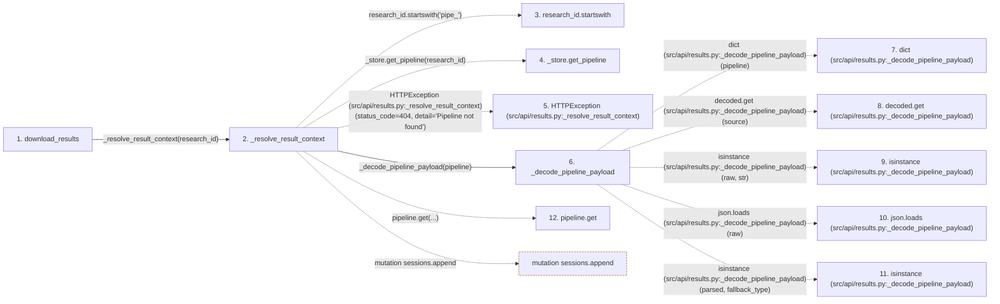

# download_results

**Entry point:** `download_results` (`http`)
**Source:** [results](../modules/results.md)
**Modules touched:** [artifact_reference](../modules/artifact_reference.md), [compat_legacy_alias](../modules/compat_legacy_alias.md), [consistency_validator](../modules/consistency_validator.md), and 3 more

**Complete modules touched:**

- [artifact_reference](../modules/artifact_reference.md)
- [compat_legacy_alias](../modules/compat_legacy_alias.md)
- [consistency_validator](../modules/consistency_validator.md)
- [gate_status](../modules/gate_status.md)
- [ml_enrichment](../modules/ml_enrichment.md)
- [results](../modules/results.md)

## Call sequence

> Static overview in presentation order, not runtime execution order. Arrows retain captured callers; representative internal continuations and boundary examples precede repeated helper detail.

```mermaid
sequenceDiagram
    participant p0 as download_results
    participant p1 as _resolve_result_context
    participant p2 as _enrich_iterations
    participant p3 as _enrich_iteration
    participant p4 as training_gates_passed_from
    participant p5 as first_valid_artifact_ref
    participant p6 as build_consistency_report
    participant p7 as _rl_economic_replay_summary
    participant p8 as _feature_readiness_metrics
    participant p9 as _rl_economic_replay_payload
    participant p10 as _adaptive_schema_flags_blocker
    participant p11 as _rl_channel_provenance
    participant p12 as _rl_feature_bundle_hash
    participant p13 as _rl_nested_validation_present
    participant p14 as _rl_multi_seed_present
    participant p15 as _rl_required_metrics_present
    participant p16 as _rl_unsafe_feature_provenance
    participant p17 as _rl_replay_assumptions_present
    participant p18 as _rl_replay_worse_than_baseline
    participant p19 as check_adaptive_feature_sweep
    participant p20 as check_evidence_artifact
    participant p21 as _adaptive_feature_evidence
    participant p22 as _rl_metric_value
    participant p23 as _feature_schema_flags
    participant p24 as _decode_pipeline_payload
    participant p25 as _decode_session_payload
    participant p26 as parse_consistency_report
    participant p27 as _rl_economic_replay
    participant p28 as model_type_to_skill_id
    participant p29 as HTTPException (src/api/results.py:download_results)
    participant p30 as _store.get_iterations
    p0->>p1: _resolve_result_context
    p0->>p2: _enrich_iterations
    p2->>p3: _enrich_iteration
    p3->>p4: training_gates_passed_from
    p3->>p5: first_valid_artifact_ref
    p3->>p6: build_consistency_report
    p3->>p7: _rl_economic_replay_summary
    p3->>p8: _feature_readiness_metrics
    p6->>p9: _rl_economic_replay_payload
    p6->>p10: _adaptive_schema_flags_blocker
    p6->>p11: _rl_channel_provenance
    p6->>p12: _rl_feature_bundle_hash
    p6->>p13: _rl_nested_validation_present
    p6->>p14: _rl_multi_seed_present
    p6->>p15: _rl_required_metrics_present
    p6->>p16: _rl_unsafe_feature_provenance
    p6->>p17: _rl_replay_assumptions_present
    p6->>p18: _rl_replay_worse_than_baseline
    p6->>p19: check_adaptive_feature_sweep
    p6->>p20: check_evidence_artifact
    p10->>p21: _adaptive_feature_evidence
    p15->>p22: _rl_metric_value
    p10->>p23: _feature_schema_flags
    p1->>p24: _decode_pipeline_payload
    p1->>p25: _decode_session_payload
    p3->>p26: parse_consistency_report
    p3->>p27: _rl_economic_replay
    p3->>p28: model_type_to_skill_id
    p0-->>p29: HTTPException (src/api/results.py:download_results)(status_code=404, detail='Phase session not found yet')
    p0-->>p30: _store.get_iterations(session[...])
```

<!-- Auto-generated from static call edges. Dashed arrows are external or unresolved calls. Reviewed runtime conditions and side effects belong in Behavior. -->

> Call sequence diagram shows 30 of 582 interactions; 552 omitted to keep the visualization within the 30-interaction and generated-diagram limits, with uncertain identities omitted rather than inferred.

> Captured boundary calls: external 1 of 116 (115 omitted); unresolved 1 of 348 (347 omitted). These counts cover the captured static trace.

Omitted captured detail, grouped by actual caller occurrence and target module:

| Caller | Parent step | Target module | Kind | Omitted interactions |
| --- | --- | --- | --- | --- |
| `src/api/results.py:_resolve_result_context` | 2 | - | unresolved | 8 |
| `src/api/results.py:_resolve_result_context` | 2 | - | external | 4 |
| `src/api/results.py:_decode_pipeline_payload` | 6 | - | external | 4 |
| `src/api/results.py:_decode_pipeline_payload` | 6 | - | unresolved | 1 |
| `src/api/results.py:_decode_session_payload` | 21 | - | external | 4 |
| `src/api/results.py:_decode_session_payload` | 21 | - | unresolved | 1 |
| `src/api/results.py:download_results` | 1 | - | unresolved | 3 |
| `src/api/results.py:_enrich_iteration` | 31 | - | external | 15 |
> Omission summary shows 8 of 94 groups; 86 further groups are not expanded here. Counts above include all omitted interactions.
> Detailed flow queries retain their own coverage and limits; omitted paths may execute at runtime.

> Trace truncated at the depth limit; deeper calls are omitted.

## Data flow

<!-- Auto-generated static analysis. Treat values and boundaries as best-effort hints, not runtime proof. -->

### Step data

| Step | Inputs | Reads | Writes | Returns |
|---|---|---|---|---|
| `download_results` | `research_id: str` | - | - | `Response(...)` |
| `_resolve_result_context` | `research_id: str` | `_PIPELINE_PHASES` | `session[...]` | `(...)`, `(...)`, `(...)` |
| `research_id.startswith` | - | - | - | - |
| `_store.get_pipeline` | - | - | - | - |
| `HTTPException (src/api/results.py:_resolve_result_context)` | - | - | - | - |
| `_decode_pipeline_payload` | `pipeline: Dict[str, Any]` | `json` | `decoded[...]` | `decoded` |
| `dict (src/api/results.py:_decode_pipeline_payload)` | - | - | - | - |
| `decoded.get (src/api/results.py:_decode_pipeline_payload)` | - | - | - | - |
| `isinstance (src/api/results.py:_decode_pipeline_payload)` | - | - | - | - |
| `json.loads (src/api/results.py:_decode_pipeline_payload)` | - | - | - | - |
| `isinstance (src/api/results.py:_decode_pipeline_payload)` | - | - | - | - |
| `pipeline.get` | - | - | - | - |

### Call data

| From | To | Line | Call |
|---|---|---:|---|
| download_results | _resolve_result_context | 728 | `_resolve_result_context(research_id)` |
| _resolve_result_context | research_id.startswith | 346 | `research_id.startswith('pipe_')` |
| _resolve_result_context | _store.get_pipeline | 347 | `_store.get_pipeline(research_id)` |
| _resolve_result_context | HTTPException (src/api/results.py:_resolve_result_context) | 349 | `HTTPException(status_code=404, detail='Pipeline not found')` |
| _resolve_result_context | _decode_pipeline_payload | 350 | `_decode_pipeline_payload(pipeline)` |
| _decode_pipeline_payload | dict (src/api/results.py:_decode_pipeline_payload) | 60 | `dict(pipeline)` |
| _decode_pipeline_payload | decoded.get (src/api/results.py:_decode_pipeline_payload) | 67 | `decoded.get(source)` |
| _decode_pipeline_payload | isinstance (src/api/results.py:_decode_pipeline_payload) | 71 | `isinstance(raw, str)` |
| _decode_pipeline_payload | json.loads (src/api/results.py:_decode_pipeline_payload) | 71 | `json.loads(raw)` |
| _decode_pipeline_payload | isinstance (src/api/results.py:_decode_pipeline_payload) | 74 | `isinstance(parsed, fallback_type)` |
| _resolve_result_context | pipeline.get | 354 | `pipeline.get(...)` |

### Boundary effects

| Kind | Target | Step | Line |
|---|---|---|---:|
| mutation | `sessions.append` | `_resolve_result_context` | 362 |

### Static analysis gaps

| Kind | Step | Target | Line |
|---|---|---|---:|
| unresolved_call | `_resolve_result_context` | `research_id.startswith` | 346 |
| unresolved_call | `_resolve_result_context` | `_store.get_pipeline` | 347 |
| external_call | `_resolve_result_context` | `HTTPException` | 349 |
| unresolved_call | `_decode_pipeline_payload` | `decoded.get` | 67 |
| external_call | `_decode_pipeline_payload` | `isinstance` | 71 |
| external_call | `_decode_pipeline_payload` | `json.loads` | 71 |
| external_call | `_decode_pipeline_payload` | `isinstance` | 74 |
| unresolved_call | `_resolve_result_context` | `pipeline.get` | 354 |
| step_limit | `download_results` | `first 12 steps` | 0 |
| truncated_flow | `download_results` | `depth limit` | 0 |

## Behavior

This flow starts at `download_results` and is classified as `http`. The generated call and data-flow sections are bounded static projections; runtime conditions and side effects require source-level confirmation.
