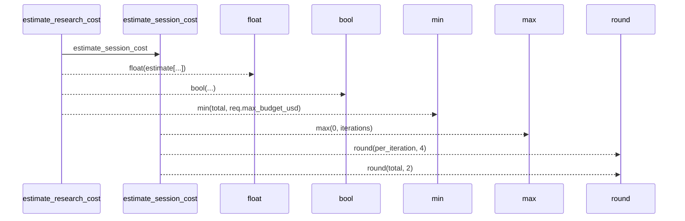
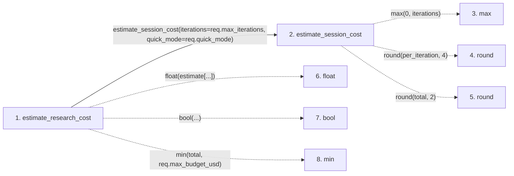

# estimate_research_cost

**Entry point:** `estimate_research_cost` (`http`)
**Source:** [research](../modules/research.md)
**Modules touched:** [llm_provider](../modules/llm_provider.md), [research](../modules/research.md)

## Call sequence

> Static overview in presentation order, not runtime execution order. Arrows retain captured callers; representative internal continuations and boundary examples precede repeated helper detail.

<!-- Auto-generated from static call edges. Dashed arrows are external or unresolved calls. Reviewed runtime conditions and side effects belong in Behavior. -->

> Call sequence diagram shows 7 of 7 interactions; 0 omitted to keep the visualization within the 30-interaction and generated-diagram limits, with uncertain identities omitted rather than inferred.

> Captured boundary calls: external 6 of 6 (0 omitted); unresolved 0 of 0 (0 omitted). These counts cover the captured static trace.
> Detailed flow queries retain their own coverage and limits; omitted paths may execute at runtime.

## Data flow

<!-- Auto-generated static analysis. Treat values and boundaries as best-effort hints, not runtime proof. -->

### Step data

| Step | Inputs | Reads | Writes | Returns |
|---|---|---|---|---|
| `estimate_research_cost` | `req: EstimateCostRequest` | - | - | `{...}` |
| `estimate_session_cost` | `iterations: int`, `quick_mode: bool`, `input_rate: float`, `output_rate: float` | - | - | `{...}` |
| `max` | - | - | - | - |
| `round` | - | - | - | - |
| `round` | - | - | - | - |
| `float` | - | - | - | - |
| `bool` | - | - | - | - |
| `min` | - | - | - | - |

### Call data

| From | To | Line | Call |
|---|---|---:|---|
| estimate_research_cost | estimate_session_cost | 577 | `estimate_session_cost(iterations=req.max_iterations, quick_mode=req.quick_mode)` |
| estimate_session_cost | max | 101 | `max(0, iterations)` |
| estimate_session_cost | round | 103 | `round(per_iteration, 4)` |
| estimate_session_cost | round | 104 | `round(total, 2)` |
| estimate_research_cost | float | 580 | `float(estimate[...])` |
| estimate_research_cost | bool | 581 | `bool(...)` |
| estimate_research_cost | min | 586 | `min(total, req.max_budget_usd)` |

### Boundary effects

*No boundary effects detected.*

### Static analysis gaps

| Kind | Step | Target | Line |
|---|---|---|---:|
| external_call | `estimate_session_cost` | `max` | 101 |
| external_call | `estimate_session_cost` | `round` | 103 |
| external_call | `estimate_session_cost` | `round` | 104 |
| external_call | `estimate_research_cost` | `min` | 586 |

## Behavior

This flow starts at `estimate_research_cost` and is classified as `http`. The generated call and data-flow sections are bounded static projections; runtime conditions and side effects require source-level confirmation.
