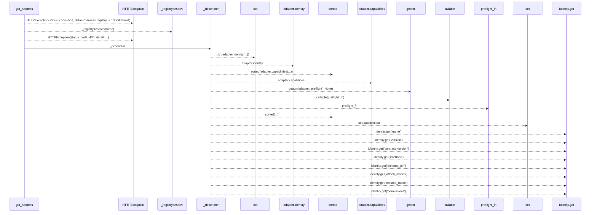
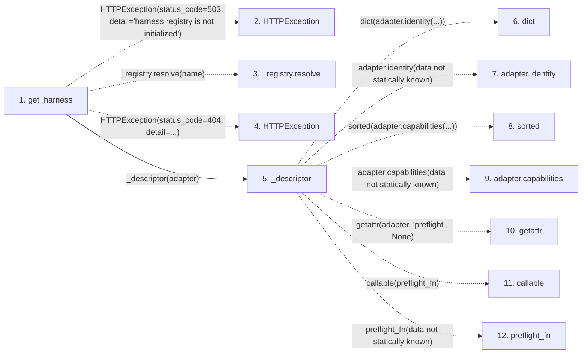

# get_harness

**Entry point:** `get_harness` (`http`)
**Source:** [harnesses](../modules/harnesses.md)
**Modules touched:** [harnesses](../modules/harnesses.md)

## Call sequence

> Static overview in presentation order, not runtime execution order. Arrows retain captured callers; representative internal continuations and boundary examples precede repeated helper detail.

<!-- Auto-generated from static call edges. Dashed arrows are external or unresolved calls. Reviewed runtime conditions and side effects belong in Behavior. -->

> Call sequence diagram shows 21 of 21 interactions; 0 omitted to keep the visualization within the 30-interaction and generated-diagram limits, with uncertain identities omitted rather than inferred.

> Captured boundary calls: external 8 of 8 (0 omitted); unresolved 12 of 12 (0 omitted). These counts cover the captured static trace.
> Detailed flow queries retain their own coverage and limits; omitted paths may execute at runtime.

## Data flow

<!-- Auto-generated static analysis. Treat values and boundaries as best-effort hints, not runtime proof. -->

### Step data

| Step | Inputs | Reads | Writes | Returns |
|---|---|---|---|---|
| `get_harness` | `name: str` | `_registry` | - | `_descriptor(...)` |
| `HTTPException` | - | - | - | - |
| `_registry.resolve` | - | - | - | - |
| `HTTPException` | - | - | - | - |
| `_descriptor` | `adapter: Any` | `OPTIONAL_CAPABILITIES` | - | `{...}` |
| `dict` | - | - | - | - |
| `adapter.identity` | - | - | - | - |
| `sorted` | - | - | - | - |
| `adapter.capabilities` | - | - | - | - |
| `getattr` | - | - | - | - |
| `callable` | - | - | - | - |
| `preflight_fn` | - | - | - | - |

### Call data

| From | To | Line | Call |
|---|---|---:|---|
| get_harness | HTTPException | 115 | `HTTPException(status_code=503, detail='harness registry is not initialized')` |
| get_harness | _registry.resolve | 117 | `_registry.resolve(name)` |
| get_harness | HTTPException | 119 | `HTTPException(status_code=404, detail=...)` |
| get_harness | _descriptor | 122 | `_descriptor(adapter)` |
| _descriptor | dict | 62 | `dict(adapter.identity(...))` |
| _descriptor | adapter.identity | 62 | `adapter.identity(data not statically known)` |
| _descriptor | sorted | 63 | `sorted(adapter.capabilities(...))` |
| _descriptor | adapter.capabilities | 63 | `adapter.capabilities(data not statically known)` |
| _descriptor | getattr | 64 | `getattr(adapter, 'preflight', None)` |
| _descriptor | callable | 65 | `callable(preflight_fn)` |
| _descriptor | preflight_fn | 66 | `preflight_fn(data not statically known)` |

### Boundary effects

*No boundary effects detected.*

### Static analysis gaps

| Kind | Step | Target | Line |
|---|---|---|---:|
| external_call | `get_harness` | `HTTPException` | 115 |
| unresolved_call | `get_harness` | `_registry.resolve` | 117 |
| external_call | `get_harness` | `HTTPException` | 119 |
| unresolved_call | `_descriptor` | `adapter.identity` | 62 |
| external_call | `_descriptor` | `sorted` | 63 |
| unresolved_call | `_descriptor` | `adapter.capabilities` | 63 |
| external_call | `_descriptor` | `getattr` | 64 |
| external_call | `_descriptor` | `callable` | 65 |
| unresolved_call | `_descriptor` | `preflight_fn` | 66 |
| step_limit | `get_harness` | `first 12 steps` | 0 |

## Behavior

This flow starts at `get_harness` and is classified as `http`. The generated call and data-flow sections are bounded static projections; runtime conditions and side effects require source-level confirmation.
