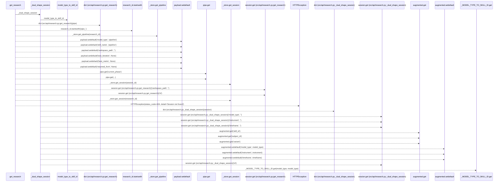
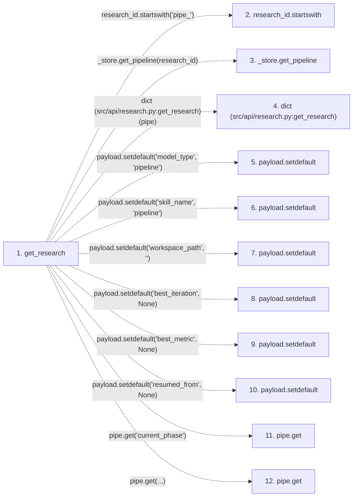

# get_research

**Entry point:** `get_research` (`http`)
**Source:** [research](../modules/research.md)
**Modules touched:** [compat_legacy_alias](../modules/compat_legacy_alias.md), [research](../modules/research.md)

## Call sequence

> Static overview in presentation order, not runtime execution order. Arrows retain captured callers; representative internal continuations and boundary examples precede repeated helper detail.

<!-- Auto-generated from static call edges. Dashed arrows are external or unresolved calls. Reviewed runtime conditions and side effects belong in Behavior. -->

> Call sequence diagram shows 30 of 31 interactions; 1 omitted to keep the visualization within the 30-interaction and generated-diagram limits, with uncertain identities omitted rather than inferred.

> Captured boundary calls: external 3 of 3 (0 omitted); unresolved 25 of 25 (0 omitted). These counts cover the captured static trace.

Omitted captured detail, grouped by actual caller occurrence and target module:

| Caller | Parent step | Target module | Kind | Omitted interactions |
| --- | --- | --- | --- | --- |
| `src/api/research.py:get_research` | 1 | [src/api/research.py](../modules/research.md) | internal | 1 |
> Detailed flow queries retain their own coverage and limits; omitted paths may execute at runtime.

## Data flow

<!-- Auto-generated static analysis. Treat values and boundaries as best-effort hints, not runtime proof. -->

### Step data

| Step | Inputs | Reads | Writes | Returns |
|---|---|---|---|---|
| `get_research` | `research_id: str` | - | `payload[...]`, `payload[...]` | `_dual_shape_session(...)`, `_dual_shape_session(...)` |
| `research_id.startswith` | - | - | - | - |
| `_store.get_pipeline` | - | - | - | - |
| `dict (src/api/research.py:get_research)` | - | - | - | - |
| `payload.setdefault` | - | - | - | - |
| `payload.setdefault` | - | - | - | - |
| `payload.setdefault` | - | - | - | - |
| `payload.setdefault` | - | - | - | - |
| `payload.setdefault` | - | - | - | - |
| `payload.setdefault` | - | - | - | - |
| `pipe.get` | - | - | - | - |
| `pipe.get` | - | - | - | - |

### Call data

| From | To | Line | Call |
|---|---|---:|---|
| get_research | research_id.startswith | 753 | `research_id.startswith('pipe_')` |
| get_research | _store.get_pipeline | 754 | `_store.get_pipeline(research_id)` |
| get_research | dict (src/api/research.py:get_research) | 756 | `dict(pipe)` |
| get_research | payload.setdefault | 757 | `payload.setdefault('model_type', 'pipeline')` |
| get_research | payload.setdefault | 758 | `payload.setdefault('skill_name', 'pipeline')` |
| get_research | payload.setdefault | 759 | `payload.setdefault('workspace_path', '')` |
| get_research | payload.setdefault | 760 | `payload.setdefault('best_iteration', None)` |
| get_research | payload.setdefault | 761 | `payload.setdefault('best_metric', None)` |
| get_research | payload.setdefault | 762 | `payload.setdefault('resumed_from', None)` |
| get_research | pipe.get | 764 | `pipe.get('current_phase')` |
| get_research | pipe.get | 766 | `pipe.get(...)` |

### Boundary effects

*No boundary effects detected.*

### Static analysis gaps

| Kind | Step | Target | Line |
|---|---|---|---:|
| unresolved_call | `get_research` | `research_id.startswith` | 753 |
| unresolved_call | `get_research` | `_store.get_pipeline` | 754 |
| unresolved_call | `get_research` | `payload.setdefault` | 757 |
| unresolved_call | `get_research` | `payload.setdefault` | 758 |
| unresolved_call | `get_research` | `payload.setdefault` | 759 |
| unresolved_call | `get_research` | `payload.setdefault` | 760 |
| unresolved_call | `get_research` | `payload.setdefault` | 761 |
| unresolved_call | `get_research` | `payload.setdefault` | 762 |
| unresolved_call | `get_research` | `pipe.get` | 764 |
| unresolved_call | `get_research` | `pipe.get` | 766 |
| step_limit | `get_research` | `first 12 steps` | 0 |

## Behavior

This flow starts at `get_research` and is classified as `http`. The generated call and data-flow sections are bounded static projections; runtime conditions and side effects require source-level confirmation.
