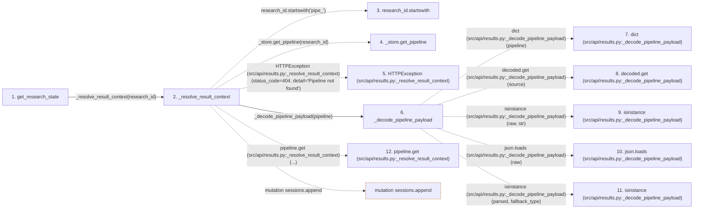

# get_research_state

**Entry point:** `get_research_state` (`http`)
**Source:** [results](../modules/results.md)
**Modules touched:** [artifact_reference](../modules/artifact_reference.md), [blocker_classifier](../modules/blocker_classifier.md), [consistency_validator](../modules/consistency_validator.md), and 6 more

**Complete modules touched:**

- [artifact_reference](../modules/artifact_reference.md)
- [blocker_classifier](../modules/blocker_classifier.md)
- [consistency_validator](../modules/consistency_validator.md)
- [gate_status](../modules/gate_status.md)
- [legacy_phase_tables](../modules/legacy_phase_tables.md)
- [observability](../modules/observability.md)
- [research_phase_plan](../modules/research_phase_plan.md)
- [research_state](../modules/research_state.md)
- [results](../modules/results.md)

## Call sequence

> Static overview in presentation order, not runtime execution order. Arrows retain captured callers; representative internal continuations and boundary examples precede repeated helper detail.

```mermaid
sequenceDiagram
    participant p0 as get_research_state
    participant p1 as _resolve_result_context
    participant p2 as build_research_state
    participant p3 as _collect_audit_events
    participant p4 as _decode_hpo_study
    participant p5 as _decode_planned_trial
    participant p6 as _is_duplicate_rejection
    participant p7 as build_phase_state
    participant p8 as _top_candidates
    participant p9 as _failed_or_pruned
    participant p10 as _production_operations_summary
    participant p11 as _research_outcome
    participant p12 as _latest_known_artifacts
    participant p13 as _terminal_reason
    participant p14 as _duplicate_rejections
    participant p15 as _gate_failure_reasons
    participant p16 as _artifact_hashes
    participant p17 as _mlflow_links
    participant p18 as _paper_status
    participant p19 as _best_candidate_row
    participant p20 as _iteration_budget_reached
    participant p21 as _candidate_summary
    participant p22 as _completed_phase_ids
    participant p23 as _blocked_reason
    participant p24 as _promotion_blockers
    participant p25 as _promotion_scope_status
    participant p26 as _rl_replay_status
    participant p27 as _supervised_feature_readiness_status
    participant p28 as _rl_oos_provenance_status
    participant p29 as HTTPException (src/api/results.py:get_research_state)
    participant p30 as _store.get_iterations
    p0->>p1: _resolve_result_context
    p0->>p2: build_research_state
    p0->>p3: _collect_audit_events
    p2->>p4: _decode_hpo_study
    p2->>p5: _decode_planned_trial
    p2->>p6: _is_duplicate_rejection
    p2->>p7: build_phase_state
    p2->>p8: _top_candidates
    p2->>p9: _failed_or_pruned
    p2->>p10: _production_operations_summary
    p2->>p11: _research_outcome
    p2->>p12: _latest_known_artifacts
    p2->>p13: _terminal_reason
    p2->>p14: _duplicate_rejections
    p2->>p15: _gate_failure_reasons
    p2->>p16: _artifact_hashes
    p2->>p17: _mlflow_links
    p2->>p18: _paper_status
    p10->>p19: _best_candidate_row
    p11->>p20: _iteration_budget_reached
    p8->>p21: _candidate_summary
    p7->>p22: _completed_phase_ids
    p7->>p23: _blocked_reason
    p10->>p24: _promotion_blockers
    p10->>p25: _promotion_scope_status
    p10->>p26: _rl_replay_status
    p10->>p27: _supervised_feature_readiness_status
    p10->>p28: _rl_oos_provenance_status
    p0-->>p29: HTTPException (src/api/results.py:get_research_state)(status_code=404, detail='Phase session not found yet')
    p0-->>p30: _store.get_iterations(session[...])
```

<!-- Auto-generated from static call edges. Dashed arrows are external or unresolved calls. Reviewed runtime conditions and side effects belong in Behavior. -->

> Call sequence diagram shows 30 of 991 interactions; 961 omitted to keep the visualization within the 30-interaction and generated-diagram limits, with uncertain identities omitted rather than inferred.

> Captured boundary calls: external 1 of 220 (219 omitted); unresolved 1 of 526 (525 omitted). These counts cover the captured static trace.

Omitted captured detail, grouped by actual caller occurrence and target module:

| Caller | Parent step | Target module | Kind | Omitted interactions |
| --- | --- | --- | --- | --- |
| `src/api/results.py:_resolve_result_context` | 2 | - | unresolved | 8 |
| `src/api/results.py:_resolve_result_context` | 2 | - | external | 4 |
| `src/api/results.py:_resolve_result_context` | 2 | [src/api/results.py](../modules/results.md) | internal | 2 |
| `src/api/results.py:_decode_pipeline_payload` | 6 | - | external | 4 |
| `src/api/results.py:_decode_pipeline_payload` | 6 | - | unresolved | 1 |
| `src/api/results.py:_decode_session_payload` | 21 | - | external | 4 |
| `src/api/results.py:_decode_session_payload` | 21 | - | unresolved | 1 |
| `src/api/results.py:get_research_state` | 1 | - | unresolved | 6 |
> Omission summary shows 8 of 243 groups; 235 further groups are not expanded here. Counts above include all omitted interactions.
> Detailed flow queries retain their own coverage and limits; omitted paths may execute at runtime.

> Trace truncated at the depth limit; deeper calls are omitted.

## Data flow

<!-- Auto-generated static analysis. Treat values and boundaries as best-effort hints, not runtime proof. -->

### Step data

| Step | Inputs | Reads | Writes | Returns |
|---|---|---|---|---|
| `get_research_state` | `research_id: str` | - | `state_session[...]`, `state_session[...]` | `build_research_state(...)` |
| `_resolve_result_context` | `research_id: str` | `_PIPELINE_PHASES` | `session[...]` | `(...)`, `(...)`, `(...)` |
| `research_id.startswith` | - | - | - | - |
| `_store.get_pipeline` | - | - | - | - |
| `HTTPException (src/api/results.py:_resolve_result_context)` | - | - | - | - |
| `_decode_pipeline_payload` | `pipeline: Dict[str, Any]` | `json` | `decoded[...]` | `decoded` |
| `dict (src/api/results.py:_decode_pipeline_payload)` | - | - | - | - |
| `decoded.get (src/api/results.py:_decode_pipeline_payload)` | - | - | - | - |
| `isinstance (src/api/results.py:_decode_pipeline_payload)` | - | - | - | - |
| `json.loads (src/api/results.py:_decode_pipeline_payload)` | - | - | - | - |
| `isinstance (src/api/results.py:_decode_pipeline_payload)` | - | - | - | - |
| `pipeline.get (src/api/results.py:_resolve_result_context)` | - | - | - | - |

### Call data

| From | To | Line | Call |
|---|---|---:|---|
| get_research_state | _resolve_result_context | 581 | `_resolve_result_context(research_id)` |
| _resolve_result_context | research_id.startswith | 342 | `research_id.startswith('pipe_')` |
| _resolve_result_context | _store.get_pipeline | 343 | `_store.get_pipeline(research_id)` |
| _resolve_result_context | HTTPException (src/api/results.py:_resolve_result_context) | 345 | `HTTPException(status_code=404, detail='Pipeline not found')` |
| _resolve_result_context | _decode_pipeline_payload | 346 | `_decode_pipeline_payload(pipeline)` |
| _decode_pipeline_payload | dict (src/api/results.py:_decode_pipeline_payload) | 56 | `dict(pipeline)` |
| _decode_pipeline_payload | decoded.get (src/api/results.py:_decode_pipeline_payload) | 63 | `decoded.get(source)` |
| _decode_pipeline_payload | isinstance (src/api/results.py:_decode_pipeline_payload) | 67 | `isinstance(raw, str)` |
| _decode_pipeline_payload | json.loads (src/api/results.py:_decode_pipeline_payload) | 67 | `json.loads(raw)` |
| _decode_pipeline_payload | isinstance (src/api/results.py:_decode_pipeline_payload) | 70 | `isinstance(parsed, fallback_type)` |
| _resolve_result_context | pipeline.get (src/api/results.py:_resolve_result_context) | 350 | `pipeline.get(...)` |

### Boundary effects

| Kind | Target | Step | Line |
|---|---|---|---:|
| mutation | `sessions.append` | `_resolve_result_context` | 358 |

### Static analysis gaps

| Kind | Step | Target | Line |
|---|---|---|---:|
| unresolved_call | `_resolve_result_context` | `research_id.startswith` | 342 |
| unresolved_call | `_resolve_result_context` | `_store.get_pipeline` | 343 |
| external_call | `_resolve_result_context` | `HTTPException` | 345 |
| unresolved_call | `_decode_pipeline_payload` | `decoded.get` | 63 |
| external_call | `_decode_pipeline_payload` | `isinstance` | 67 |
| external_call | `_decode_pipeline_payload` | `json.loads` | 67 |
| external_call | `_decode_pipeline_payload` | `isinstance` | 70 |
| unresolved_call | `_resolve_result_context` | `pipeline.get` | 350 |
| step_limit | `get_research_state` | `first 12 steps` | 0 |
| truncated_flow | `get_research_state` | `depth limit` | 0 |

## Behavior

This flow starts at `get_research_state` and is classified as `http`. The generated call and data-flow sections are bounded static projections; runtime conditions and side effects require source-level confirmation.
