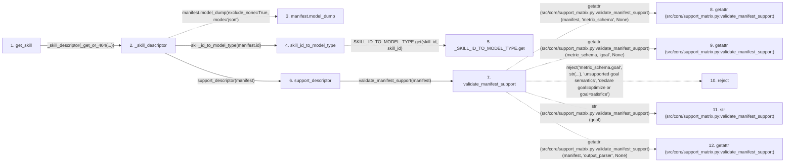

# get_skill

**Entry point:** `get_skill` (`http`)
**Source:** [src_api_skills](../modules/src_api_skills.md)
**Modules touched:** [compat_legacy_alias](../modules/compat_legacy_alias.md), [src_api_skills](../modules/src_api_skills.md), [support_matrix](../modules/support_matrix.md)

## Call sequence

> Static overview in presentation order, not runtime execution order. Arrows retain captured callers; representative internal continuations and boundary examples precede repeated helper detail.

```mermaid
sequenceDiagram
    participant p0 as get_skill
    participant p1 as _skill_descriptor
    participant p2 as _get_or_404
    participant p3 as support_descriptor
    participant p4 as toolchain_diagnostics
    participant p5 as skill_id_to_model_type
    participant p6 as validate_manifest_support
    participant p7 as _declared
    participant p8 as HTTPException
    participant p9 as manifest.model_dump
    participant p10 as _registry.get
    participant p11 as _SKILL_ID_TO_MODEL_TYPE.get
    participant p12 as getattr (src/core/support_matrix.py:support_descriptor)
    participant p13 as getattr (src/core/support_matrix.py:validate_manifest_support)
    participant p14 as getattr (src/core/support_matrix.py:toolchain_diagnostics)
    participant p15 as reject
    participant p16 as str (src/core/support_matrix.py:validate_manifest_support)
    participant p17 as which
    participant p18 as out.append
    p0->>p1: _skill_descriptor
    p0->>p2: _get_or_404
    p1->>p3: support_descriptor
    p3->>p4: toolchain_diagnostics
    p1->>p5: skill_id_to_model_type
    p3->>p6: validate_manifest_support
    p4->>p7: _declared
    p2-->>p8: HTTPException(status_code=404, detail={...})
    p1-->>p9: manifest.model_dump(exclude_none=True, mode='json')
    p2-->>p10: _registry.get(skill_id)
    p5-->>p11: _SKILL_ID_TO_MODEL_TYPE.get(skill_id, skill_id)
    p3-->>p12: getattr (src/core/support_matrix.py:support_descriptor)(getattr(...), 'format', None)
    p3-->>p12: getattr (src/core/support_matrix.py:support_descriptor)(manifest, 'output_parser', None)
    p3-->>p12: getattr (src/core/support_matrix.py:support_descriptor)(getattr(...), 'goal', None)
    p3-->>p12: getattr (src/core/support_matrix.py:support_descriptor)(manifest, 'metric_schema', None)
    p3-->>p12: getattr (src/core/support_matrix.py:support_descriptor)(getattr(...), 'kind', None)
    p3-->>p12: getattr (src/core/support_matrix.py:support_descriptor)(getattr(...), 'primary', None)
    p3-->>p12: getattr (src/core/support_matrix.py:support_descriptor)(manifest, 'promotion_target', None)
    p6-->>p13: getattr (src/core/support_matrix.py:validate_manifest_support)(manifest, 'metric_schema', None)
    p4-->>p14: getattr (src/core/support_matrix.py:toolchain_diagnostics)(manifest, 'command_policy', None)
    p6-->>p13: getattr (src/core/support_matrix.py:validate_manifest_support)(metric_schema, 'goal', None)
    p6-->>p15: reject('metric_schema.goal', str(...), 'unsupported goal semantics', 'declare goal=optimize or goal=satisfice')
    p4-->>p14: getattr (src/core/support_matrix.py:toolchain_diagnostics)(policy, 'allowed_executables', None)
    p6-->>p16: str (src/core/support_matrix.py:validate_manifest_support)(goal)
    p4-->>p17: which(name)
    p6-->>p13: getattr (src/core/support_matrix.py:validate_manifest_support)(manifest, 'output_parser', None)
    p4-->>p18: out.append({...})
    p6-->>p13: getattr (src/core/support_matrix.py:validate_manifest_support)(output_parser, 'format', None)
    p6-->>p15: reject('output_parser.format', str(...), 'no parser handler implements this format', 'declare delimited_kv or json_marker')
    p4-->>p14: getattr (src/core/support_matrix.py:toolchain_diagnostics)(policy, 'allowed_python', None)
```

<!-- Auto-generated from static call edges. Dashed arrows are external or unresolved calls. Reviewed runtime conditions and side effects belong in Behavior. -->

> Call sequence diagram shows 30 of 59 interactions; 29 omitted to keep the visualization within the 30-interaction and generated-diagram limits, with uncertain identities omitted rather than inferred.

> Captured boundary calls: external 16 of 36 (20 omitted); unresolved 7 of 15 (8 omitted). These counts cover the captured static trace.

Omitted captured detail, grouped by actual caller occurrence and target module:

| Caller | Parent step | Target module | Kind | Omitted interactions |
| --- | --- | --- | --- | --- |
| `src/core/support_matrix.py:validate_manifest_support` | 7 | - | external | 17 |
| `src/core/support_matrix.py:validate_manifest_support` | 7 | - | unresolved | 7 |
| `src/core/support_matrix.py:_declared` | 41 | - | external | 3 |
| `src/core/support_matrix.py:toolchain_diagnostics` | 39 | [src/core/support_matrix.py](../modules/support_matrix.md) | internal | 1 |
| `src/core/support_matrix.py:toolchain_diagnostics` | 39 | - | unresolved | 1 |
> Detailed flow queries retain their own coverage and limits; omitted paths may execute at runtime.

## Data flow

<!-- Auto-generated static analysis. Treat values and boundaries as best-effort hints, not runtime proof. -->

### Step data

| Step | Inputs | Reads | Writes | Returns |
|---|---|---|---|---|
| `get_skill` | `skill_id: str` | - | - | `_skill_descriptor(...)` |
| `_skill_descriptor` | `manifest: ResearchSkillManifest` | - | `dump[...]`, `dump[...]`, `dump[...]` | `dump` |
| `manifest.model_dump` | - | - | - | - |
| `skill_id_to_model_type` | `skill_id: str` | - | - | `''`, `_SKILL_ID_TO_MODEL_TYPE.get(...)` |
| `_SKILL_ID_TO_MODEL_TYPE.get` | - | - | - | - |
| `support_descriptor` | `manifest: Any`, `which: Any` | `SUPPORT_MATRIX`, `ACCEPTED_ADVISORY` | - | `{...}` |
| `validate_manifest_support` | `manifest: Any` | `SUPPORT_MATRIX`, `SUPPORT_MATRIX` | - | `diagnostics` |
| `getattr (src/core/support_matrix.py:validate_manifest_support)` | - | - | - | - |
| `getattr (src/core/support_matrix.py:validate_manifest_support)` | - | - | - | - |
| `reject` | - | - | - | - |
| `str (src/core/support_matrix.py:validate_manifest_support)` | - | - | - | - |
| `getattr (src/core/support_matrix.py:validate_manifest_support)` | - | - | - | - |

### Call data

| From | To | Line | Call |
|---|---|---:|---|
| get_skill | _skill_descriptor | 227 | `_skill_descriptor(_get_or_404(...))` |
| _skill_descriptor | manifest.model_dump | 109 | `manifest.model_dump(exclude_none=True, mode='json')` |
| _skill_descriptor | skill_id_to_model_type | 110 | `skill_id_to_model_type(manifest.id)` |
| skill_id_to_model_type | _SKILL_ID_TO_MODEL_TYPE.get | 56 | `_SKILL_ID_TO_MODEL_TYPE.get(skill_id, skill_id)` |
| _skill_descriptor | support_descriptor | 115 | `support_descriptor(manifest)` |
| support_descriptor | validate_manifest_support | 179 | `validate_manifest_support(manifest)` |
| validate_manifest_support | getattr (src/core/support_matrix.py:validate_manifest_support) | 101 | `getattr(manifest, 'metric_schema', None)` |
| validate_manifest_support | getattr (src/core/support_matrix.py:validate_manifest_support) | 102 | `getattr(metric_schema, 'goal', None)` |
| validate_manifest_support | reject | 104 | `reject('metric_schema.goal', str(...), 'unsupported goal semantics', 'declare goal=optimize or goal=satisfice')` |
| validate_manifest_support | str (src/core/support_matrix.py:validate_manifest_support) | 104 | `str(goal)` |
| validate_manifest_support | getattr (src/core/support_matrix.py:validate_manifest_support) | 107 | `getattr(manifest, 'output_parser', None)` |

### Boundary effects

*No boundary effects detected.*

### Static analysis gaps

| Kind | Step | Target | Line |
|---|---|---|---:|
| unresolved_call | `_skill_descriptor` | `manifest.model_dump` | 109 |
| unresolved_call | `skill_id_to_model_type` | `_SKILL_ID_TO_MODEL_TYPE.get` | 56 |
| external_call | `validate_manifest_support` | `getattr` | 101 |
| external_call | `validate_manifest_support` | `getattr` | 102 |
| unresolved_call | `validate_manifest_support` | `reject` | 104 |
| external_call | `validate_manifest_support` | `getattr` | 107 |
| step_limit | `get_skill` | `first 12 steps` | 0 |

## Behavior

This flow starts at `get_skill` and is classified as `http`. The generated call and data-flow sections are bounded static projections; runtime conditions and side effects require source-level confirmation.
