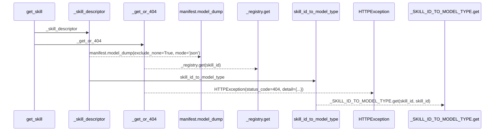
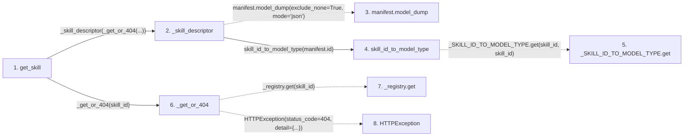

# get_skill

**Entry point:** `get_skill` (`http`)
**Source:** [src_api_skills](../modules/src_api_skills.md)
**Modules touched:** [compat_legacy_alias](../modules/compat_legacy_alias.md), [src_api_skills](../modules/src_api_skills.md)

## Call sequence

> Static overview in presentation order, not runtime execution order. Arrows retain captured callers; representative internal continuations and boundary examples precede repeated helper detail.

<!-- Auto-generated from static call edges. Dashed arrows are external or unresolved calls. Reviewed runtime conditions and side effects belong in Behavior. -->

> Call sequence diagram shows 7 of 7 interactions; 0 omitted to keep the visualization within the 30-interaction and generated-diagram limits, with uncertain identities omitted rather than inferred.

> Captured boundary calls: external 1 of 1 (0 omitted); unresolved 3 of 3 (0 omitted). These counts cover the captured static trace.
> Detailed flow queries retain their own coverage and limits; omitted paths may execute at runtime.

## Data flow

<!-- Auto-generated static analysis. Treat values and boundaries as best-effort hints, not runtime proof. -->

### Step data

| Step | Inputs | Reads | Writes | Returns |
|---|---|---|---|---|
| `get_skill` | `skill_id: str` | - | - | `_skill_descriptor(...)` |
| `_skill_descriptor` | `manifest: ResearchSkillManifest` | - | `dump[...]`, `dump[...]` | `dump` |
| `manifest.model_dump` | - | - | - | - |
| `skill_id_to_model_type` | `skill_id: str` | - | - | `''`, `_SKILL_ID_TO_MODEL_TYPE.get(...)` |
| `_SKILL_ID_TO_MODEL_TYPE.get` | - | - | - | - |
| `_get_or_404` | `skill_id: str` | `SkillNotRegisteredError` | - | `_registry.get(...)` |
| `_registry.get` | - | - | - | - |
| `HTTPException` | - | - | - | - |

### Call data

| From | To | Line | Call |
|---|---|---:|---|
| get_skill | _skill_descriptor | 220 | `_skill_descriptor(_get_or_404(...))` |
| _skill_descriptor | manifest.model_dump | 108 | `manifest.model_dump(exclude_none=True, mode='json')` |
| _skill_descriptor | skill_id_to_model_type | 109 | `skill_id_to_model_type(manifest.id)` |
| skill_id_to_model_type | _SKILL_ID_TO_MODEL_TYPE.get | 56 | `_SKILL_ID_TO_MODEL_TYPE.get(skill_id, skill_id)` |
| get_skill | _get_or_404 | 220 | `_get_or_404(skill_id)` |
| _get_or_404 | _registry.get | 181 | `_registry.get(skill_id)` |
| _get_or_404 | HTTPException | 183 | `HTTPException(status_code=404, detail={...})` |

### Boundary effects

*No boundary effects detected.*

### Static analysis gaps

| Kind | Step | Target | Line |
|---|---|---|---:|
| unresolved_call | `_skill_descriptor` | `manifest.model_dump` | 108 |
| unresolved_call | `skill_id_to_model_type` | `_SKILL_ID_TO_MODEL_TYPE.get` | 56 |
| unresolved_call | `_get_or_404` | `_registry.get` | 181 |
| external_call | `_get_or_404` | `HTTPException` | 183 |

## Behavior

This flow starts at `get_skill` and is classified as `http`. The generated call and data-flow sections are bounded static projections; runtime conditions and side effects require source-level confirmation.
