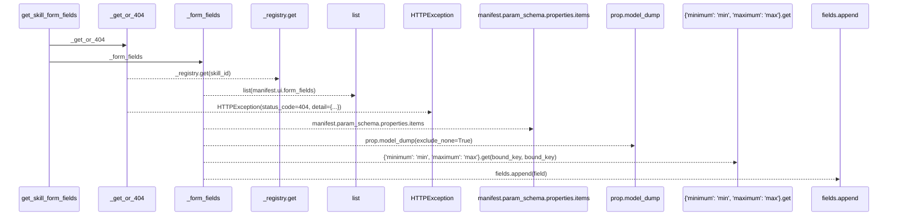
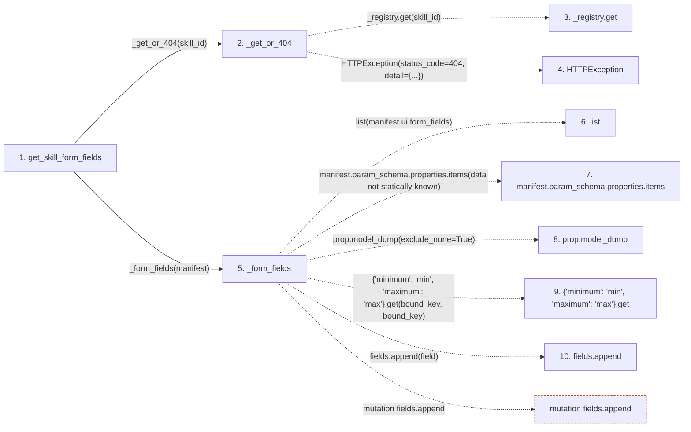

# get_skill_form_fields

**Entry point:** `get_skill_form_fields` (`http`)
**Source:** [src_api_skills](../modules/src_api_skills.md)
**Modules touched:** [src_api_skills](../modules/src_api_skills.md)

## Call sequence

> Static overview in presentation order, not runtime execution order. Arrows retain captured callers; representative internal continuations and boundary examples precede repeated helper detail.

<!-- Auto-generated from static call edges. Dashed arrows are external or unresolved calls. Reviewed runtime conditions and side effects belong in Behavior. -->

> Call sequence diagram shows 9 of 9 interactions; 0 omitted to keep the visualization within the 30-interaction and generated-diagram limits, with uncertain identities omitted rather than inferred.

> Captured boundary calls: external 2 of 2 (0 omitted); unresolved 5 of 5 (0 omitted). These counts cover the captured static trace.
> Detailed flow queries retain their own coverage and limits; omitted paths may execute at runtime.

## Data flow

<!-- Auto-generated static analysis. Treat values and boundaries as best-effort hints, not runtime proof. -->

### Step data

| Step | Inputs | Reads | Writes | Returns |
|---|---|---|---|---|
| `get_skill_form_fields` | `skill_id: str` | - | - | `{...}` |
| `_get_or_404` | `skill_id: str` | `SkillNotRegisteredError` | - | `_registry.get(...)` |
| `_registry.get` | - | - | - | - |
| `HTTPException` | - | - | - | - |
| `_form_fields` | `manifest: ResearchSkillManifest` | - | `field[...]`, `field[...]`, `field[...]` | `list(...)`, `fields` |
| `list` | - | - | - | - |
| `manifest.param_schema.properties.items` | - | - | - | - |
| `prop.model_dump` | - | - | - | - |
| `{'minimum': 'min', 'maximum': 'max'}.get` | - | - | - | - |
| `fields.append` | - | - | - | - |

### Call data

| From | To | Line | Call |
|---|---|---:|---|
| get_skill_form_fields | _get_or_404 | 240 | `_get_or_404(skill_id)` |
| _get_or_404 | _registry.get | 188 | `_registry.get(skill_id)` |
| _get_or_404 | HTTPException | 190 | `HTTPException(status_code=404, detail={...})` |
| get_skill_form_fields | _form_fields | 241 | `_form_fields(manifest)` |
| _form_fields | list | 137 | `list(manifest.ui.form_fields)` |
| _form_fields | manifest.param_schema.properties.items | 141 | `manifest.param_schema.properties.items(data not statically known)` |
| _form_fields | prop.model_dump | 151 | `prop.model_dump(exclude_none=True)` |
| _form_fields | {'minimum': 'min', 'maximum': 'max'}.get | 154 | `{'minimum': 'min', 'maximum': 'max'}.get(bound_key, bound_key)` |
| _form_fields | fields.append | 156 | `fields.append(field)` |

### Boundary effects

| Kind | Target | Step | Line |
|---|---|---|---:|
| mutation | `fields.append` | `_form_fields` | 156 |

### Static analysis gaps

| Kind | Step | Target | Line |
|---|---|---|---:|
| unresolved_call | `_get_or_404` | `_registry.get` | 188 |
| external_call | `_get_or_404` | `HTTPException` | 190 |
| unresolved_call | `_form_fields` | `manifest.param_schema.properties.items` | 141 |
| unresolved_call | `_form_fields` | `prop.model_dump` | 151 |
| unresolved_call | `_form_fields` | `{'minimum': 'min', 'maximum': 'max'}.get` | 154 |

## Behavior

This flow starts at `get_skill_form_fields` and is classified as `http`. The generated call and data-flow sections are bounded static projections; runtime conditions and side effects require source-level confirmation.
