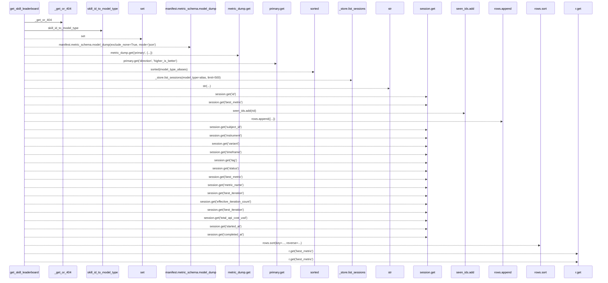
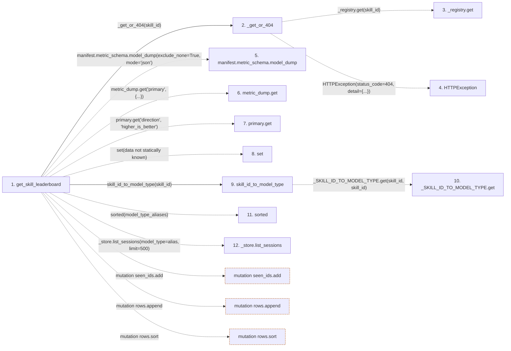

# get_skill_leaderboard

**Entry point:** `get_skill_leaderboard` (`http`)
**Source:** [src_api_skills](../modules/src_api_skills.md)
**Modules touched:** [compat_legacy_alias](../modules/compat_legacy_alias.md), [src_api_skills](../modules/src_api_skills.md)

## Call sequence

> Static overview in presentation order, not runtime execution order. Arrows retain captured callers; representative internal continuations and boundary examples precede repeated helper detail.

<!-- Auto-generated from static call edges. Dashed arrows are external or unresolved calls. Reviewed runtime conditions and side effects belong in Behavior. -->

> Call sequence diagram shows 30 of 37 interactions; 7 omitted to keep the visualization within the 30-interaction and generated-diagram limits, with uncertain identities omitted rather than inferred.

> Captured boundary calls: external 3 of 5 (2 omitted); unresolved 25 of 30 (5 omitted). These counts cover the captured static trace.

Omitted captured detail, grouped by actual caller occurrence and target module:

| Caller | Parent step | Target module | Kind | Omitted interactions |
| --- | --- | --- | --- | --- |
| `src/api/skills.py:_get_or_404` | 2 | - | unresolved | 1 |
| `src/api/skills.py:_get_or_404` | 2 | - | external | 1 |
| `src/compat/legacy_alias.py:skill_id_to_model_type` | 9 | - | unresolved | 1 |
| `src/api/skills.py:get_skill_leaderboard` | 1 | - | external | 1 |
| `src/api/skills.py:get_skill_leaderboard` | 1 | - | unresolved | 3 |
> Detailed flow queries retain their own coverage and limits; omitted paths may execute at runtime.

## Data flow

<!-- Auto-generated static analysis. Treat values and boundaries as best-effort hints, not runtime proof. -->

### Step data

| Step | Inputs | Reads | Writes | Returns |
|---|---|---|---|---|
| `get_skill_leaderboard` | `skill_id: str`, `limit: int` | `_store` | - | `{...}` |
| `_get_or_404` | `skill_id: str` | `SkillNotRegisteredError` | - | `_registry.get(...)` |
| `_registry.get` | - | - | - | - |
| `HTTPException` | - | - | - | - |
| `manifest.metric_schema.model_dump` | - | - | - | - |
| `metric_dump.get` | - | - | - | - |
| `primary.get` | - | - | - | - |
| `set` | - | - | - | - |
| `skill_id_to_model_type` | `skill_id: str` | - | - | `''`, `_SKILL_ID_TO_MODEL_TYPE.get(...)` |
| `_SKILL_ID_TO_MODEL_TYPE.get` | - | - | - | - |
| `sorted` | - | - | - | - |
| `_store.list_sessions` | - | - | - | - |

### Call data

| From | To | Line | Call |
|---|---|---:|---|
| get_skill_leaderboard | _get_or_404 | 256 | `_get_or_404(skill_id)` |
| _get_or_404 | _registry.get | 181 | `_registry.get(skill_id)` |
| _get_or_404 | HTTPException | 183 | `HTTPException(status_code=404, detail={...})` |
| get_skill_leaderboard | manifest.metric_schema.model_dump | 257 | `manifest.metric_schema.model_dump(exclude_none=True, mode='json')` |
| get_skill_leaderboard | metric_dump.get | 258 | `metric_dump.get('primary', {...})` |
| get_skill_leaderboard | primary.get | 259 | `primary.get('direction', 'higher_is_better')` |
| get_skill_leaderboard | set | 262 | `set(data not statically known)` |
| get_skill_leaderboard | skill_id_to_model_type | 266 | `skill_id_to_model_type(skill_id)` |
| skill_id_to_model_type | _SKILL_ID_TO_MODEL_TYPE.get | 56 | `_SKILL_ID_TO_MODEL_TYPE.get(skill_id, skill_id)` |
| get_skill_leaderboard | sorted | 267 | `sorted(model_type_aliases)` |
| get_skill_leaderboard | _store.list_sessions | 270 | `_store.list_sessions(model_type=alias, limit=500)` |

### Boundary effects

| Kind | Target | Step | Line |
|---|---|---|---:|
| mutation | `seen_ids.add` | `get_skill_leaderboard` | 276 |
| mutation | `rows.append` | `get_skill_leaderboard` | 277 |
| mutation | `rows.sort` | `get_skill_leaderboard` | 297 |

### Static analysis gaps

| Kind | Step | Target | Line |
|---|---|---|---:|
| unresolved_call | `_get_or_404` | `_registry.get` | 181 |
| external_call | `_get_or_404` | `HTTPException` | 183 |
| unresolved_call | `get_skill_leaderboard` | `manifest.metric_schema.model_dump` | 257 |
| unresolved_call | `get_skill_leaderboard` | `metric_dump.get` | 258 |
| unresolved_call | `get_skill_leaderboard` | `primary.get` | 259 |
| unresolved_call | `skill_id_to_model_type` | `_SKILL_ID_TO_MODEL_TYPE.get` | 56 |
| external_call | `get_skill_leaderboard` | `sorted` | 267 |
| unresolved_call | `get_skill_leaderboard` | `_store.list_sessions` | 270 |
| step_limit | `get_skill_leaderboard` | `first 12 steps` | 0 |

## Behavior

This flow starts at `get_skill_leaderboard` and is classified as `http`. The generated call and data-flow sections are bounded static projections; runtime conditions and side effects require source-level confirmation.
