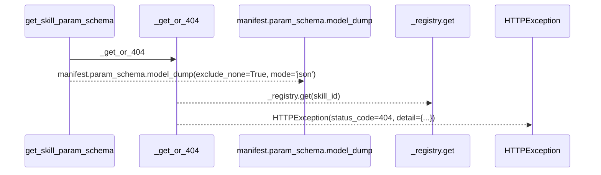
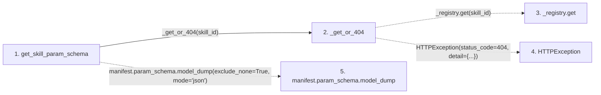

# get_skill_param_schema

**Entry point:** `get_skill_param_schema` (`http`)
**Source:** [src_api_skills](../modules/src_api_skills.md)
**Modules touched:** [src_api_skills](../modules/src_api_skills.md)

## Call sequence

> Static overview in presentation order, not runtime execution order. Arrows retain captured callers; representative internal continuations and boundary examples precede repeated helper detail.

<!-- Auto-generated from static call edges. Dashed arrows are external or unresolved calls. Reviewed runtime conditions and side effects belong in Behavior. -->

> Call sequence diagram shows 4 of 4 interactions; 0 omitted to keep the visualization within the 30-interaction and generated-diagram limits, with uncertain identities omitted rather than inferred.

> Captured boundary calls: external 1 of 1 (0 omitted); unresolved 2 of 2 (0 omitted). These counts cover the captured static trace.
> Detailed flow queries retain their own coverage and limits; omitted paths may execute at runtime.

## Data flow

<!-- Auto-generated static analysis. Treat values and boundaries as best-effort hints, not runtime proof. -->

### Step data

| Step | Inputs | Reads | Writes | Returns |
|---|---|---|---|---|
| `get_skill_param_schema` | `skill_id: str` | - | - | `manifest.param_schema.model_dump(...)` |
| `_get_or_404` | `skill_id: str` | `SkillNotRegisteredError` | - | `_registry.get(...)` |
| `_registry.get` | - | - | - | - |
| `HTTPException` | - | - | - | - |
| `manifest.param_schema.model_dump` | - | - | - | - |

### Call data

| From | To | Line | Call |
|---|---|---:|---|
| get_skill_param_schema | _get_or_404 | 233 | `_get_or_404(skill_id)` |
| _get_or_404 | _registry.get | 188 | `_registry.get(skill_id)` |
| _get_or_404 | HTTPException | 190 | `HTTPException(status_code=404, detail={...})` |
| get_skill_param_schema | manifest.param_schema.model_dump | 234 | `manifest.param_schema.model_dump(exclude_none=True, mode='json')` |

### Boundary effects

*No boundary effects detected.*

### Static analysis gaps

| Kind | Step | Target | Line |
|---|---|---|---:|
| unresolved_call | `_get_or_404` | `_registry.get` | 188 |
| external_call | `_get_or_404` | `HTTPException` | 190 |
| unresolved_call | `get_skill_param_schema` | `manifest.param_schema.model_dump` | 234 |

## Behavior

This flow starts at `get_skill_param_schema` and is classified as `http`. The generated call and data-flow sections are bounded static projections; runtime conditions and side effects require source-level confirmation.
