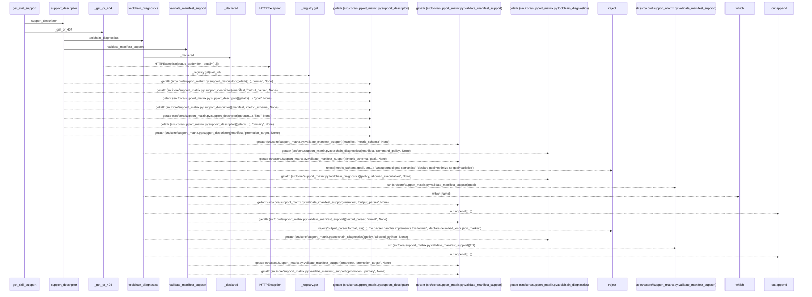
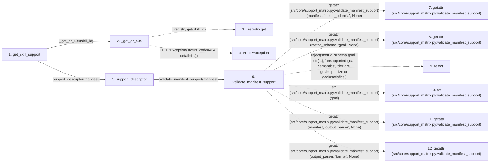

# get_skill_support

**Entry point:** `get_skill_support` (`http`)
**Source:** [src_api_skills](../modules/src_api_skills.md)
**Modules touched:** [src_api_skills](../modules/src_api_skills.md), [support_matrix](../modules/support_matrix.md)

## Call sequence

> Static overview in presentation order, not runtime execution order. Arrows retain captured callers; representative internal continuations and boundary examples precede repeated helper detail.

<!-- Auto-generated from static call edges. Dashed arrows are external or unresolved calls. Reviewed runtime conditions and side effects belong in Behavior. -->

> Call sequence diagram shows 30 of 55 interactions; 25 omitted to keep the visualization within the 30-interaction and generated-diagram limits, with uncertain identities omitted rather than inferred.

> Captured boundary calls: external 19 of 36 (17 omitted); unresolved 6 of 13 (7 omitted). These counts cover the captured static trace.

Omitted captured detail, grouped by actual caller occurrence and target module:

| Caller | Parent step | Target module | Kind | Omitted interactions |
| --- | --- | --- | --- | --- |
| `src/core/support_matrix.py:validate_manifest_support` | 6 | - | external | 14 |
| `src/core/support_matrix.py:validate_manifest_support` | 6 | - | unresolved | 7 |
| `src/core/support_matrix.py:_declared` | 40 | - | external | 3 |
| `src/core/support_matrix.py:toolchain_diagnostics` | 38 | [src/core/support_matrix.py](../modules/support_matrix.md) | internal | 1 |
> Detailed flow queries retain their own coverage and limits; omitted paths may execute at runtime.

## Data flow

<!-- Auto-generated static analysis. Treat values and boundaries as best-effort hints, not runtime proof. -->

### Step data

| Step | Inputs | Reads | Writes | Returns |
|---|---|---|---|---|
| `get_skill_support` | `skill_id: str` | - | - | `support_descriptor(...)` |
| `_get_or_404` | `skill_id: str` | `SkillNotRegisteredError` | - | `_registry.get(...)` |
| `_registry.get` | - | - | - | - |
| `HTTPException` | - | - | - | - |
| `support_descriptor` | `manifest: Any`, `which: Any` | `SUPPORT_MATRIX`, `ACCEPTED_ADVISORY` | - | `{...}` |
| `validate_manifest_support` | `manifest: Any` | `SUPPORT_MATRIX`, `SUPPORT_MATRIX` | - | `diagnostics` |
| `getattr (src/core/support_matrix.py:validate_manifest_support)` | - | - | - | - |
| `getattr (src/core/support_matrix.py:validate_manifest_support)` | - | - | - | - |
| `reject` | - | - | - | - |
| `str (src/core/support_matrix.py:validate_manifest_support)` | - | - | - | - |
| `getattr (src/core/support_matrix.py:validate_manifest_support)` | - | - | - | - |
| `getattr (src/core/support_matrix.py:validate_manifest_support)` | - | - | - | - |

### Call data

| From | To | Line | Call |
|---|---|---:|---|
| get_skill_support | _get_or_404 | 253 | `_get_or_404(skill_id)` |
| _get_or_404 | _registry.get | 188 | `_registry.get(skill_id)` |
| _get_or_404 | HTTPException | 190 | `HTTPException(status_code=404, detail={...})` |
| get_skill_support | support_descriptor | 256 | `support_descriptor(manifest)` |
| support_descriptor | validate_manifest_support | 179 | `validate_manifest_support(manifest)` |
| validate_manifest_support | getattr (src/core/support_matrix.py:validate_manifest_support) | 101 | `getattr(manifest, 'metric_schema', None)` |
| validate_manifest_support | getattr (src/core/support_matrix.py:validate_manifest_support) | 102 | `getattr(metric_schema, 'goal', None)` |
| validate_manifest_support | reject | 104 | `reject('metric_schema.goal', str(...), 'unsupported goal semantics', 'declare goal=optimize or goal=satisfice')` |
| validate_manifest_support | str (src/core/support_matrix.py:validate_manifest_support) | 104 | `str(goal)` |
| validate_manifest_support | getattr (src/core/support_matrix.py:validate_manifest_support) | 107 | `getattr(manifest, 'output_parser', None)` |
| validate_manifest_support | getattr (src/core/support_matrix.py:validate_manifest_support) | 108 | `getattr(output_parser, 'format', None)` |

### Boundary effects

*No boundary effects detected.*

### Static analysis gaps

| Kind | Step | Target | Line |
|---|---|---|---:|
| unresolved_call | `_get_or_404` | `_registry.get` | 188 |
| external_call | `_get_or_404` | `HTTPException` | 190 |
| external_call | `validate_manifest_support` | `getattr` | 101 |
| external_call | `validate_manifest_support` | `getattr` | 102 |
| unresolved_call | `validate_manifest_support` | `reject` | 104 |
| external_call | `validate_manifest_support` | `getattr` | 107 |
| external_call | `validate_manifest_support` | `getattr` | 108 |
| step_limit | `get_skill_support` | `first 12 steps` | 0 |

## Behavior

This flow starts at `get_skill_support` and is classified as `http`. The generated call and data-flow sections are bounded static projections; runtime conditions and side effects require source-level confirmation.
