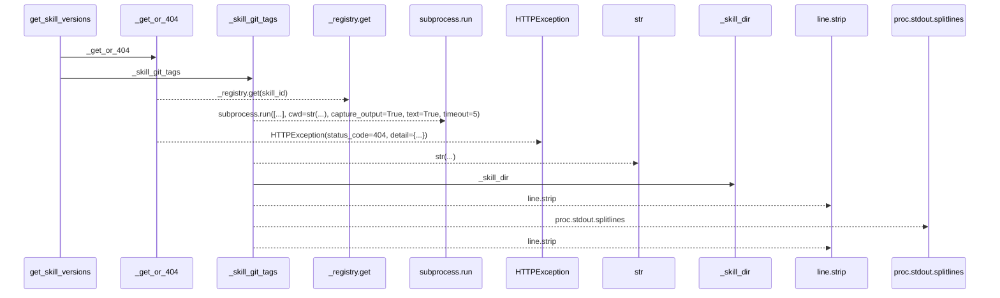
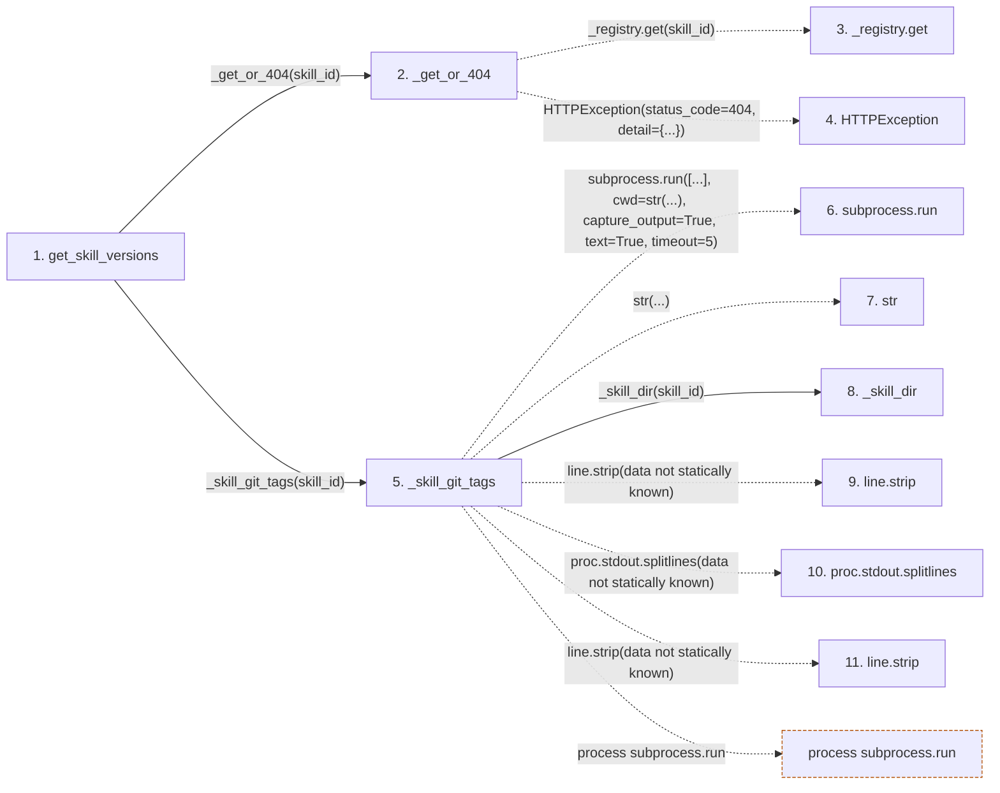

# get_skill_versions

**Entry point:** `get_skill_versions` (`http`)
**Source:** [src_api_skills](../modules/src_api_skills.md)
**Modules touched:** [src_api_skills](../modules/src_api_skills.md)

## Call sequence

> Static overview in presentation order, not runtime execution order. Arrows retain captured callers; representative internal continuations and boundary examples precede repeated helper detail.

<!-- Auto-generated from static call edges. Dashed arrows are external or unresolved calls. Reviewed runtime conditions and side effects belong in Behavior. -->

> Call sequence diagram shows 10 of 10 interactions; 0 omitted to keep the visualization within the 30-interaction and generated-diagram limits, with uncertain identities omitted rather than inferred.

> Captured boundary calls: external 3 of 3 (0 omitted); unresolved 4 of 4 (0 omitted). These counts cover the captured static trace.
> Detailed flow queries retain their own coverage and limits; omitted paths may execute at runtime.

## Data flow

<!-- Auto-generated static analysis. Treat values and boundaries as best-effort hints, not runtime proof. -->

### Step data

| Step | Inputs | Reads | Writes | Returns |
|---|---|---|---|---|
| `get_skill_versions` | `skill_id: str` | - | - | `{...}` |
| `_get_or_404` | `skill_id: str` | `SkillNotRegisteredError` | - | `_registry.get(...)` |
| `_registry.get` | - | - | - | - |
| `HTTPException` | - | - | - | - |
| `_skill_git_tags` | `skill_id: str` | - | - | `[...]`, `[...]`, `...` |
| `subprocess.run` | - | - | - | - |
| `str` | - | - | - | - |
| `_skill_dir` | `manifest_id: str` | `DEFAULT_SKILLS_ROOT` | - | `...` |
| `line.strip` | - | - | - | - |
| `proc.stdout.splitlines` | - | - | - | - |
| `line.strip` | - | - | - | - |

### Call data

| From | To | Line | Call |
|---|---|---:|---|
| get_skill_versions | _get_or_404 | 324 | `_get_or_404(skill_id)` |
| _get_or_404 | _registry.get | 181 | `_registry.get(skill_id)` |
| _get_or_404 | HTTPException | 183 | `HTTPException(status_code=404, detail={...})` |
| get_skill_versions | _skill_git_tags | 325 | `_skill_git_tags(skill_id)` |
| _skill_git_tags | subprocess.run | 349 | `subprocess.run([...], cwd=str(...), capture_output=True, text=True, timeout=5)` |
| _skill_git_tags | str | 351 | `str(...)` |
| _skill_git_tags | _skill_dir | 351 | `_skill_dir(skill_id)` |
| _skill_git_tags | line.strip | 358 | `line.strip(data not statically known)` |
| _skill_git_tags | proc.stdout.splitlines | 358 | `proc.stdout.splitlines(data not statically known)` |
| _skill_git_tags | line.strip | 358 | `line.strip(data not statically known)` |

### Boundary effects

| Kind | Target | Step | Line |
|---|---|---|---:|
| process | `subprocess.run` | `_skill_git_tags` | 349 |

### Static analysis gaps

| Kind | Step | Target | Line |
|---|---|---|---:|
| unresolved_call | `_get_or_404` | `_registry.get` | 181 |
| external_call | `_get_or_404` | `HTTPException` | 183 |
| unresolved_call | `_skill_git_tags` | `line.strip` | 358 |
| unresolved_call | `_skill_git_tags` | `proc.stdout.splitlines` | 358 |

## Behavior

This flow starts at `get_skill_versions` and is classified as `http`. The generated call and data-flow sections are bounded static projections; runtime conditions and side effects require source-level confirmation.
