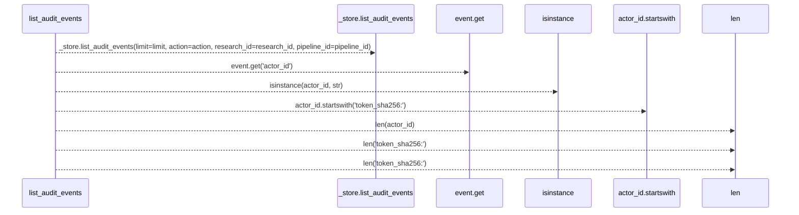
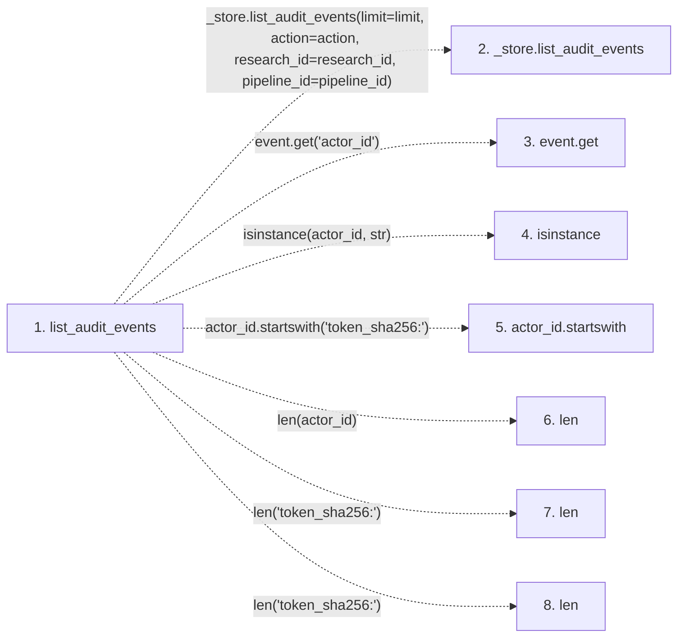

# list_audit_events

**Entry point:** `list_audit_events` (`http`)
**Source:** [research](../modules/research.md)
**Modules touched:** [research](../modules/research.md)

## Call sequence

> Static overview in presentation order, not runtime execution order. Arrows retain captured callers; representative internal continuations and boundary examples precede repeated helper detail.

<!-- Auto-generated from static call edges. Dashed arrows are external or unresolved calls. Reviewed runtime conditions and side effects belong in Behavior. -->

> Call sequence diagram shows 7 of 7 interactions; 0 omitted to keep the visualization within the 30-interaction and generated-diagram limits, with uncertain identities omitted rather than inferred.

> Captured boundary calls: external 4 of 4 (0 omitted); unresolved 3 of 3 (0 omitted). These counts cover the captured static trace.
> Detailed flow queries retain their own coverage and limits; omitted paths may execute at runtime.

## Data flow

<!-- Auto-generated static analysis. Treat values and boundaries as best-effort hints, not runtime proof. -->

### Step data

| Step | Inputs | Reads | Writes | Returns |
|---|---|---|---|---|
| `list_audit_events` | `limit: int`, `action: Optional[str]`, `research_id: Optional[str]`, `pipeline_id: Optional[str]` | - | `event[...]` | `events` |
| `_store.list_audit_events` | - | - | - | - |
| `event.get` | - | - | - | - |
| `isinstance` | - | - | - | - |
| `actor_id.startswith` | - | - | - | - |
| `len` | - | - | - | - |
| `len` | - | - | - | - |
| `len` | - | - | - | - |

### Call data

| From | To | Line | Call |
|---|---|---:|---|
| list_audit_events | _store.list_audit_events | 728 | `_store.list_audit_events(limit=limit, action=action, research_id=research_id, pipeline_id=pipeline_id)` |
| list_audit_events | event.get | 739 | `event.get('actor_id')` |
| list_audit_events | isinstance | 741 | `isinstance(actor_id, str)` |
| list_audit_events | actor_id.startswith | 742 | `actor_id.startswith('token_sha256:')` |
| list_audit_events | len | 743 | `len(actor_id)` |
| list_audit_events | len | 743 | `len('token_sha256:')` |
| list_audit_events | len | 745 | `len('token_sha256:')` |

### Boundary effects

*No boundary effects detected.*

### Static analysis gaps

| Kind | Step | Target | Line |
|---|---|---|---:|
| unresolved_call | `list_audit_events` | `_store.list_audit_events` | 728 |
| unresolved_call | `list_audit_events` | `event.get` | 739 |
| external_call | `list_audit_events` | `isinstance` | 741 |
| unresolved_call | `list_audit_events` | `actor_id.startswith` | 742 |

## Behavior

This flow starts at `list_audit_events` and is classified as `http`. The generated call and data-flow sections are bounded static projections; runtime conditions and side effects require source-level confirmation.
