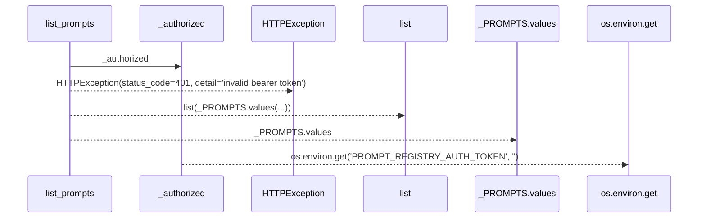
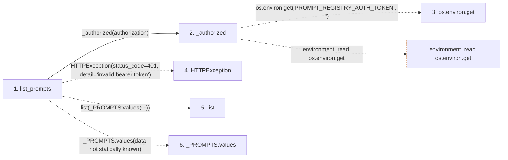

# list_prompts

**Entry point:** `list_prompts` (`http`)
**Source:** [examples_prompt-registry_main](../modules/examples_prompt-registry_main.md)
**Modules touched:** [examples_prompt-registry_main](../modules/examples_prompt-registry_main.md)

## Call sequence

> Static overview in presentation order, not runtime execution order. Arrows retain captured callers; representative internal continuations and boundary examples precede repeated helper detail.

<!-- Auto-generated from static call edges. Dashed arrows are external or unresolved calls. Reviewed runtime conditions and side effects belong in Behavior. -->

> Call sequence diagram shows 5 of 5 interactions; 0 omitted to keep the visualization within the 30-interaction and generated-diagram limits, with uncertain identities omitted rather than inferred.

> Captured boundary calls: external 3 of 3 (0 omitted); unresolved 1 of 1 (0 omitted). These counts cover the captured static trace.
> Detailed flow queries retain their own coverage and limits; omitted paths may execute at runtime.

## Data flow

<!-- Auto-generated static analysis. Treat values and boundaries as best-effort hints, not runtime proof. -->

### Step data

| Step | Inputs | Reads | Writes | Returns |
|---|---|---|---|---|
| `list_prompts` | `authorization: str \| None` | - | - | `{...}` |
| `_authorized` | `authorization: str \| None` | - | - | `True`, `...` |
| `os.environ.get` | - | - | - | - |
| `HTTPException` | - | - | - | - |
| `list` | - | - | - | - |
| `_PROMPTS.values` | - | - | - | - |

### Call data

| From | To | Line | Call |
|---|---|---:|---|
| list_prompts | _authorized | 91 | `_authorized(authorization)` |
| _authorized | os.environ.get | 44 | `os.environ.get('PROMPT_REGISTRY_AUTH_TOKEN', '')` |
| list_prompts | HTTPException | 92 | `HTTPException(status_code=401, detail='invalid bearer token')` |
| list_prompts | list | 93 | `list(_PROMPTS.values(...))` |
| list_prompts | _PROMPTS.values | 93 | `_PROMPTS.values(data not statically known)` |

### Boundary effects

| Kind | Target | Step | Line |
|---|---|---|---:|
| environment_read | `os.environ.get` | `_authorized` | 44 |

### Static analysis gaps

| Kind | Step | Target | Line |
|---|---|---|---:|
| external_call | `list_prompts` | `HTTPException` | 92 |
| unresolved_call | `list_prompts` | `_PROMPTS.values` | 93 |

## Behavior

This flow starts at `list_prompts` and is classified as `http`. The generated call and data-flow sections are bounded static projections; runtime conditions and side effects require source-level confirmation.
