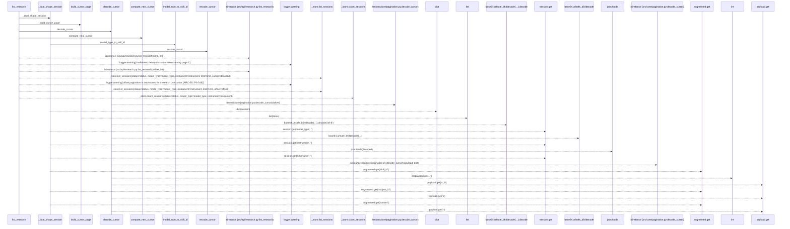
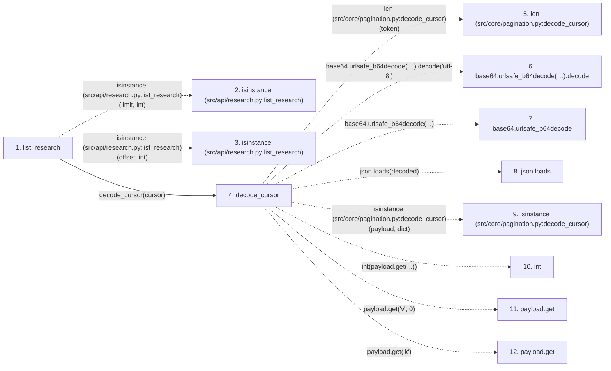

# list_research

**Entry point:** `list_research` (`http`)
**Source:** [research](../modules/research.md)
**Modules touched:** [compat_legacy_alias](../modules/compat_legacy_alias.md), [pagination](../modules/pagination.md), [research](../modules/research.md)

## Call sequence

> Static overview in presentation order, not runtime execution order. Arrows retain captured callers; representative internal continuations and boundary examples precede repeated helper detail.

<!-- Auto-generated from static call edges. Dashed arrows are external or unresolved calls. Reviewed runtime conditions and side effects belong in Behavior. -->

> Call sequence diagram shows 30 of 45 interactions; 15 omitted to keep the visualization within the 30-interaction and generated-diagram limits, with uncertain identities omitted rather than inferred.

> Captured boundary calls: external 9 of 13 (4 omitted); unresolved 15 of 24 (9 omitted). These counts cover the captured static trace.

Omitted captured detail, grouped by actual caller occurrence and target module:

| Caller | Parent step | Target module | Kind | Omitted interactions |
| --- | --- | --- | --- | --- |
| `src/core/pagination.py:decode_cursor` | 4 | - | external | 1 |
| `src/compat/legacy_alias.py:model_type_to_skill_id` | 23 | - | unresolved | 1 |
| `src/api/research.py:_dual_shape_session` | 17 | - | unresolved | 4 |
| `src/core/pagination.py:build_cursor_page` | 31 | [src/core/pagination.py](../modules/pagination.md) | internal | 1 |
| `src/core/pagination.py:compute_next_cursor` | 33 | - | external | 1 |
| `src/core/pagination.py:compute_next_cursor` | 33 | - | unresolved | 1 |
| `src/core/pagination.py:encode_cursor` | 36 | - | unresolved | 3 |
| `src/core/pagination.py:encode_cursor` | 36 | - | external | 2 |
> Omission summary shows 8 of 9 groups; 1 further groups are not expanded here. Counts above include all omitted interactions.
> Detailed flow queries retain their own coverage and limits; omitted paths may execute at runtime.

## Data flow

<!-- Auto-generated static analysis. Treat values and boundaries as best-effort hints, not runtime proof. -->

### Step data

| Step | Inputs | Reads | Writes | Returns |
|---|---|---|---|---|
| `list_research` | `status: Optional[str]`, `model_type: Optional[str]`, `instrument: Optional[str]`, `limit: int`, `offset: int`, `cursor: Optional[str]` | `DEFAULT_PAGE_SIZE`, `_started_at_id_cursor`, `_started_at_id_cursor` | - | `build_cursor_page(...)`, `{...}` |
| `isinstance (src/api/research.py:list_research)` | - | - | - | - |
| `isinstance (src/api/research.py:list_research)` | - | - | - | - |
| `decode_cursor` | `token: Optional[str]` | `_CURSOR_VERSION`, `json` | - | `None`, `None`, `None`, `None`, `None`, `(...)`, `None` |
| `len (src/core/pagination.py:decode_cursor)` | - | - | - | - |
| `base64.urlsafe_b64decode(…).decode` | - | - | - | - |
| `base64.urlsafe_b64decode` | - | - | - | - |
| `json.loads` | - | - | - | - |
| `isinstance (src/core/pagination.py:decode_cursor)` | - | - | - | - |
| `int` | - | - | - | - |
| `payload.get` | - | - | - | - |
| `payload.get` | - | - | - | - |

### Call data

| From | To | Line | Call |
|---|---|---:|---|
| list_research | isinstance (src/api/research.py:list_research) | 684 | `isinstance(limit, int)` |
| list_research | isinstance (src/api/research.py:list_research) | 686 | `isinstance(offset, int)` |
| list_research | decode_cursor | 688 | `decode_cursor(cursor)` |
| decode_cursor | len (src/core/pagination.py:decode_cursor) | 66 | `len(token)` |
| decode_cursor | base64.urlsafe_b64decode(…).decode | 67 | `base64.urlsafe_b64decode(token + padding).decode('utf-8')` |
| decode_cursor | base64.urlsafe_b64decode | 67 | `base64.urlsafe_b64decode(...)` |
| decode_cursor | json.loads | 68 | `json.loads(decoded)` |
| decode_cursor | isinstance (src/core/pagination.py:decode_cursor) | 69 | `isinstance(payload, dict)` |
| decode_cursor | int | 71 | `int(payload.get(...))` |
| decode_cursor | payload.get | 71 | `payload.get('v', 0)` |
| decode_cursor | payload.get | 73 | `payload.get('k')` |

### Boundary effects

*No boundary effects detected.*

### Static analysis gaps

| Kind | Step | Target | Line |
|---|---|---|---:|
| external_call | `list_research` | `isinstance` | 684 |
| external_call | `list_research` | `isinstance` | 686 |
| unresolved_call | `decode_cursor` | `base64.urlsafe_b64decode(token + padding).decode` | 67 |
| external_call | `decode_cursor` | `base64.urlsafe_b64decode` | 67 |
| external_call | `decode_cursor` | `json.loads` | 68 |
| external_call | `decode_cursor` | `isinstance` | 69 |
| unresolved_call | `decode_cursor` | `payload.get` | 71 |
| unresolved_call | `decode_cursor` | `payload.get` | 73 |
| step_limit | `list_research` | `first 12 steps` | 0 |

## Behavior

This flow starts at `list_research` and is classified as `http`. The generated call and data-flow sections are bounded static projections; runtime conditions and side effects require source-level confirmation.
