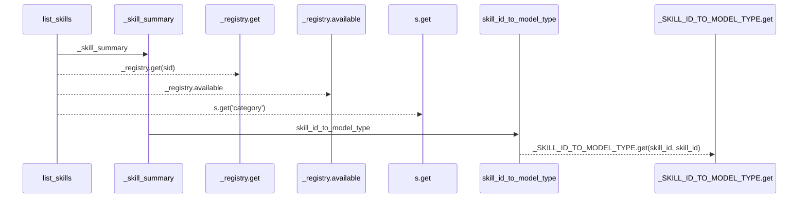
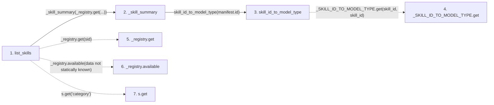

# list_skills

**Entry point:** `list_skills` (`http`)
**Source:** [src_api_skills](../modules/src_api_skills.md)
**Modules touched:** [compat_legacy_alias](../modules/compat_legacy_alias.md), [src_api_skills](../modules/src_api_skills.md)

## Call sequence

> Static overview in presentation order, not runtime execution order. Arrows retain captured callers; representative internal continuations and boundary examples precede repeated helper detail.

<!-- Auto-generated from static call edges. Dashed arrows are external or unresolved calls. Reviewed runtime conditions and side effects belong in Behavior. -->

> Call sequence diagram shows 6 of 6 interactions; 0 omitted to keep the visualization within the 30-interaction and generated-diagram limits, with uncertain identities omitted rather than inferred.

> Captured boundary calls: external 0 of 0 (0 omitted); unresolved 4 of 4 (0 omitted). These counts cover the captured static trace.
> Detailed flow queries retain their own coverage and limits; omitted paths may execute at runtime.

## Data flow

<!-- Auto-generated static analysis. Treat values and boundaries as best-effort hints, not runtime proof. -->

### Step data

| Step | Inputs | Reads | Writes | Returns |
|---|---|---|---|---|
| `list_skills` | `category: Optional[str]` | - | - | `summaries` |
| `_skill_summary` | `manifest: ResearchSkillManifest` | - | - | `{...}` |
| `skill_id_to_model_type` | `skill_id: str` | - | - | `''`, `_SKILL_ID_TO_MODEL_TYPE.get(...)` |
| `_SKILL_ID_TO_MODEL_TYPE.get` | - | - | - | - |
| `_registry.get` | - | - | - | - |
| `_registry.available` | - | - | - | - |
| `s.get` | - | - | - | - |

### Call data

| From | To | Line | Call |
|---|---|---:|---|
| list_skills | _skill_summary | 218 | `_skill_summary(_registry.get(...))` |
| _skill_summary | skill_id_to_model_type | 99 | `skill_id_to_model_type(manifest.id)` |
| skill_id_to_model_type | _SKILL_ID_TO_MODEL_TYPE.get | 56 | `_SKILL_ID_TO_MODEL_TYPE.get(skill_id, skill_id)` |
| list_skills | _registry.get | 218 | `_registry.get(sid)` |
| list_skills | _registry.available | 218 | `_registry.available(data not statically known)` |
| list_skills | s.get | 220 | `s.get('category')` |

### Boundary effects

*No boundary effects detected.*

### Static analysis gaps

| Kind | Step | Target | Line |
|---|---|---|---:|
| unresolved_call | `skill_id_to_model_type` | `_SKILL_ID_TO_MODEL_TYPE.get` | 56 |
| unresolved_call | `list_skills` | `_registry.get` | 218 |
| unresolved_call | `list_skills` | `_registry.available` | 218 |
| unresolved_call | `list_skills` | `s.get` | 220 |

## Behavior

This flow starts at `list_skills` and is classified as `http`. The generated call and data-flow sections are bounded static projections; runtime conditions and side effects require source-level confirmation.
