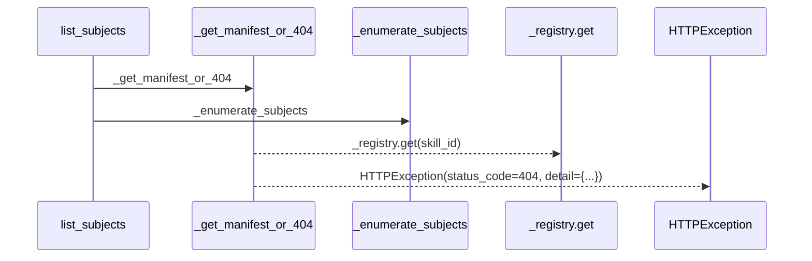
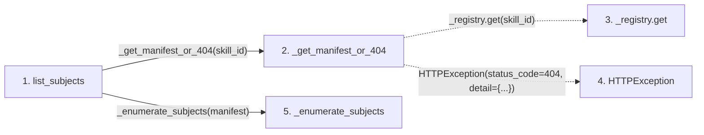

# list_subjects

**Entry point:** `list_subjects` (`http`)
**Source:** [subjects](../modules/subjects.md)
**Modules touched:** [subjects](../modules/subjects.md)

## Call sequence

> Static overview in presentation order, not runtime execution order. Arrows retain captured callers; representative internal continuations and boundary examples precede repeated helper detail.

<!-- Auto-generated from static call edges. Dashed arrows are external or unresolved calls. Reviewed runtime conditions and side effects belong in Behavior. -->

> Call sequence diagram shows 4 of 4 interactions; 0 omitted to keep the visualization within the 30-interaction and generated-diagram limits, with uncertain identities omitted rather than inferred.

> Captured boundary calls: external 1 of 1 (0 omitted); unresolved 1 of 1 (0 omitted). These counts cover the captured static trace.
> Detailed flow queries retain their own coverage and limits; omitted paths may execute at runtime.

## Data flow

<!-- Auto-generated static analysis. Treat values and boundaries as best-effort hints, not runtime proof. -->

### Step data

| Step | Inputs | Reads | Writes | Returns |
|---|---|---|---|---|
| `list_subjects` | `skill_id: str` | - | - | `_enumerate_subjects(...)` |
| `_get_manifest_or_404` | `skill_id: str` | `SkillNotRegisteredError` | - | `_registry.get(...)` |
| `_registry.get` | - | - | - | - |
| `HTTPException` | - | - | - | - |
| `_enumerate_subjects` | `manifest: ResearchSkillManifest` | - | - | `[...]`, `...`, `[...]` |

### Call data

| From | To | Line | Call |
|---|---|---:|---|
| list_subjects | _get_manifest_or_404 | 105 | `_get_manifest_or_404(skill_id)` |
| _get_manifest_or_404 | _registry.get | 57 | `_registry.get(skill_id)` |
| _get_manifest_or_404 | HTTPException | 59 | `HTTPException(status_code=404, detail={...})` |
| list_subjects | _enumerate_subjects | 106 | `_enumerate_subjects(manifest)` |

### Boundary effects

*No boundary effects detected.*

### Static analysis gaps

| Kind | Step | Target | Line |
|---|---|---|---:|
| unresolved_call | `_get_manifest_or_404` | `_registry.get` | 57 |
| external_call | `_get_manifest_or_404` | `HTTPException` | 59 |

## Behavior

This flow starts at `list_subjects` and is classified as `http`. The generated call and data-flow sections are bounded static projections; runtime conditions and side effects require source-level confirmation.
