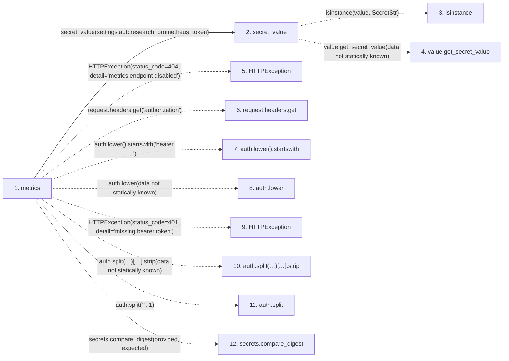

# metrics

**Entry point:** `metrics` (`http`)
**Source:** [src_main](../modules/src_main.md)
**Modules touched:** [config](../modules/config.md), [observability](../modules/observability.md), [src_main](../modules/src_main.md)

## Call sequence

> Static overview in presentation order, not runtime execution order. Arrows retain captured callers; representative internal continuations and boundary examples precede repeated helper detail.

```mermaid
sequenceDiagram
    participant p0 as metrics
    participant p1 as secret_value
    participant p2 as HTTPException
    participant p3 as request.headers.get
    participant p4 as auth.lower().startswith
    participant p5 as auth.lower
    participant p6 as auth.split(…)[…].strip
    participant p7 as auth.split
    participant p8 as secrets.compare_digest
    participant p9 as _collect_observability_snapshot
    participant p10 as Response
    participant p11 as format_prometheus
    participant p12 as isinstance
    participant p13 as empty_observability_snapshot
    participant p14 as generate_prometheus_latest(…).decode
    participant p15 as value.get_secret_value
    participant p16 as _store.collect_observability_metrics
    participant p17 as generate_prometheus_latest
    participant p18 as datetime.now(…).isoformat
    participant p19 as generate_latest
    participant p20 as datetime.now
    participant p21 as alert_suggestions
    participant p22 as _snapshot_registry
    participant p23 as dict
    participant p24 as CollectorRegistry
    participant p25 as registry.register
    participant p26 as cast
    participant p27 as _SnapshotCollector
    p0->>p1: secret_value
    p0-->>p2: HTTPException(status_code=404, detail='metrics endpoint disabled')
    p0-->>p3: request.headers.get('authorization')
    p0-->>p4: auth.lower().startswith('bearer ')
    p0-->>p5: auth.lower
    p0-->>p2: HTTPException(status_code=401, detail='missing bearer token')
    p0-->>p6: auth.split(…)[…].strip
    p0-->>p7: auth.split(' ', 1)
    p0-->>p8: secrets.compare_digest(provided, expected)
    p0-->>p2: HTTPException(status_code=401, detail='invalid scrape token')
    p0->>p9: _collect_observability_snapshot
    p0-->>p10: Response(content=format_prometheus(...), media_type=PROMETHEUS_CONTENT_TYPE)
    p0->>p11: format_prometheus
    p1-->>p12: isinstance(value, SecretStr)
    p9->>p13: empty_observability_snapshot
    p11-->>p14: generate_prometheus_latest(…).decode('utf-8')
    p1-->>p15: value.get_secret_value
    p9-->>p16: _store.collect_observability_metrics(active_sessions=active_sessions)
    p11->>p17: generate_prometheus_latest
    p13-->>p18: datetime.now(…).isoformat
    p17-->>p19: generate_latest(REGISTRY)
    p13-->>p20: datetime.now(timezone.utc)
    p17-->>p19: generate_latest(_snapshot_registry(...))
    p13->>p21: alert_suggestions
    p17->>p22: _snapshot_registry
    p21-->>p23: dict(item)
    p22-->>p24: CollectorRegistry
    p22-->>p25: registry.register(cast(...))
    p22-->>p26: cast(Any, _SnapshotCollector(...))
    p22->>p27: _SnapshotCollector
```

<!-- Auto-generated from static call edges. Dashed arrows are external or unresolved calls. Reviewed runtime conditions and side effects belong in Behavior. -->

> Call sequence diagram shows 30 of 30 interactions; 0 omitted to keep the visualization within the 30-interaction and generated-diagram limits, with uncertain identities omitted rather than inferred.

> Captured boundary calls: external 12 of 12 (0 omitted); unresolved 10 of 10 (0 omitted). These counts cover the captured static trace.
> Detailed flow queries retain their own coverage and limits; omitted paths may execute at runtime.

## Data flow

<!-- Auto-generated static analysis. Treat values and boundaries as best-effort hints, not runtime proof. -->

### Step data

| Step | Inputs | Reads | Writes | Returns |
|---|---|---|---|---|
| `metrics` | `request: Request` | `settings`, `PROMETHEUS_CONTENT_TYPE` | - | `Response(...)` |
| `secret_value` | `value: SecretStr \| str \| None` | `SecretStr` | - | `value.get_secret_value(...)`, `value` |
| `isinstance` | - | - | - | - |
| `value.get_secret_value` | - | - | - | - |
| `HTTPException` | - | - | - | - |
| `request.headers.get` | - | - | - | - |
| `auth.lower().startswith` | - | - | - | - |
| `auth.lower` | - | - | - | - |
| `HTTPException` | - | - | - | - |
| `auth.split(…)[…].strip` | - | - | - | - |
| `auth.split` | - | - | - | - |
| `secrets.compare_digest` | - | - | - | - |

### Call data

| From | To | Line | Call |
|---|---|---:|---|
| metrics | secret_value | 317 | `secret_value(settings.autoresearch_prometheus_token)` |
| secret_value | isinstance | 25 | `isinstance(value, SecretStr)` |
| secret_value | value.get_secret_value | 26 | `value.get_secret_value(data not statically known)` |
| metrics | HTTPException | 319 | `HTTPException(status_code=404, detail='metrics endpoint disabled')` |
| metrics | request.headers.get | 320 | `request.headers.get('authorization')` |
| metrics | auth.lower().startswith | 321 | `auth.lower().startswith('bearer ')` |
| metrics | auth.lower | 321 | `auth.lower(data not statically known)` |
| metrics | HTTPException | 322 | `HTTPException(status_code=401, detail='missing bearer token')` |
| metrics | auth.split(…)[…].strip | 323 | `auth.split(' ', 1)[1].strip(data not statically known)` |
| metrics | auth.split | 323 | `auth.split(' ', 1)` |
| metrics | secrets.compare_digest | 324 | `secrets.compare_digest(provided, expected)` |

### Boundary effects

*No boundary effects detected.*

### Static analysis gaps

| Kind | Step | Target | Line |
|---|---|---|---:|
| external_call | `secret_value` | `isinstance` | 25 |
| unresolved_call | `secret_value` | `value.get_secret_value` | 26 |
| external_call | `metrics` | `HTTPException` | 319 |
| unresolved_call | `metrics` | `request.headers.get` | 320 |
| unresolved_call | `metrics` | `auth.lower().startswith` | 321 |
| unresolved_call | `metrics` | `auth.lower` | 321 |
| external_call | `metrics` | `HTTPException` | 322 |
| unresolved_call | `metrics` | `auth.split(' ', 1)[1].strip` | 323 |
| unresolved_call | `metrics` | `auth.split` | 323 |
| external_call | `metrics` | `secrets.compare_digest` | 324 |
| step_limit | `metrics` | `first 12 steps` | 0 |

## Behavior

This flow starts at `metrics` and is classified as `http`. The generated call and data-flow sections are bounded static projections; runtime conditions and side effects require source-level confirmation.
