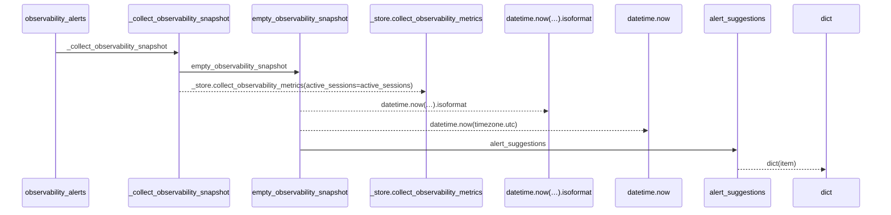
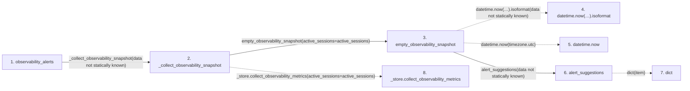

# observability_alerts

**Entry point:** `observability_alerts` (`http`)
**Source:** [src_main](../modules/src_main.md)
**Modules touched:** [observability](../modules/observability.md), [src_main](../modules/src_main.md)

## Call sequence

> Static overview in presentation order, not runtime execution order. Arrows retain captured callers; representative internal continuations and boundary examples precede repeated helper detail.

<!-- Auto-generated from static call edges. Dashed arrows are external or unresolved calls. Reviewed runtime conditions and side effects belong in Behavior. -->

> Call sequence diagram shows 7 of 7 interactions; 0 omitted to keep the visualization within the 30-interaction and generated-diagram limits, with uncertain identities omitted rather than inferred.

> Captured boundary calls: external 2 of 2 (0 omitted); unresolved 2 of 2 (0 omitted). These counts cover the captured static trace.
> Detailed flow queries retain their own coverage and limits; omitted paths may execute at runtime.

## Data flow

<!-- Auto-generated static analysis. Treat values and boundaries as best-effort hints, not runtime proof. -->

### Step data

| Step | Inputs | Reads | Writes | Returns |
|---|---|---|---|---|
| `observability_alerts` | - | - | - | `{...}` |
| `_collect_observability_snapshot` | - | `_session_manager`, `_store` | - | `empty_observability_snapshot(...)`, `...` |
| `empty_observability_snapshot` | `active_sessions: int` | `OBSERVABILITY_SCHEMA_VERSION` | - | `{...}` |
| `datetime.now(…).isoformat` | - | - | - | - |
| `datetime.now` | - | - | - | - |
| `alert_suggestions` | - | `ALERT_SUGGESTIONS` | - | `...` |
| `dict` | - | - | - | - |
| `_store.collect_observability_metrics` | - | - | - | - |

### Call data

| From | To | Line | Call |
|---|---|---:|---|
| observability_alerts | _collect_observability_snapshot | 349 | `_collect_observability_snapshot(data not statically known)` |
| _collect_observability_snapshot | empty_observability_snapshot | 314 | `empty_observability_snapshot(active_sessions=active_sessions)` |
| empty_observability_snapshot | datetime.now(…).isoformat | 73 | `datetime.now(timezone.utc).isoformat(data not statically known)` |
| empty_observability_snapshot | datetime.now | 73 | `datetime.now(timezone.utc)` |
| empty_observability_snapshot | alert_suggestions | 84 | `alert_suggestions(data not statically known)` |
| alert_suggestions | dict | 91 | `dict(item)` |
| _collect_observability_snapshot | _store.collect_observability_metrics | 315 | `_store.collect_observability_metrics(active_sessions=active_sessions)` |

### Boundary effects

*No boundary effects detected.*

### Static analysis gaps

| Kind | Step | Target | Line |
|---|---|---|---:|
| unresolved_call | `empty_observability_snapshot` | `datetime.now(timezone.utc).isoformat` | 73 |
| external_call | `empty_observability_snapshot` | `datetime.now` | 73 |
| unresolved_call | `_collect_observability_snapshot` | `_store.collect_observability_metrics` | 315 |

## Behavior

This flow starts at `observability_alerts` and is classified as `http`. The generated call and data-flow sections are bounded static projections; runtime conditions and side effects require source-level confirmation.
