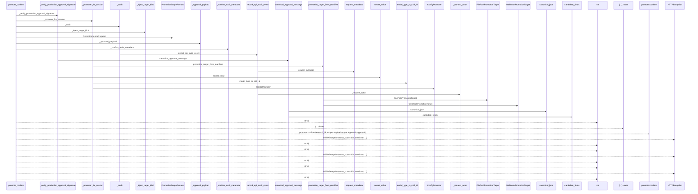
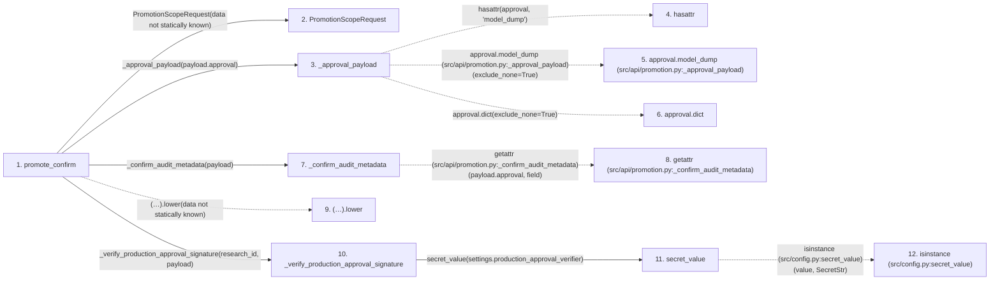

# promote_confirm

**Entry point:** `promote_confirm` (`http`)
**Source:** [promotion](../modules/promotion.md)
**Modules touched:** [audit](../modules/audit.md), [compat_legacy_alias](../modules/compat_legacy_alias.md), [config](../modules/config.md), [config_promoter](../modules/config_promoter.md), and 3 more

**Complete modules touched:**

- [audit](../modules/audit.md)
- [compat_legacy_alias](../modules/compat_legacy_alias.md)
- [config](../modules/config.md)
- [config_promoter](../modules/config_promoter.md)
- [promotion](../modules/promotion.md)
- [promotion_approval](../modules/promotion_approval.md)
- [promotion_target](../modules/promotion_target.md)

## Call sequence

> Static overview in presentation order, not runtime execution order. Arrows retain captured callers; representative internal continuations and boundary examples precede repeated helper detail.

<!-- Auto-generated from static call edges. Dashed arrows are external or unresolved calls. Reviewed runtime conditions and side effects belong in Behavior. -->

> Call sequence diagram shows 30 of 107 interactions; 77 omitted to keep the visualization within the 30-interaction and generated-diagram limits, with uncertain identities omitted rather than inferred.

> Captured boundary calls: external 9 of 50 (41 omitted); unresolved 2 of 32 (30 omitted). These counts cover the captured static trace.

Omitted captured detail, grouped by actual caller occurrence and target module:

| Caller | Parent step | Target module | Kind | Omitted interactions |
| --- | --- | --- | --- | --- |
| `src/api/promotion.py:_approval_payload` | 3 | - | external | 1 |
| `src/api/promotion.py:_approval_payload` | 3 | - | unresolved | 2 |
| `src/api/promotion.py:_confirm_audit_metadata` | 7 | - | external | 1 |
| `src/config.py:secret_value` | 11 | - | external | 1 |
| `src/config.py:secret_value` | 11 | - | unresolved | 1 |
| `src/api/promotion.py:_verify_production_approval_signature` | 10 | - | external | 5 |
| `src/core/promotion_approval.py:canonical_approval_message` | 16 | - | external | 7 |
| `src/core/promotion_approval.py:canonical_approval_message` | 16 | - | unresolved | 5 |
> Omission summary shows 8 of 26 groups; 18 further groups are not expanded here. Counts above include all omitted interactions.
> Detailed flow queries retain their own coverage and limits; omitted paths may execute at runtime.

## Data flow

<!-- Auto-generated static analysis. Treat values and boundaries as best-effort hints, not runtime proof. -->

### Step data

| Step | Inputs | Reads | Writes | Returns |
|---|---|---|---|---|
| `promote_confirm` | `request: Request`, `research_id: str`, `payload: PromotionScopeRequest \| None` | - | - | `_inject_target_kind(...)` |
| `PromotionScopeRequest` | - | - | - | - |
| `_approval_payload` | `approval: PromotionApproval \| None` | - | - | `None`, `approval.model_dump(...)`, `approval.dict(...)` |
| `hasattr` | - | - | - | - |
| `approval.model_dump (src/api/promotion.py:_approval_payload)` | - | - | - | - |
| `approval.dict` | - | - | - | - |
| `_confirm_audit_metadata` | `payload: PromotionScopeRequest` | `CANDIDATE_FIELDS` | `metadata[...]`, `metadata[...]`, `metadata[...]` | `metadata` |
| `getattr (src/api/promotion.py:_confirm_audit_metadata)` | - | - | - | - |
| `(…).lower` | - | - | - | - |
| `_verify_production_approval_signature` | `research_id: str`, `payload: PromotionScopeRequest` | `settings` | - | - |
| `secret_value` | `value: SecretStr \| str \| None` | `SecretStr` | - | `value.get_secret_value(...)`, `value` |
| `isinstance (src/config.py:secret_value)` | - | - | - | - |

### Call data

| From | To | Line | Call |
|---|---|---:|---|
| promote_confirm | PromotionScopeRequest | 377 | `PromotionScopeRequest(data not statically known)` |
| promote_confirm | _approval_payload | 378 | `_approval_payload(payload.approval)` |
| _approval_payload | hasattr | 198 | `hasattr(approval, 'model_dump')` |
| _approval_payload | approval.model_dump (src/api/promotion.py:_approval_payload) | 199 | `approval.model_dump(exclude_none=True)` |
| _approval_payload | approval.dict | 200 | `approval.dict(exclude_none=True)` |
| promote_confirm | _confirm_audit_metadata | 379 | `_confirm_audit_metadata(payload)` |
| _confirm_audit_metadata | getattr (src/api/promotion.py:_confirm_audit_metadata) | 252 | `getattr(payload.approval, field)` |
| promote_confirm | (…).lower | 384 | `(payload.scope or '').lower(data not statically known)` |
| promote_confirm | _verify_production_approval_signature | 385 | `_verify_production_approval_signature(research_id, payload)` |
| _verify_production_approval_signature | secret_value | 215 | `secret_value(settings.production_approval_verifier)` |
| secret_value | isinstance (src/config.py:secret_value) | 25 | `isinstance(value, SecretStr)` |

### Boundary effects

*No boundary effects detected.*

### Static analysis gaps

| Kind | Step | Target | Line |
|---|---|---|---:|
| external_call | `_approval_payload` | `hasattr` | 198 |
| unresolved_call | `_approval_payload` | `approval.model_dump` | 199 |
| external_call | `_confirm_audit_metadata` | `getattr` | 252 |
| unresolved_call | `promote_confirm` | `(payload.scope or '').lower` | 384 |
| external_call | `secret_value` | `isinstance` | 25 |
| step_limit | `promote_confirm` | `first 12 steps` | 0 |

## Behavior

This flow starts at `promote_confirm` and is classified as `http`. The generated call and data-flow sections are bounded static projections; runtime conditions and side effects require source-level confirmation.
