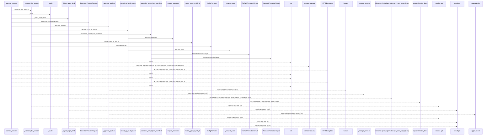
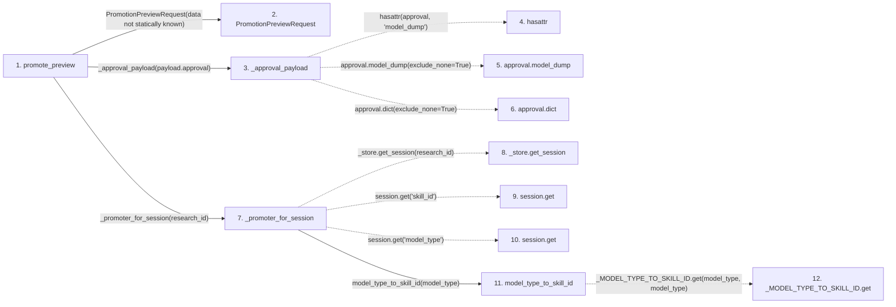

# promote_preview

**Entry point:** `promote_preview` (`http`)
**Source:** [promotion](../modules/promotion.md)
**Modules touched:** [audit](../modules/audit.md), [compat_legacy_alias](../modules/compat_legacy_alias.md), [config_promoter](../modules/config_promoter.md), [promotion](../modules/promotion.md), and 1 more

**Complete modules touched:**

- [audit](../modules/audit.md)
- [compat_legacy_alias](../modules/compat_legacy_alias.md)
- [config_promoter](../modules/config_promoter.md)
- [promotion](../modules/promotion.md)
- [promotion_target](../modules/promotion_target.md)

## Call sequence

> Static overview in presentation order, not runtime execution order. Arrows retain captured callers; representative internal continuations and boundary examples precede repeated helper detail.

<!-- Auto-generated from static call edges. Dashed arrows are external or unresolved calls. Reviewed runtime conditions and side effects belong in Behavior. -->

> Call sequence diagram shows 30 of 60 interactions; 30 omitted to keep the visualization within the 30-interaction and generated-diagram limits, with uncertain identities omitted rather than inferred.

> Captured boundary calls: external 8 of 25 (17 omitted); unresolved 9 of 17 (8 omitted). These counts cover the captured static trace.

Omitted captured detail, grouped by actual caller occurrence and target module:

| Caller | Parent step | Target module | Kind | Omitted interactions |
| --- | --- | --- | --- | --- |
| `src/compat/legacy_alias.py:model_type_to_skill_id` | 11 | - | unresolved | 1 |
| `src/api/promotion.py:_promoter_for_session` | 7 | - | unresolved | 1 |
| `src/core/promotion_target.py:promotion_target_from_manifest` | 14 | - | external | 14 |
| `src/core/promotion_target.py:promotion_target_from_manifest` | 14 | [src/core/promotion_target.py](../modules/promotion_target.md) | internal | 1 |
| `src/api/promotion.py:_promoter_for_session` | 7 | - | external | 1 |
| `src/api/audit.py:_request_actor` | 37 | - | external | 2 |
| `src/api/audit.py:record_api_audit_event` | 36 | - | unresolved | 1 |
| `src/api/audit.py:request_metadata` | 41 | [src/api/audit.py](../modules/audit.md) | internal | 1 |
> Omission summary shows 8 of 12 groups; 4 further groups are not expanded here. Counts above include all omitted interactions.
> Detailed flow queries retain their own coverage and limits; omitted paths may execute at runtime.

## Data flow

<!-- Auto-generated static analysis. Treat values and boundaries as best-effort hints, not runtime proof. -->

### Step data

| Step | Inputs | Reads | Writes | Returns |
|---|---|---|---|---|
| `promote_preview` | `request: Request`, `research_id: str`, `payload: PromotionPreviewRequest \| None` | - | - | `_inject_target_kind(...)` |
| `PromotionPreviewRequest` | - | - | - | - |
| `_approval_payload` | `approval: PromotionApproval \| None` | - | - | `None`, `approval.model_dump(...)`, `approval.dict(...)` |
| `hasattr` | - | - | - | - |
| `approval.model_dump` | - | - | - | - |
| `approval.dict` | - | - | - | - |
| `_promoter_for_session` | `research_id: str` | `_registry`, `_store`, `_promoter`, `_promoter`, `_promoter`, `_promoter`, `_promoter`, `_promoter` | - | `(...)`, `(...)`, `(...)`, `(...)`, `(...)`, `(...)`, `(...)`, `(...)` |
| `_store.get_session` | - | - | - | - |
| `session.get` | - | - | - | - |
| `session.get` | - | - | - | - |
| `model_type_to_skill_id` | `model_type: str` | - | - | `''`, `_MODEL_TYPE_TO_SKILL_ID.get(...)` |
| `_MODEL_TYPE_TO_SKILL_ID.get` | - | - | - | - |

### Call data

| From | To | Line | Call |
|---|---|---:|---|
| promote_preview | PromotionPreviewRequest | 314 | `PromotionPreviewRequest(data not statically known)` |
| promote_preview | _approval_payload | 315 | `_approval_payload(payload.approval)` |
| _approval_payload | hasattr | 187 | `hasattr(approval, 'model_dump')` |
| _approval_payload | approval.model_dump | 188 | `approval.model_dump(exclude_none=True)` |
| _approval_payload | approval.dict | 189 | `approval.dict(exclude_none=True)` |
| promote_preview | _promoter_for_session | 317 | `_promoter_for_session(research_id)` |
| _promoter_for_session | _store.get_session | 267 | `_store.get_session(research_id)` |
| _promoter_for_session | session.get | 272 | `session.get('skill_id')` |
| _promoter_for_session | session.get | 274 | `session.get('model_type')` |
| _promoter_for_session | model_type_to_skill_id | 278 | `model_type_to_skill_id(model_type)` |
| model_type_to_skill_id | _MODEL_TYPE_TO_SKILL_ID.get | 45 | `_MODEL_TYPE_TO_SKILL_ID.get(model_type, model_type)` |

### Boundary effects

*No boundary effects detected.*

### Static analysis gaps

| Kind | Step | Target | Line |
|---|---|---|---:|
| external_call | `_approval_payload` | `hasattr` | 187 |
| unresolved_call | `_approval_payload` | `approval.model_dump` | 188 |
| unresolved_call | `_promoter_for_session` | `_store.get_session` | 267 |
| unresolved_call | `_promoter_for_session` | `session.get` | 272 |
| unresolved_call | `_promoter_for_session` | `session.get` | 274 |
| unresolved_call | `model_type_to_skill_id` | `_MODEL_TYPE_TO_SKILL_ID.get` | 45 |
| step_limit | `promote_preview` | `first 12 steps` | 0 |

## Behavior

This flow starts at `promote_preview` and is classified as `http`. The generated call and data-flow sections are bounded static projections; runtime conditions and side effects require source-level confirmation.
